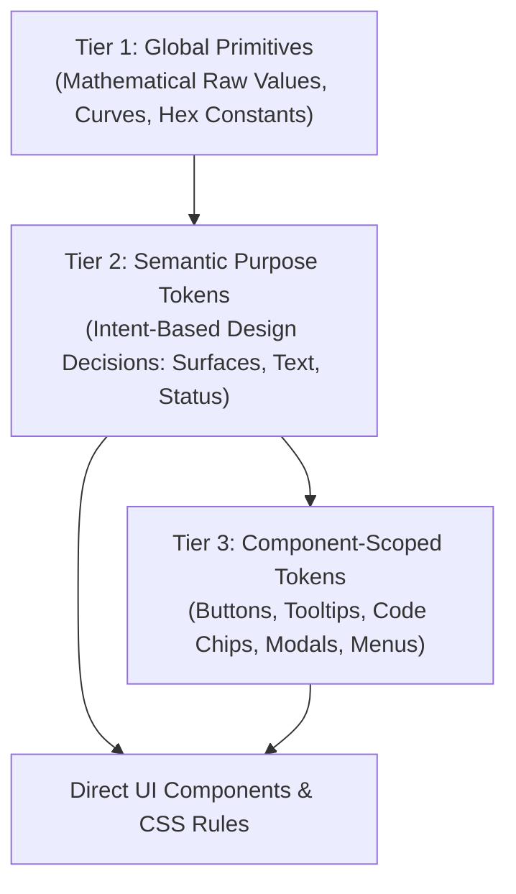

# Sutra Design System: Design Tokens Reference Guide

> **Version**: 2.1.0 (Production Verified & Fully Synchronized)  
> **Source of Truth**: [`css/tokens.css`](file:///c:/Users/Surya%20Teja%20S/OneDrive/Documents/Agentic%20AI%20research/sutra-ui/css/tokens.css)  
> **Root Copy**: [`DESIGN_TOKENS.md`](file:///c:/Users/Surya%20Teja%20S/OneDrive/Documents/Agentic%20AI%20research/sutra-ui/DESIGN_TOKENS.md)  
> **Standards Compliance**: [Astryx Design Tokens Standard](https://astryx.atmeta.com/docs/tokens) & Apple Human Interface Guidelines (Fluid Physics & Ergonomics)  
> **Target Audience**: Product Designers, Design System Engineers, and Frontend Developers  

---

## 1. Architectural Overview & Token Taxonomy

Sutra UI uses a **three-tier token architecture** designed for bulletproof consistency, rapid theming, and zero visual drift across complex multi-agent workflows.



### The Three Token Tiers
1. **Tier 1 — Global Primitives**:
   Raw mathematical constants that establish scale and rhythm (e.g. geometric 4px/8px spacing steps, even-pixel font sizes, bezier curves, raw color hex codes).
2. **Tier 2 — Semantic Purpose Tokens**:
   Contextual, intent-driven tokens describing *how* a value should be used (e.g. `--color-surface-card`, `--color-text-primary`, `--border-width-hairline`, `--icon-size-md`, `--color-code-bg`). These automatically adapt across all 4 live surface themes.
3. **Tier 3 — Component-Scoped Tokens**:
   Specific component overrides derived directly from semantic tokens (e.g. `--btn-primary-bg`, `--tooltip-bg`, `--color-dock-btn-active-hover-border`, `--color-code-shadow`).

### Governance & Engineering Golden Rules
- **Rule 1 (No Arbitrary Values)**: Never write hardcoded hex colors, ad-hoc box-shadows, arbitrary pixel margins/paddings, or magic numbers in component CSS. Always reference a token via `var(--token-name, fallback)`.
- **Rule 2 (Strict Even-Pixel Typography)**: All typography sizes must strictly be **even pixels only** (`12px`, `14px`, `16px`, `20px`, `24px`, `28px`, `32px`, `40px`, `48px`). Minimum UI size is `12px` (`--font-size-xs`). Odd font sizes (`11px`, `13px`, `15px`, `17px`, etc.) are prohibited in general UI.
- **Rule 3 (Composite-Only Motion)**: Transitions must animate composite-only properties (`transform`, `opacity`, `background-color`, `border-color`, `color`, `box-shadow`). Never animate layout properties (`width`, `height`, `padding`, `margin`) or declare `transition: all`.
- **Rule 4 (WCAG Accessibility Guarantee)**: All primary content must achieve WCAG 2.1 Level AAA (7:1) contrast against its canvas, and secondary content must meet Level AA (4.5:1).

---

## 2. Multi-Theme Surface System

Sutra UI natively supports **4 Live Surface Themes** switchable at runtime via the `data-surface-theme` attribute on the `<html>` or `<body>` element:

| Theme Name | Attribute Selector | Canvas Tone | Left Dock Rail Tone | Key Semantic Characteristic |
|---|---|---|---|---|
| **1. Modern Crisp** *(Default)* | `:root` or `[data-surface-theme="default"]` | Slate-50 (`#F8FAFC`) | Translucent White (`rgba(255,255,255,0.88)`) | High-clarity enterprise crispness with pure white popping cards. |
| **2. Dual-Tone Contrast Dock** | `[data-surface-theme="contrast"]` | Slate-50 (`#F8FAFC`) | Deep Obsidian (`#0F172A`) | Grounded command center dock with light, high-focus content canvas. |
| **3. Warm Minimalist** | `[data-surface-theme="warm"]` | Warm Zinc-50 (`#F5F5F7`) | Soft Warm Zinc (`rgba(245,245,247,0.90)`) | Low-glare, calming, tactile editorial palette for reading-heavy sessions. |
| **4. Obsidian Dark** | `[data-theme="dark"]`, `[data-surface-theme="dark"]`, `body.theme-dark` | Neutral Obsidian (`#0F0F12`) | Deep Obsidian (`#131317`) | True neutral dark mode (zero blue cast) calibrated for zero ocular fatigue. |

---

## 3. Complete Design Token Catalog

### 3.1. Brand & Accent Tokens
Anchored by Sutra Electric Vivid Blue (`#006EF5`) in light modes, calibrated to soft Velvet Cobalt (`#366CE2`) for primary actions and Cornflower Blue (`#60A5FA`) for text links in dark modes to eliminate eye strain and laser-neon glare.

| Token Name | Light / Crisp | Contrast Dock | Warm Minimalist | Obsidian Dark | Purpose & Semantic Role |
|---|---|---|---|---|---|
| `--color-brand-primary` | `#006EF5` | `#006EF5` | `#006EF5` | `#366CE2` | Primary action CTAs, key brand highlights, active states |
| `--color-brand-primary-hover` | `#005BD6` | `#005BD6` | `#005BD6` | `#4B7FE8` | Interactive hover state for primary brand elements |
| `--color-brand-primary-active` | `#004EB8` | `#004EB8` | `#004EB8` | `#2B5EC8` | Pressed/active state for primary brand controls |
| `--color-brand-subtle` | `#EFF6FF` | `#EFF6FF` | `#EFF6FF` | `rgba(54, 108, 226, 0.12)` | Subtle brand tint for selected row fills, active tab pills |
| `--color-brand-muted` | `#DBEAFE` | `#DBEAFE` | `#DBEAFE` | `rgba(54, 108, 226, 0.20)` | Secondary brand wash, selection badges |
| `--color-brand-border` | `#BFDBFE` | `#BFDBFE` | `#BFDBFE` | `rgba(54, 108, 226, 0.35)` | Accent border for selected cards and active focus elements |
| `--color-accent-purple` | `#8B5CF6` | `#8B5CF6` | `#8B5CF6` | `#8B5CF6` | AI accent highlight, multimodal generative badges |

---

### 3.2. Surface & Background Tokens

| Token Name | Light / Crisp | Contrast Dock | Warm Minimalist | Obsidian Dark | Purpose & Semantic Role |
|---|---|---|---|---|---|
| `--color-surface-canvas` | `#F8FAFC` | `#F8FAFC` | `#F5F5F7` | `#0F0F12` | Main viewport canvas / page workspace background |
| `--color-surface-canvas-subtle` | `#F1F5F9` | `#F1F5F9` | `#EBEBEF` | `#15151A` | Secondary canvas areas, sidebar gutters, code containers |
| `--color-surface-card` | `#FFFFFF` | `#FFFFFF` | `#FFFFFF` | `#19191E` | Primary cards, modal dialogs, chat composer, popovers |
| `--color-surface-card-subtle` | `#F1F5F9` | `#F1F5F9` | `#EFEFF3` | `#212128` | Recessed wells, search bars (resting), dropzones, table headers |
| `--color-surface-card-hover` | `#F1F5F9` | `#F1F5F9` | `#E4E4E7` | `#262630` | Hover highlight for table rows, cards, and subtle action triggers |
| `--color-surface-dock` | `rgba(255, 255, 255, 0.88)` | `#0F172A` | `rgba(245, 245, 247, 0.90)` | `#131317` | Left navigation rail background |
| `--color-surface-dock-border` | `#E2E8F0` | `#1E293B` | `#E4E4E7` | `#24242C` | Outer dividing border of the navigation dock |
| `--color-surface-dock-active` | `#EFF6FF` | `#1E293B` | `#E4E4E7` | `#24242C` | Active navigation dock section indicator background |
| `--color-surface-overlay` | `rgba(15, 23, 42, 0.45)` | `rgba(15, 23, 42, 0.45)` | `rgba(24, 24, 27, 0.45)` | `rgba(0, 0, 0, 0.75)` | Modal backdrop blur overlay and drawer scrim |

---

### 3.3. Navigation Rail & Dock Tokens

| Token Name | Light / Crisp | Contrast Dock | Warm Minimalist | Obsidian Dark | Purpose & Semantic Role |
|---|---|---|---|---|---|
| `--color-dock-btn-color` | `#475569` | `#94A3B8` | `#52525B` | `#A1A1AA` | Resting dock button icon color |
| `--color-dock-btn-hover-bg` | `#F1F5F9` | `#1E293B` | `#E4E4E7` | `#212128` | Dock button hover background |
| `--color-dock-btn-hover-color` | `#0F172A` | `#F8FAFC` | `#18181B` | `#E9E7E7` | Dock button hover icon color |
| `--color-dock-btn-active-bg` | `#EFF6FF` | `#1E293B` | `#E4E4E7` | `#24242C` | Active navigation view button background |
| `--color-dock-btn-active-color` | `#006EF5` | `#38BDF8` | `#006EF5` | `#60A5FA` | Active navigation view button icon color |
| `--color-dock-btn-active-border` | `#BFDBFE` | `#334155` | `#D4D4D8` | `#366CE2` | Active navigation view button border |
| `--color-dock-btn-active-hover-bg` | `#DBEAFE` | `#243247` | `#D4D4D8` | `#2C2C36` | Active button hover background |
| `--color-dock-btn-active-hover-color` | `#005BD6` | `#38BDF8` | `#005BD6` | `#93C5FD` | Active button hover icon color |
| `--color-dock-btn-active-hover-border` | `#93C5FD` | `#475569` | `#A1A1AA` | `#60A5FA` | Active button hover border (prevents flare) |
| `--color-surface-dock-logo-bg` | Gradient `#EFF6FF`→`#DBEAFE` | `#1E293B` | `#E4E4E7` | `#212128` | Dock logo container background |
| `--color-surface-dock-logo-color` | `#006EF5` | `#38BDF8` | `#006EF5` | `#60A5FA` | Dock logo icon fill color |

---

### 3.4. Text & Content Tokens

> [!IMPORTANT]
> **Dark Theme Text Luminance**: In Dark Mode, `--color-text-primary` is calibrated to `#E9E7E7` (91% luminance). It provides **14.8:1 contrast** on `#0F0F12` canvas (far exceeding the 7:1 WCAG AAA standard) while eliminating the painful halation and glare caused by 100% pure white text.

| Token Name | Light / Crisp | Contrast Dock | Warm Minimalist | Obsidian Dark | Contrast Ratio (Canvas) | Purpose & Semantic Role |
|---|---|---|---|---|---|---|
| `--color-text-primary` | `#0F172A` | `#0F172A` | `#18181B` | `#E9E7E7` | **14.8 : 1 (AAA)** | Primary titles, view headings, body text, card titles |
| `--color-text-secondary` | `#475569` | `#475569` | `#52525B` | `#A1A1AA` | **7.3 : 1 (AAA)** | Subtitles, form labels, section descriptions, timestamps |
| `--color-text-tertiary` | `#64748B` | `#64748B` | `#71717A` | `#71717A` | **4.5 : 1 (AA)** | Captions, placeholder hints, empty states, micro metadata |
| `--color-text-disabled` | `#94A3B8` | `#94A3B8` | `#A1A1AA` | `#52525B` | **3.0 : 1 (UI)** | Disabled button text, inactive controls |
| `--color-text-inverse` | `#FFFFFF` | `#FFFFFF` | `#FFFFFF` | `#FFFFFF` | **4.77 : 1 (AA)** | Text on solid brand buttons, primary CTAs, filled badges |
| `--color-text-brand` | `#006EF5` | `#006EF5` | `#006EF5` | `#60A5FA` | **6.9 : 1 (AAA)** | Interactive text links, breadcrumb trail active links |

---

### 3.5. Inline Code & Monospace Chip Tokens (Option 1: Elevated Micro-Chip)

> **Architectural Background**: Established to resolve Review Studio Visual Feedback items [1] (`<code>Development Sandbox</code>`) and [2] (`<code>web-platform</code>`). Inline monospace snippets nested inside tinted blockquotes previously suffered from double-tinting (`rgba(15, 23, 42, 0.06)` wash with zero border on a `#F8FAFC` container), creating a muddy, illegible presentation. Option 1 establishes an elevated micro-chip architecture that guarantees crisp distinction, high contrast, and tactile depth across light and dark modes.

| Token Name | Light / Crisp | Contrast Dock | Warm Minimalist | Obsidian Dark | Contrast Ratio | Purpose & Semantic Role |
|---|---|---|---|---|---|---|
| `--color-code-bg` | `var(--color-surface-card, #FFFFFF)` | `var(--color-surface-card, #FFFFFF)` | `var(--color-surface-card, #FFFFFF)` | `rgba(255, 255, 255, 0.06)` | — | Elevated chip surface background |
| `--color-code-text` | `var(--color-text-primary, #0F172A)` | `var(--color-text-primary, #0F172A)` | `var(--color-text-primary, #18181B)` | `var(--color-text-primary, #E9E7E7)` | **14.8 : 1 (AAA)** | Monospace text label color |
| `--color-code-border` | `var(--color-border-default, #E2E8F0)` | `var(--color-border-default, #E2E8F0)` | `var(--color-border-default, #E4E4E7)` | `rgba(255, 255, 255, 0.14)` | — | Hairline boundary border (1px solid) |
| `--color-code-shadow` | `none` | `none` | `none` | `none` | — | Flat clean chip style without box-shadow per Review Studio feedback |

#### Micro-Chip Geometry & Typography Primitives
- **Font Family**: `var(--font-family-code, 'JetBrains Mono', 'SF Mono', Menlo, Consolas, monospace)`
- **Font Size**: `var(--font-size-xs, 12px)` (Strictly even-pixel; compliant with Rule 2)
- **Font Weight**: `var(--font-weight-medium, 500)`
- **Padding**: `2px 6px` (`--spacing-0-5` vertical, `--spacing-1-5` horizontal)
- **Border Radius**: `var(--radius-xs, 4px)`
- **Line Height**: `1.4` (with `display: inline-block; vertical-align: baseline;` to prevent line-box jitter)
- **Preformatted Blocks Exclusion**: Preformatted multi-line blocks (`pre code`) remain transparent and inherit parent container styling.

#### Usage Matrix
- **Markdown Blockquotes**: `.s08-agent-md-response blockquote code`
- **Markdown Body Paragraphs**: `.s08-agent-md-response p code`
- **Markdown Ordered/Unordered Lists**: `.s08-agent-md-response li code`
- **Universal Base Fallback**: `code:not(pre code)` in `base.css`

---

### 3.6. Status & Semantic Feedback Tokens

| Semantic Status | Text Token (Light / Dark) | Background Token (Light / Dark) | Border Token (Light / Dark) | Typical Usage |
|---|---|---|---|---|
| **Neutral / Draft** | `#475569` / `#A1A1AA` | `#F1F5F9` / `#212128` | `#E2E8F0` / `#2A2A32` | Draft status, inactive chips, file extensions |
| **Warning / Clarify** | `#B45309` / `#FBBF24` | `#FEF3C7` / `rgba(245,158,11,0.15)` | `#FDE68A` / `rgba(245,158,11,0.30)` | Human approval required, pending action |
| **Info / Plan** | `#2054B8` / `#60A5FA` | `#EEF4FE` / `rgba(59,130,246,0.15)` | `#BFD5F8` / `rgba(59,130,246,0.30)` | Agent analysis state, informative banners |
| **Success / Approved**| `#047857` / `#34D399` | `#ECFDF5` / `rgba(16,185,129,0.15)` | `#A7F3D0` / `rgba(16,185,129,0.30)` | Test passed, task completed, verified status |
| **Error / Destructive**| `#B91C1C` / `#F87171` | `#FEF2F2` / `rgba(239,68,68,0.15)` | `#FECACA` / `rgba(239,68,68,0.30)` | Execution failed, delete confirmation |
| **Purple / Special** | `#6D28D9` / `#C084FC` | `#F5F3FF` / `rgba(168,85,247,0.15)` | `#DDD6FE` / `rgba(168,85,247,0.30)` | AI generative badge, prompt enhancements |
| **Cyan / Diagnostics**| `#0891B2` / `#22D3EE` | `#ECFEFF` / `rgba(6,182,212,0.15)` | `#A5F3FC` / `rgba(6,182,212,0.30)` | Network ping, telemetry, memory metrics |

#### Feedback & Rating Tokens
| Token Name | Value | Purpose |
|---|---|---|
| `--color-rating-star` | `#F59E0B` | Filled rating star highlight (Amber-500) |
| `--color-rating-star-empty` | `#CBD5E1` | Empty/unrated star border outline (Slate-300) |

---

### 3.7. Window & Stage Control Indicators (macOS Standard)

Used for window controls, stage split triggers, and dock preview headers:

| Control Target | Fill Token | Border Token | Description |
|---|---|---|---|
| **Close** | `--color-control-close: #FF5F56` | `--color-control-close-border: #E0443E` | Window dismiss button |
| **Minimize** | `--color-control-minimize: #FFBD2E` | `--color-control-minimize-border: #DEA123` | Window minimize / collapse button |
| **Expand / Zoom**| `--color-control-expand: #27C93F` | `--color-control-expand-border: #1AAB29` | Fullscreen / pane maximize button |

---

### 3.8. Third-Party Vendor Integration & Mockup Tokens

#### 3.8.1. Cloud Storage Brand Integrations
| Token Name | Value | Vendor |
|---|---|---|
| `--color-brand-onedrive` | `#0078D4` | Microsoft OneDrive brand accent |
| `--color-brand-gdrive` | `#0066DA` | Google Drive brand accent |

#### 3.8.2. Atlassian Jira / Jira Integration Mockup Tokens
High-fidelity tokens matching enterprise Atlassian Jira and Jira task boards across light and dark modes:

| Token Name | Light Mode Value | Dark Mode Value | Semantic Role |
|---|---|---|---|
| `--color-vendor-jira-blue` | `#0052CC` | `#58A6FF` | Jira primary brand blue |
| `--color-vendor-jira-blue-hover` | `#0747A6` | `#79C0FF` | Jira primary button hover |
| `--color-vendor-jira-navy` | `#172B4D` | `#F0F6FC` | Jira deep header text |
| `--color-vendor-jira-subtle` | `#F4F5F7` | `#0D1117` | Jira subtle background |
| `--color-vendor-jira-canvas` | `#FAFBFC` | `#21262D` | Jira canvas container |
| `--color-vendor-jira-button` | `#EBECF0` | `#21262D` | Jira secondary button surface |
| `--color-vendor-jira-border` | `#DFE1E6` | `#30363D` | Jira divider line |
| `--color-vendor-jira-selected` | `#DEEBFF` | `rgba(56, 139, 253, 0.15)` | Jira selected row tint |
| `--color-vendor-jira-selected-border` | `#B3D4FF` | `rgba(56, 139, 253, 0.40)` | Jira selected row border |
| `--color-vendor-jira-text` | `#172B4D` | `#F0F6FC` | Jira primary text |
| `--color-vendor-jira-text-secondary`| `#42526E` | `#8B949E` | Jira secondary metadata |
| `--color-vendor-jira-text-subtle` | `#5E6C84` | `#8B949E` | Jira placeholder & caption |
| `--color-vendor-jira-text-muted` | `#6B778C` | `#8B949E` | Jira timestamp text |
| `--color-vendor-jira-text-body` | `#344563` | `#C9D1D9` | Jira issue description body |
| `--color-vendor-jira-green` | `#00875A` | `#2EA043` | Jira status: Done / Resolved |
| `--color-vendor-jira-green-text` | `#006644` | `#3FB950` | Jira green status text |
| `--color-vendor-jira-green-bg` | `#E3FCEF` | `rgba(46, 160, 67, 0.15)` | Jira green status badge fill |
| `--color-vendor-jira-green-border` | `#ABF5D1` | `rgba(46, 160, 67, 0.40)` | Jira green status badge border |
| `--color-vendor-jira-red` | `#DE350B` | `#F85149` | Jira priority: High / Blocker |

#### 3.8.3. GitHub Dark Preview Mockup Tokens
Used in code preview cards and repository commit diff viewers:
| Token Name | Value | Semantic Role |
|---|---|---|
| `--color-vendor-github-dark-canvas` | `#0D1117` | GitHub dark canvas background |
| `--color-vendor-github-dark-card` | `#161B22` | GitHub dark file diff card background |
| `--color-vendor-github-dark-hover` | `#21262D` | GitHub dark row hover |
| `--color-vendor-github-dark-border` | `#30363D` | GitHub dark container hairline border |
| `--color-vendor-github-dark-text` | `#C9D1D9` | GitHub dark primary code text |
| `--color-vendor-github-dark-text-muted` | `#8B949E` | GitHub dark line numbers & comments |
| `--color-vendor-github-dark-text-white` | `#F0F6FC` | GitHub dark header title text |

---

### 3.9. Border & Divider Tokens

| Token Name | Value | Purpose & Semantic Role |
|---|---|---|
| `--border-width-none` | `0px` | Explicit reset for borderless cards and ghost buttons |
| `--border-width-hairline`| `1px` | Standard interface divider, card outline, dropdown edge |
| `--border-width-prominent` | `2px` | Active selection outlines, high-contrast states |
| `--border-width-focus` | `2px` | Focus ring outline width |
| `--border-width-accent` | `3px` | Left status indicator stripe on review diff cards |
| `--border-style-solid` | `solid` | Standard solid border rule |
| `--border-style-dashed` | `dashed` | Drag & drop dropzone borders, draft outlines |
| `--border-style-none` | `none` | Explicit border removal |
| `--color-border-default` | `#E2E8F0` *(Light)* / `#2A2A32` *(Dark)* / `#E4E4E7` *(Warm)* | Standard container cards, table borders, panel separators |
| `--color-border-subtle` | `#F1F5F9` *(Light)* / `#1F1F26` *(Dark)* / `#EFEFF3` *(Warm)* | Internal row dividers, subtle card headers |
| `--color-border-hover` | `#CBD5E1` *(Light)* / `#3C3C48` *(Dark)* / `#D4D4D8` *(Warm)* | Interactive card hover outline, text input hover |
| `--color-border-focus` | `#64748B` *(Light)* / `#4B83EB` *(Dark)* | Input focus border |
| `--color-border-brand` | `#006EF5` *(Light)* / `#366CE2` *(Dark)* | Selected active item indicator border |

---

### 3.10. Typography Primitives, Weights & Optical Tracking

Strictly adheres to **even pixels only** with an 8-step modular hierarchy.

```css
/* Font Families */
--font-family-body: 'Open Sans', -apple-system, BlinkMacSystemFont, 'Segoe UI', Roboto, sans-serif;
--font-family-heading: 'Open Sans', -apple-system, BlinkMacSystemFont, 'Segoe UI', Roboto, sans-serif;
--font-family-code: 'JetBrains Mono', 'SF Mono', Menlo, Consolas, monospace;

/* Font Weights */
--font-weight-normal: 400;
--font-weight-medium: 500;
--font-weight-semibold: 600;
--font-weight-bold: 700;
```

#### Font Size Hierarchy (Even Pixels Only)
| Token Name | Rem Value | Pixel Value | Line Height | Primary Role |
|---|---|---|---|---|
| `--font-size-2xs` | `0.6875rem` | **11px** | `14px` | Micro overlines, uppercase tags (Strict Primitive) |
| `--font-size-xs` | `0.75rem` | **12px** | `16px` | Badges, tags, micro-metadata, tooltip text, keyboard shortcuts, inline code chips |
| `--font-size-base` | `0.875rem` | **14px** | `20px` | Default body copy, form inputs, table data cells, menu items |
| `--font-size-md` | `1.0rem` | **16px** | `24px` | Prominent body text, subheadings, primary button labels |
| `--font-size-lg` | `1.25rem` | **20px** | `28px` | Card headers, section titles, drawer panel headings |
| `--font-size-xl` | `1.5rem` | **24px** | `32px` | Modal dialog titles, main document/artifact titles |
| `--font-size-2xl` | `1.75rem` | **28px** | `36px` | View landmark headers, catalogue category titles |
| `--font-size-3xl` | `2.0rem` | **32px** | `40px` | Welcome display headlines, dashboard banners |
| `--font-size-4xl` | `2.5rem` | **40px** | `48px` | Major metric KPI numbers, hero banners |
| `--font-size-5xl` | `3.0rem` | **48px** | `56px` | Large hero display numbers |

#### Optical Typography Tracking (Apple HIG)
Size-calibrated letter-spacing prevents visual crowding on large headers and enhances legibility on micro-typography:

| Token Name | Value | Recommended Target Elements |
|---|---|---|
| `--tracking-tighter` | `-0.025em` | Large display titles (`>= 28px`: `--font-size-2xl` and up) |
| `--tracking-tight` | `-0.015em` | Section headers, card titles, modal titles (`18px`–`24px`) |
| `--tracking-normal` | `0em` | Standard UI body text and form inputs (`14px`–`16px`) |
| `--tracking-wide` | `0.015em` | Captions, secondary metadata chips, timestamps (`12px`–`13px`) |
| `--tracking-wider` | `0.03em` | Uppercase badges, overlines, status tags (`10px`–`12px`) |

---

### 3.11. Icon Tokens (SVG Only)

All interface icons must be native SVGs. Raster icon assets (`.png`, `.jpg`, `.ico`) are strictly disallowed for UI chrome.

#### Sizing & Stroke Scale
| Sizing Token | Pixel Value | Default Stroke Token | Recommended Target Role |
|---|---|---|---|
| `--icon-size-xs` | **12px** | `--icon-stroke-default: 1.5px` | Micro status indicators inside badges, pill close buttons |
| `--icon-size-sm` | **16px** | `--icon-stroke-default: 1.5px` | Standard button icons, dropdown carets, table row actions |
| `--icon-size-md` | **20px** | `--icon-stroke-default: 1.5px` | Navigation dock icons, search bar icon, header action buttons |
| `--icon-size-lg` | **24px** | `--icon-stroke-bold: 2.0px` | Modal close triggers, empty state illustrations |
| `--icon-size-xl` | **32px** | `--icon-stroke-bold: 2.0px` | Feature cards, file upload dropzone icons |
| `--icon-size-2xl` | **48px** | `--icon-stroke-bold: 2.0px` | Large hero empty states, error splash views |

#### Semantic Icon Color Tokens
| Token Name | Light Mode Value | Dark Mode Value | Role |
|---|---|---|---|
| `--color-icon-primary` | `#0F172A` | `#E9E7E7` | Primary content icons, close buttons |
| `--color-icon-secondary` | `#475569` | `#A1A1AA` | Secondary action icons, table row actions |
| `--color-icon-muted` | `#94A3B8` | `#71717A` | Placeholder icons, disabled triggers |
| `--color-icon-brand` | `#006EF5` | `#6FA1F5` | Brand icon fills, active navigation indicator |
| `--color-icon-inverse` | `#FFFFFF` | `#FFFFFF` | Icons on solid brand backgrounds |
| `--color-icon-disabled` | `#CBD5E1` | `#52525B` | Disabled icon buttons |
| `--color-icon-success` | `#059669` | `#34D399` | Success checkmarks |
| `--color-icon-warning` | `#D97706` | `#FBBF24` | Alert / triangle warning icons |
| `--color-icon-error` | `#DC2626` | `#F87171` | Error crosses, destructive actions |

---

### 3.12. Spacing Scale (4px/8px Geometric Grid)

| Spacing Token | Rem Value | Pixel Value | Semantic Layout Role |
|---|---|---|---|
| `--spacing-0` | `0rem` | **0px** | Reset margins / paddings |
| `--spacing-0-5`| `0.125rem` | **2px** | Micro alignment nudges, badge padding, code vertical padding |
| `--spacing-1` | `0.25rem` | **4px** | Button icon gaps, tag vertical padding |
| `--spacing-1-5`| `0.375rem` | **6px** | Dropdown option vertical padding, compact row gaps, code horizontal padding |
| `--spacing-2` | `0.5rem` | **8px** | Standard component internal gap, input horizontal padding |
| `--spacing-2-5`| `0.625rem` | **10px** | Compact card padding, breadcrumb separator gap |
| `--spacing-3` | `0.75rem` | **12px** | Card compact padding, menu container padding |
| `--spacing-3-5`| `0.875rem` | **14px** | Intermediate section gap |
| `--spacing-4` | `1.0rem` | **16px** | Standard card body padding, modal internal gap |
| `--spacing-5` | `1.25rem` | **20px** | Medium container margins, section spacing |
| `--spacing-6` | `1.5rem` | **24px** | Modal header/footer padding, column layout gap |
| `--spacing-8` | `2.0rem` | **32px** | Page gutter padding, major section divisions |
| `--spacing-10` | `2.5rem` | **40px** | Hero sections, dashboard widget spacing |
| `--spacing-12` | `3.0rem` | **48px** | Marketing display headers, splash container margins |

---

### 3.13. Element & Modal Heights Scale

| Token Name | Pixel Value | Typical Application |
|---|---|---|
| `--size-element-sm` | `28px` | Micro inline controls, compact table inputs, small search toggles |
| `--size-element-md` | `32px` | Standard compact form inputs, filter chips, secondary toggles |
| `--size-element-lg` | `36px` | Standard primary inputs, search bars, form dropdown triggers |
| `--size-element-xl` | `44px` | Mobile touch targets, large form inputs, hero controls |
| `--size-modal-sm` | `440px` | Compact confirmation modal width |
| `--btn-min-width-showcase`| `140px` | Standardized minimum width for catalogue showcase CTA buttons |

---

### 3.14. Border Radius Scale (Apple Continuous Curves)

Follows smooth squircle continuous geometry:

| Token Name | Pixel Value | Semantic Usage Target |
|---|---|---|
| `--radius-none` | `0px` | Explicit reset, square code editor frames |
| `--radius-2xs` | `2px` | Micro indicators, progress ticks, timeline dots |
| `--radius-badge` | `3px` | Lozenges, status badges, compact metadata tags |
| `--radius-xs` | `4px` | Micro tags, inline keyboard hints (`<kbd>`), inline code chips (`<code>`) |
| `--radius-sm` | `6px` | Tooltips, context menus, action items, preformatted code containers |
| `--radius-inner` | `8px` | Nested cards, form input fields, segmented control pills |
| `--radius-element`| `12px` | Navigation dock buttons, standard cards, dropdown menus |
| `--radius-container`| `16px` | Large workspace cards, task containers, code boxes |
| `--radius-chat` | `24px` | AI conversational bubbles, search composer capsules |
| `--radius-page` | `32px` | Large modal dialogs, drawer panels |
| `--radius-full` | `9999px` | Capsule pill buttons (`.sutra-btn`), status badges, avatar chips |

---

### 3.15. Elevation, Shadows, Materials & Glassmorphism

| Token Name | Value (Light) | Value (Dark) | Semantic Depth Purpose |
|---|---|---|---|
| `--shadow-card-subtle` | `0 1px 3px 0 rgba(15,23,42,0.05), 0 1px 2px -1px rgba(15,23,42,0.04)` | `0 1px 3px 0 rgba(0,0,0,0.35), 0 1px 2px -1px rgba(0,0,0,0.25)` | Resting cards, dock buttons, table containers |
| `--shadow-card-elevated`| `0 4px 12px -2px rgba(15,23,42,0.07), 0 2px 4px -2px rgba(15,23,42,0.04)` | `0 4px 12px -2px rgba(0,0,0,0.45), 0 2px 4px -2px rgba(0,0,0,0.30)` | Hovered cards, drag previews, sticky headers |
| `--shadow-card-floating`| `0 12px 28px -4px rgba(15,23,42,0.10), 0 4px 8px -2px rgba(15,23,42,0.03)` | `0 12px 28px -4px rgba(0,0,0,0.60), 0 4px 8px -2px rgba(0,0,0,0.35)` | Modal dialogs, floating action menus, search popovers |
| `--shadow-brand-glow` | `0 4px 14px 0 rgba(0, 110, 245, 0.25)` | `0 4px 14px 0 rgba(54, 108, 226, 0.35)` | Primary CTA focus glow, active agent indicator |
| `--shadow-menu-floating`| `0 12px 32px -4px rgba(15, 23, 42, 0.12), 0 4px 8px -2px rgba(15, 23, 42, 0.04)` | `0 12px 32px -4px rgba(0, 0, 0, 0.65), 0 4px 8px -2px rgba(0, 0, 0, 0.40)` | Floating context menus and dropdown panels |
| `--shadow-popover-subtle`| `0 6px 20px rgba(0, 0, 0, 0.08), 0 1px 4px rgba(0, 0, 0, 0.04)` | `0 6px 20px rgba(0, 0, 0, 0.40), 0 1px 4px rgba(0, 0, 0, 0.25)` | Popover ambient shadow |
| `--material-glass-chrome-bg`| `rgba(255, 255, 255, 0.82)` | `rgba(25, 25, 30, 0.85)` | Navigation bar and chrome glass background |
| `--material-glass-blur` | `blur(20px) saturate(180%)` | `blur(20px) saturate(180%)` | Translucent glass backdrop filter |
| `--material-glass-blur-subtle`| `blur(12px) saturate(160%)` | `blur(12px) saturate(160%)` | Subtle glass backdrop filter |
| `--material-specular-edge`| `1px solid rgba(255, 255, 255, 0.55)`| `1px solid rgba(255, 255, 255, 0.08)` | Glossy top edge highlight for glass sheets |
| `--material-glass-menu-bg`| `rgba(255, 255, 255, 0.94)` | `rgba(25, 25, 30, 0.96)` | Dropdown menus, popover containers |
| `--material-menu-bg` | `var(--color-surface-card, #FFFFFF)` | `var(--color-surface-card, #19191E)` | Menu card background |
| `--material-glass-tooltip-bg`| `rgba(15, 23, 42, 0.96)` | `rgba(30, 30, 38, 0.96)` | Glass tooltip background |
| `--material-glass-overlay-bg`| `rgba(15, 23, 42, 0.45)` | `rgba(0, 0, 0, 0.75)` | Glass backdrop overlay |

---

### 3.16. Dedicated Tooltip Tokens (Apple HIG / Linear Inverted)

Tooltips render using an inverted high-contrast system with crisp keyboard hint styling:

| Token Name | Light Theme Value | Dark Theme Value | Purpose |
|---|---|---|---|
| `--tooltip-bg` | `rgba(15, 23, 42, 0.96)` | `rgba(30, 30, 38, 0.96)` | Floating tooltip bubble fill |
| `--tooltip-text` | `#FFFFFF` | `#E9E7E7` | Tooltip title and description text |
| `--tooltip-border` | `rgba(255, 255, 255, 0.14)` | `rgba(255, 255, 255, 0.18)` | Hairline translucent boundary edge |
| `--tooltip-kbd-bg` | `rgba(255, 255, 255, 0.15)` | `rgba(255, 255, 255, 0.12)` | `<kbd>` shortcut badge container |
| `--tooltip-kbd-border` | `rgba(255, 255, 255, 0.22)` | `rgba(255, 255, 255, 0.20)` | `<kbd>` outline |
| `--tooltip-kbd-text` | `#E2E8F0` | `#E4E4E7` | `<kbd>` shortcut key text |

---

### 3.17. Motion, Transition & Focus Ring System (Apple Fluid Physics)

| Token Name | Value | Intent & Usage |
|---|---|---|
| `--ease-apple-default` | `cubic-bezier(0.25, 1, 0.5, 1)` | Standard smooth easing for modals and view crossfades |
| `--ease-apple-spring` | `cubic-bezier(0.16, 1, 0.3, 1)` | Responsive physical spring: fast dispatch with gentle tactile settle |
| `--ease-apple-settle` | `cubic-bezier(0.25, 1, 0.5, 1)` | Critically damped settle with zero cartoon wobble/overshoot |
| `--ease-apple-exit` | `cubic-bezier(0.4, 0, 1, 1)` | Snappy exit/dismiss curve |
| `--ease-apple-drawer` | `cubic-bezier(0.32, 0.72, 0, 1)` | Drawer/sheet slide curve |
| `--ease-apple-bounce` | `cubic-bezier(0.16, 1, 0.3, 1)` | Refined physical spring replacing cartoon wobble |
| `--duration-instant` | `100ms` | Micro-press feedback, scale tactile feedback |
| `--duration-micro` | `160ms` | Tooltip appearance, dropdown pop, tab highlight glide |
| `--duration-normal` | `240ms` | Modal presentation, drawer slide, panel accordion |
| `--duration-expand` | `320ms` | Multi-column layout reconfiguration, full workspace split |
| `--focus-ring` | `0 0 0 3px rgba(0, 110, 245, 0.25)` | Standard accessible focus ring |
| `--focus-ring-subtle` | `0 0 0 2px rgba(0, 110, 245, 0.18)` | Subtle internal focus ring |

---

### 3.18. Button Component Tokens (Aligned with `BUTTON_DESIGN_SYSTEM.md`)

All interactive buttons in Sutra UI are pill-shaped (`border-radius: var(--btn-radius, var(--radius-full, 9999px))`) with standardized 5-tier sizing:

#### Sizing Scale
| Size Variant | Height Token | Padding Token | Font Size Token | Gap Token | Typical Usage |
|---|---|---|---|---|---|
| **XS** | `--btn-height-xs: 28px` | `--btn-padding-xs: 0 10px` | `--font-size-xs: 12px` | `4px` | Micro inline row actions, table cell buttons |
| **SM** | `--btn-height-sm: 32px` | `--btn-padding-sm: 0 14px` | `--font-size-xs: 12px` | `4px` | Card header triggers, secondary filters |
| **MD** *(Default)*| `--btn-height-md: 36px` | `--btn-padding-md: 0 18px` | `--font-size-base: 14px` | `6px` | Standard form submissions, toolbars |
| **LG** | `--btn-height-lg: 44px` | `--btn-padding-lg: 0 22px` | `--font-size-md: 16px` | `8px` | Modal primary CTAs, review drawer actions |
| **XL** | `--btn-height-xl: 52px` | `--btn-padding-xl: 0 26px` | `--font-size-md: 16px` | `8px` | Hero banners, onboarding primary launch |

#### Shared Base Button Tokens
```css
--btn-radius: var(--radius-full, 9999px);
--btn-font-weight: var(--font-weight-medium, 500);
--btn-font-weight-emphasis: var(--font-weight-semibold, 600);
--btn-transition: transform var(--duration-instant, 100ms) var(--ease-apple-spring),
                  background-color var(--duration-micro, 160ms) ease,
                  border-color var(--duration-micro, 160ms) ease,
                  box-shadow var(--duration-micro, 160ms) ease,
                  color var(--duration-micro, 160ms) ease;
```

#### Button Semantic Roles & Status Variants (Light & Dark)

| Button Variant | State | Light Mode Token & Value | Dark Mode Token & Value |
|---|---|---|---|
| **Primary** | Background (Resting) | `--btn-primary-bg: #006EF5` | `--btn-primary-bg: #366CE2` |
| | Text | `--btn-primary-text: #FFFFFF` | `--btn-primary-text: #FFFFFF` |
| | Border | `--btn-primary-border: transparent`| `--btn-primary-border: transparent` |
| | Hover Background | `--btn-primary-bg-hover: #005BD6` | `--btn-primary-bg-hover: #4B7FE8` |
| | Active Background| `--btn-primary-bg-active: #004EB8` | `--btn-primary-bg-active: #2B5EC8` |
| | Shadow (Resting) | `0 1px 2px rgba(0,110,245,0.2)` | `0 1px 2px rgba(0,0,0,0.35)` |
| | Shadow (Hover) | `0 4px 14px rgba(0,110,245,0.28)` | `0 4px 14px rgba(54,108,226,0.35)`|
| **Secondary** | Background (Resting) | `--btn-secondary-bg: #FFFFFF` | Card surface (`#19191E`) |
| | Border | `--btn-secondary-border: #006EF5`| `#366CE2` |
| | Text | `--btn-secondary-text: #006EF5` | `#60A5FA` |
| | Hover Background | `--btn-secondary-bg-hover: #EFF6FF`| `rgba(54,108,226,0.15)` |
| **Ghost** | Background (Resting) | `--btn-ghost-bg: #FFFFFF` | Card surface (`#19191E`) |
| | Border | `--btn-ghost-border: #E2E8F0` | `#2A2A32` |
| | Text | `--btn-ghost-text: #475569` | `#A1A1AA` |
| | Hover Background | `--btn-ghost-bg-hover: #F8FAFC` | `#262630` |
| **Text** | Color (Resting) | `--btn-text-color: #006EF5` | `#60A5FA` |
| | Hover Background | `rgba(0, 110, 245, 0.08)` | `rgba(96, 165, 250, 0.12)` |
| **Destructive Filled**| Background | `--btn-destructive-filled-bg: #DC2626` | `#DC2626` |
| | Hover Background | `--btn-destructive-filled-hover: #B91C1C` | `#EF4444` |
| | Active Background| `--btn-destructive-filled-active: #991B1B`| `#B91C1C` |
| **Destructive Tonal** | Background | `--btn-destructive-tonal-bg: #FEF2F2` | `rgba(239, 68, 68, 0.15)` |
| | Text | `--btn-destructive-tonal-text: #B91C1C` | `#F87171` |
| | Border | `--btn-destructive-tonal-border: #FECACA` | `rgba(239, 68, 68, 0.30)` |
| | Hover Background | `--btn-destructive-tonal-hover: #FEE2E2` | `rgba(239, 68, 68, 0.25)` |
| **Success Filled** | Background | `--btn-success-filled-bg: #059669` | `#059669` |
| | Hover Background | `--btn-success-filled-hover: #047857` | `#10B981` |
| | Active Background| `--btn-success-filled-active: #065F46` | `#047857` |
| **Success Tonal** | Background | `--btn-success-tonal-bg: #ECFDF5` | `rgba(16, 185, 129, 0.15)` |
| | Text | `--btn-success-tonal-text: #047857` | `#34D399` |
| | Border | `--btn-success-tonal-border: #A7F3D0` | `rgba(16, 185, 129, 0.30)` |
| | Hover Background | `--btn-success-tonal-hover: #D1FAE5` | `rgba(16, 185, 129, 0.25)` |
| **Warning Filled** | Background | `--btn-warning-filled-bg: #D97706` | `#D97706` |
| | Hover Background | `--btn-warning-filled-hover: #B45309` | `#F59E0B` |
| | Active Background| `--btn-warning-filled-active: #92400E` | `#B45309` |
| **Warning Tonal** | Background | `--btn-warning-tonal-bg: #FEF3C7` | `rgba(245, 158, 11, 0.15)` |
| | Text | `--btn-warning-tonal-text: #B45309` | `#FBBF24` |
| | Border | `--btn-warning-tonal-border: #FDE68A` | `rgba(245, 158, 11, 0.30)` |
| | Hover Background | `--btn-warning-tonal-hover: #FDE68A` | `rgba(245, 158, 11, 0.25)` |
| **Info Filled** | Background | `--btn-info-filled-bg: #0284C7` | `#0284C7` |
| | Hover Background | `--btn-info-filled-hover: #0369A1` | `#38BDF8` |
| | Active Background| `--btn-info-filled-active: #075985` | `#0369A1` |
| **Info Tonal** | Background | `--btn-info-tonal-bg: #F0F9FF` | `rgba(59, 130, 246, 0.15)` |
| | Text | `--btn-info-tonal-text: #0369A1` | `#60A5FA` |
| | Border | `--btn-info-tonal-border: #BAE6FD` | `rgba(59, 130, 246, 0.30)` |
| | Hover Background | `--btn-info-tonal-hover: #E0F2FE` | `rgba(59, 130, 246, 0.25)` |

---

## 4. How to Consume Tokens in Code (Developer Quickstart)

### CSS Implementation Pattern
Always reference tokens using fallback values:
```css
/* Good: Fully tokenized, resilient across all 4 themes */
.my-card {
  background-color: var(--color-surface-card, #FFFFFF);
  border: var(--border-width-hairline, 1px) var(--border-style-solid, solid) var(--color-border-default, #E2E8F0);
  border-radius: var(--radius-container, 16px);
  padding: var(--spacing-4, 16px);
  box-shadow: var(--shadow-card-subtle);
  transition: border-color var(--duration-micro, 160ms) ease,
              box-shadow var(--duration-micro, 160ms) ease;
}

.my-card:hover {
  border-color: var(--color-border-hover, #CBD5E1);
  box-shadow: var(--shadow-card-elevated);
}

.my-card-title {
  font-family: var(--font-family-heading);
  font-size: var(--font-size-lg, 20px);
  font-weight: var(--font-weight-semibold, 600);
  letter-spacing: var(--tracking-tight, -0.015em);
  color: var(--color-text-primary, #0F172A);
}
```

### JavaScript Theme Switching Pattern
To switch surface themes dynamically in JavaScript:
```javascript
// Switch to Dual-Tone Contrast Dock theme
document.documentElement.setAttribute('data-surface-theme', 'contrast');

// Switch to Obsidian Dark mode
document.documentElement.setAttribute('data-theme', 'dark');

// Reset to Default Modern Crisp
document.documentElement.removeAttribute('data-surface-theme');
document.documentElement.removeAttribute('data-theme');
```

---

## 5. Token Quality & Pre-Merge Checklist

Before committing code or approving UI PRs, verify:

- [ ] **No Raw Hex Values**: Search the component CSS for `#` to ensure zero ad-hoc colors are introduced.
- [ ] **Even-Pixel Font Verification**: Ensure no `11px`, `13px`, `15px`, `17px`, or odd font sizes exist.
- [ ] **Hover/Active Completeness**: Does every interactive element specify both resting and active/hover token states?
- [ ] **Contrast Theme Resilience**: If the component interacts with the left dock rail, does it use `--color-dock-btn-*` tokens rather than canvas tokens to prevent white flashes?
- [ ] **Dark Mode Glare Check**: Does body text in dark mode resolve to `--color-text-primary` (`#E9E7E7`) rather than glaring pure white `#FFFFFF`?
- [ ] **Accessibility Contrast**: Does the text maintain at least 4.5:1 (AA) or 7:1 (AAA) contrast against its immediate container?
- [ ] **Code Chips Elevation**: Are inline code snippets wrapped in `<code>` and leveraging `--color-code-bg` with 1px border rather than flat un-tokenized washes?
