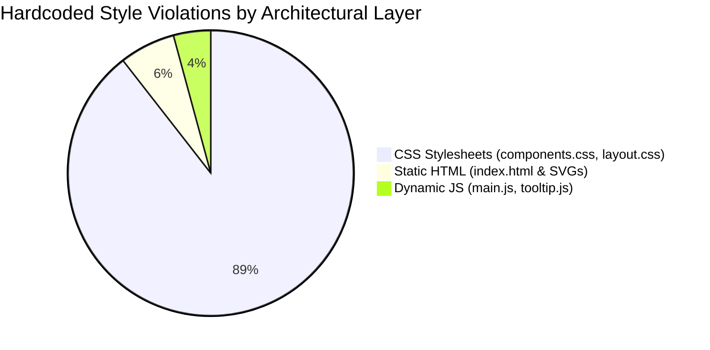

# Sutra UI: Unified Master Design Token Audit Report
**Scope:** HTML (`index.html`), CSS (`components.css`, `layout.css`, `base.css`), and JavaScript (`main.js`, `tooltip.js`)  
**Design System Standard:** Astryx & Apple HIG Guidelines (`tokens.css`)  
**Generated:** 2026-10-24  

---

## 1. Executive Summary & Architecture Health

Across all three layers of the Sutra UI codebase (Static Markup, Cascading Stylesheets, and Dynamic Runtime Scripts), the application demonstrates strong architectural intent around the Astryx/Apple token system. However, **hundreds of ad-hoc declarations bypass CSS variables**.

### Key Quantified Metrics
- **Hardcoded Colors & Surfaces:** **390+** occurrences (56+ `#FFFFFF`, 52+ `#0F172A`, 35+ `#F8FAFC`/`#F1F5F9`, plus direct hex mutations in JavaScript).
- **Typography Rule Violations:** **115+** occurrences of non-token, odd, or fractional font sizes (`10.5px`, `11px`, `11.5px`, `12.5px`, `13px`, `13.5px`, `15px`), violating the explicit *"Even Pixels Only (minimum 12px)"* specification.
- **Bespoke Elevation Shadows:** **60+** ad-hoc `box-shadow` values on dropdowns, popovers, badges, and modals rather than `--shadow-card-*` tokens.
- **Un-tokenized Border Radii:** **65+** occurrences of `6px` and `4px`, which do not exist in the official token scale (`8px`, `12px`, `16px`, `9999px`).
- **Off-Grid Spacing (Rhythm Drift):** **130+** instances of irregular margins, paddings, and gaps (`1px`, `7px`, `10px`, `14px`, `18px`, `36px`).



---

## 2. Priority Classification Framework

- **P0 — Critical (Theming & Contrast Breaking):** Hardcoded `#FFFFFF`, `#0F172A`, and status hex values directly preventing dark mode / theme adaptability.
- **P1 — High (Core System Rule Breakers & Missing Tokens):** Fractional/odd font sizes and missing tokens in `tokens.css` (e.g., star ratings, compact radii).
- **P2 — Medium (Elevation, Sizing & SVG Offsets):** Arbitrary `box-shadow` values, off-scale icon viewports (`13px`, `14px`, `15px`, `18px`), and modal stage constraints.
- **P3 — Low (Structural Polish & Utility Separation):** Inline `display: none` attributes, inline text alignments, and minor 1px/2px spacing rhythm misalignments.

---

## 3. The Unified Prioritized Matrix

| Priority | Source File & Location | Element / Selector / Context | Current Hardcoded Value | Category | Violation Analysis | Recommended Design Token / Fix |
| :---: | :--- | :--- | :--- | :---: | :--- | :--- |
| **P0** | [components.css:L2893, L2908](file:///c:/Users/Surya%20Teja%20S/OneDrive/Documents/Agentic%20AI%20research/sutra-ui/css/components.css#L2893) | `.s08-agent-header-btn` | `background-color: #FFFFFF;` | Color | Hardcodes card surface. Will fail when dark mode is enabled. | `var(--color-surface-card)` |
| **P0** | [components.css:L5396](file:///c:/Users/Surya%20Teja%20S/OneDrive/Documents/Agentic%20AI%20research/sutra-ui/css/components.css#L5396) | `.s08-tabs-col` | `background-color: #FFFFFF;` | Color | Column background hardcoded to white. | `var(--color-surface-card)` |
| **P0** | [components.css:L7462](file:///c:/Users/Surya%20Teja%20S/OneDrive/Documents/Agentic%20AI%20research/sutra-ui/css/components.css#L7462) | `.s08-artifacts-view` | `background-color: #FFFFFF;` | Color | Artifacts tab body hardcoded to white. | `var(--color-surface-card)` |
| **P0** | [components.css:L3055, L4662, L5408](file:///c:/Users/Surya%20Teja%20S/OneDrive/Documents/Agentic%20AI%20research/sutra-ui/css/components.css#L3055) (52+ rules) | Headers, tab titles, item names | `color: #0F172A;` | Color | Deep slate text hardcoded without token. | `var(--color-text-primary)` |
| **P0** | [components.css:L4588, L4605](file:///c:/Users/Surya%20Teja%20S/OneDrive/Documents/Agentic%20AI%20research/sutra-ui/css/components.css#L4588) | `.s08-scope-setup-bar` | `background-color: #F8FAFC;` | Color | Subtle surface hardcoded to hex. | `var(--color-surface-canvas-subtle)` |
| **P0** | [components.css:L5407](file:///c:/Users/Surya%20Teja%20S/OneDrive/Documents/Agentic%20AI%20research/sutra-ui/css/components.css#L5407) | `.s08-tab-icon-btn.active` | `background-color: #F1F5F9;` | Color | Subtle card surface hardcoded to hex. | `var(--color-surface-card-subtle)` |
| **P0** | [main.js:L844-L846](file:///c:/Users/Surya%20Teja%20S/OneDrive/Documents/Agentic%20AI%20research/sutra-ui/js/main.js#L844-L846) | Dynamic `btn` click animation | `btn.style.backgroundColor = '#ECFDF5';`<br>`btn.style.color = '#047857';`<br>`btn.style.borderColor = '#A7F3D0';` | Color | JavaScript dynamically injects raw hex colors into the DOM. | Replace with CSS class or tokens: `var(--color-status-success-bg)`, `var(--color-status-success-text)`, `var(--color-status-success-border)` |
| **P0** | [main.js:L1960, L1975, L1990](file:///c:/Users/Surya%20Teja%20S/OneDrive/Documents/Agentic%20AI%20research/sutra-ui/js/main.js#L1960) | `tabContextActionBtn` | `style.color = '#10B981';`<br>`style.color = '#3B82F6';` | Color | Dynamic JS status colors bypassing tokens. | `var(--color-icon-success)`, `var(--color-brand-primary)` |
| **P0** | [base.css:L18](file:///c:/Users/Surya%20Teja%20S/OneDrive/Documents/Agentic%20AI%20research/sutra-ui/css/base.css#L18) | `body` | `background-color: #E2E8F0;` | Color | Outer page frame backdrop hardcoded. | `var(--color-border-default)` or `--color-surface-canvas-subtle` |
| **P0** | [layout.css:L302-304](file:///c:/Users/Surya%20Teja%20S/OneDrive/Documents/Agentic%20AI%20research/sutra-ui/css/layout.css#L302-L304) | `.sutra-icon-dock` | `background-color: #121217;`<br>`color: #F4F4F6;` | Color | Hardcoded dark surface dock colors. | `var(--color-surface-dock)`, `var(--color-text-inverse)` |
| **P1** | [index.html:L163, L200, L238, L274...](file:///c:/Users/Surya%20Teja%20S/OneDrive/Documents/Agentic%20AI%20research/sutra-ui/index.html#L163) (10 cards) | `.sutra-agent-rating svg` | `fill="#F59E0B"`<br>`stroke="#F59E0B"` | Color | Rating star color is completely missing from `tokens.css`. | Add `--color-rating-star: #F59E0B;` to `tokens.css` and style via CSS class. |
| **P1** | [index.html:L2228](file:///c:/Users/Surya%20Teja%20S/OneDrive/Documents/Agentic%20AI%20research/sutra-ui/index.html#L2228) | Button Showcase Specs Box | `font-size: 11.5px;` | Typography | Direct violation of the "Even Pixels Only" (minimum 12px) rule. | `font-size: var(--font-size-xs);` (12px / 0.75rem) |
| **P1** | [components.css:L6903](file:///c:/Users/Surya%20Teja%20S/OneDrive/Documents/Agentic%20AI%20research/sutra-ui/css/components.css#L6903) | `.sutra-tooltip` | `font-size: 11.5px;` | Typography | Fractional pixel typography in global tooltip engine. | `font-size: var(--font-size-xs);` |
| **P1** | [components.css:L1341](file:///c:/Users/Surya%20Teja%20S/OneDrive/Documents/Agentic%20AI%20research/sutra-ui/css/components.css#L1341) | `.sutra-agent-author` | `font-size: 11.5px;` | Typography | Fractional pixel typography in table author view. | `font-size: var(--font-size-xs);` |
| **P1** | [components.css:L3056, L4661](file:///c:/Users/Surya%20Teja%20S/OneDrive/Documents/Agentic%20AI%20research/sutra-ui/css/components.css#L3056) (20+ places) | `.s08-agent-item-name`, etc. | `font-size: 13px;` | Typography | Non-token odd font size between 12px (`--font-size-xs`) and 14px (`--font-size-base`). | Standardize to `var(--font-size-base)` (14px) or `var(--font-size-xs)` (12px). |
| **P1** | [components.css:L2316, L3085, L3395](file:///c:/Users/Surya%20Teja%20S/OneDrive/Documents/Agentic%20AI%20research/sutra-ui/css/components.css#L2316) | Secondary labels, badges | `font-size: 11px;` | Typography | Sub-12px odd font size. | Standardize to `var(--font-size-xs)` (12px). |
| **P1** | [main.js:L2334-L2335](file:///c:/Users/Surya%20Teja%20S/OneDrive/Documents/Agentic%20AI%20research/sutra-ui/js/main.js#L2334-L2335) | `#s08-frame-reload-btn`, chip | `font-size: 11.5px;`<br>`font-size: 11px;` | Typography | Dynamic JS template injecting illegal font sizes inline. | Standardize to `font-size: var(--font-size-xs);` |
| **P1** | [components.css:L704, L1135, L6908](file:///c:/Users/Surya%20Teja%20S/OneDrive/Documents/Agentic%20AI%20research/sutra-ui/css/components.css#L704) (25+ places) | Tooltips, tags, dropdown items | `border-radius: 6px;` | Radius | `6px` radius is used widely, but missing from `tokens.css`. | Add token `--radius-sm: 6px;` to `tokens.css` or standardize to `--radius-inner` (8px). |
| **P1** | [components.css:L2390, L3363, L4860](file:///c:/Users/Surya%20Teja%20S/OneDrive/Documents/Agentic%20AI%20research/sutra-ui/css/components.css#L2390) (15+ places) | Badges, small icons, toggles | `border-radius: 4px;` | Radius | `4px` radius is used widely, but missing from `tokens.css`. | Add token `--radius-xs: 4px;` to `tokens.css`. |
| **P2** | [components.css:L2895, L4664, L6098](file:///c:/Users/Surya%20Teja%20S/OneDrive/Documents/Agentic%20AI%20research/sutra-ui/css/components.css#L2895) | Header cards, active items | `box-shadow: 0 1px 3px rgba(15, 23, 42, 0.05);` | Elevation | Bespoke subtle elevation shadow. | `var(--shadow-card-subtle)` |
| **P2** | [components.css:L3009, L3170, L4752](file:///c:/Users/Surya%20Teja%20S/OneDrive/Documents/Agentic%20AI%20research/sutra-ui/css/components.css#L3009) | Dropdown menus, popovers | `box-shadow: 0 4px 16px rgba(0, 0, 0, 0.08)...` | Elevation | Bespoke floating menu shadow. | `var(--shadow-card-floating)` |
| **P2** | [components.css:L6910](file:///c:/Users/Surya%20Teja%20S/OneDrive/Documents/Agentic%20AI%20research/sutra-ui/css/components.css#L6910) | `.sutra-tooltip` | `box-shadow: 0 4px 14px 0 rgba(0, 0, 0, 0.18)...` | Elevation | Bespoke tooltip shadow. | `var(--shadow-card-elevated)` |
| **P2** | [components.css:L6002](file:///c:/Users/Surya%20Teja%20S/OneDrive/Documents/Agentic%20AI%20research/sutra-ui/css/components.css#L6002) | Focus states | `box-shadow: 0 0 0 2px rgba(0, 110, 245, 0.12);` | Elevation | Bespoke focus outline. | `var(--focus-ring-subtle)` |
| **P2** | [index.html:L101](file:///c:/Users/Surya%20Teja%20S/OneDrive/Documents/Agentic%20AI%20research/sutra-ui/index.html#L101) | Search Bar SVG | `width="18" height="18"` | Icon Sizing | Off-grid icon dimension (Grid defines 16px and 20px). | Standardize to `var(--icon-size-sm)` (16px) or `var(--icon-size-md)` (20px). |
| **P2** | [index.html:L613, L670, L689](file:///c:/Users/Surya%20Teja%20S/OneDrive/Documents/Agentic%20AI%20research/sutra-ui/index.html#L613) | Chevrons & Nav SVGs | `width="14" height="14"` | Icon Sizing | Off-grid icon dimension. | Standardize to `var(--icon-size-xs)` (12px) or `var(--icon-size-sm)` (16px). |
| **P2** | [index.html:L834, L837](file:///c:/Users/Surya%20Teja%20S/OneDrive/Documents/Agentic%20AI%20research/sutra-ui/index.html#L834) | Project action icons | `width="13" height="13"` | Icon Sizing | Off-grid odd icon dimension. | Standardize to `var(--icon-size-xs)` (12px). |
| **P2** | [index.html:L2198](file:///c:/Users/Surya%20Teja%20S/OneDrive/Documents/Agentic%20AI%20research/sutra-ui/index.html#L2198) | Button Showcase Card | `style="max-width: 440px;"` | Element Sizing | Hardcoded modal container width. | Add `--size-modal-sm: 440px;` to `tokens.css` or use `.sutra-modal-card-sm`. |
| **P2** | [index.html:L2213](file:///c:/Users/Surya%20Teja%20S/OneDrive/Documents/Agentic%20AI%20research/sutra-ui/index.html#L2213) | Button Showcase Stage | `border-radius: 12px;`<br>`padding: 36px 24px;`<br>`gap: 20px; margin: 20px 0;` | Radius & Spacing | Hardcoded styles on modal container. | `border-radius: var(--radius-element);`<br>`padding: var(--spacing-8) var(--spacing-6);`<br>`gap: var(--spacing-5); margin: var(--spacing-5) 0;` |
| **P2** | [index.html:L2215-L2224](file:///c:/Users/Surya%20Teja%20S/OneDrive/Documents/Agentic%20AI%20research/sutra-ui/index.html#L2215) | Showcase buttons (x4) | `style="min-width: 140px;"` | Element Sizing | Hardcoded min-width on button variations. | Define `--btn-min-width-showcase: 140px;` in `tokens.css`. |
| **P3** | [index.html:L581](file:///c:/Users/Surya%20Teja%20S/OneDrive/Documents/Agentic%20AI%20research/sutra-ui/index.html#L581) | `#pagination-pages` | `style="display:flex; gap:6px;"` | Spacing & Layout | Inline layout & spacing attribute in HTML. | Move to CSS class `.sutra-pagination-pages { display: flex; gap: var(--spacing-1-5); }`. |
| **P3** | [index.html:L545](file:///c:/Users/Surya%20Teja%20S/OneDrive/Documents/Agentic%20AI%20research/sutra-ui/index.html#L545) | Table Action Header | `style="text-align: right;"` | Typography / Layout | Inline text alignment. | Move to stylesheet: `.sutra-th-action { text-align: right; }`. |
| **P3** | [main.js:L232](file:///c:/Users/Surya%20Teja%20S/OneDrive/Documents/Agentic%20AI%20research/sutra-ui/js/main.js#L232) | Dynamic Table Action Cell | `style="text-align: right;"` | Typography / Layout | Inline text alignment injected via JS. | Move to stylesheet: `.sutra-td-action { text-align: right; }`. |
| **P3** | [components.css:L2896](file:///c:/Users/Surya%20Teja%20S/OneDrive/Documents/Agentic%20AI%20research/sutra-ui/css/components.css#L2896) | `.s08-agent-header-btn` | `padding: 7px 8px;` | Spacing | 7px is an off-grid odd spacing value. | Standardize to `padding: 6px var(--spacing-2);` or `padding: var(--spacing-2);` (8px). |
| **P3** | [components.css:L4587](file:///c:/Users/Surya%20Teja%20S/OneDrive/Documents/Agentic%20AI%20research/sutra-ui/css/components.css#L4587) | `.s08-scope-setup-bar` | `padding: 10px 14px;` | Spacing | Off-scale padding. | Standardize to `var(--spacing-2) var(--spacing-4);` (8px 16px). |
| **P3** | [components.css:L2235](file:///c:/Users/Surya%20Teja%20S/OneDrive/Documents/Agentic%20AI%20research/sutra-ui/css/components.css#L2235) | `.sutra-modal-actions` | `style="margin-top: 18px;"` | Spacing | 18px is an off-scale spacing value. | Standardize to `var(--spacing-4)` (16px) or `var(--spacing-5)` (20px). |
| **P3** | [index.html:L830, L1200, L1325...](file:///c:/Users/Surya%20Teja%20S/OneDrive/Documents/Agentic%20AI%20research/sutra-ui/index.html#L830) (14 instances) | Various hidden panels/buttons | `style="display: none;"` | Layout / State | Inline display override in static HTML. | Replace with standard HTML `hidden` attribute or utility class `.u-hidden`. |

---

## 4. Design System Token Expansion Blueprint

To resolve these violations systematically without ad-hoc overrides, the following tokens should be added directly to **[tokens.css](file:///c:/Users/Surya%20Teja%20S/OneDrive/Documents/Agentic%20AI%20research/sutra-ui/css/tokens.css)**:

```css
/* ==========================================================================
   PROPOSED EXTENSIONS TO SUTRA TOKENS.CSS
   ========================================================================== */
:root {
  /* 1. Extended Border Radius Scale (Filling compact component gaps) */
  --radius-xs: 4px;           /* Micro tags, inner chips, toggles */
  --radius-sm: 6px;           /* Tooltips, context menus, action items */

  /* 2. Rating & Feedback Tokens */
  --color-rating-star: #F59E0B; /* Amber star fill & stroke */
  --color-rating-star-empty: #CBD5E1;

  /* 3. Window & Stage Control Indicators */
  --color-control-close: #FF5F56;
  --color-control-minimize: #FFBD2E;
  --color-control-expand: #27C93F;

  /* 4. Third-Party Integration Tokens */
  --color-brand-onedrive: #0078D4;
  --color-brand-gdrive: #0066DA;

  /* 5. Fixed Component Width Tokens */
  --size-modal-sm: 440px;
  --btn-min-width-showcase: 140px;
}
```

---

## 5. Phased Remediation Roadmap

```mermaid
graph TD
    A[Phase 1: Extend tokens.css] --> B[Phase 2: Refactor components.css]
    B --> C[Phase 3: Clean up index.html]
    C --> D[Phase 4: Decouple JavaScript mutations]
    
    A -.->|Injects missing radius, rating & window tokens| B
    B -.->|Replaces 380+ hex values with var(--color-*)| C
    C -.->|Removes inline styles from modal & table headers| D
    D -.->|Converts inline style mutations to CSS state classes| E[100% Token Compliant System]
```

1. **Phase 1: Extend `tokens.css`:** Add `--radius-xs: 4px`, `--radius-sm: 6px`, and `--color-rating-star: #F59E0B`.
2. **Phase 2: Clean `components.css`:** Replace raw `#FFFFFF` with `var(--color-surface-card)`, `#0F172A` with `var(--color-text-primary)`, normalize fractional font sizes to `var(--font-size-xs)` / `var(--font-size-base)`, and map ad-hoc box-shadows to design tokens.
3. **Phase 3: Clean `index.html`:** Move the Button Showcase Modal inline CSS into dedicated component classes in `components.css` and use the star rating token.
4. **Phase 4: Clean `main.js` & `tooltip.js`:** Eliminate direct `.style.backgroundColor` hex assignments in favor of class-driven state toggles.
