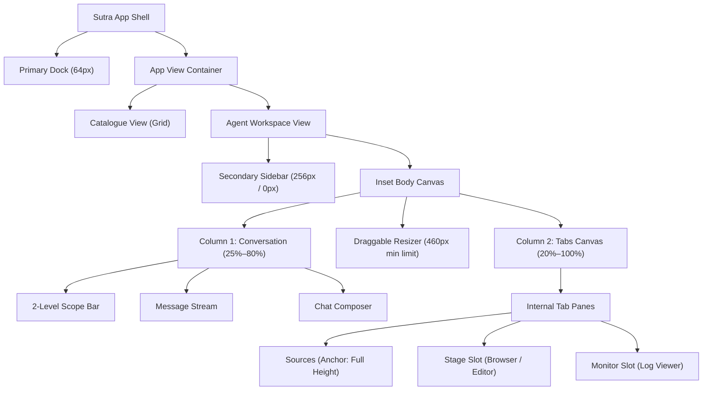
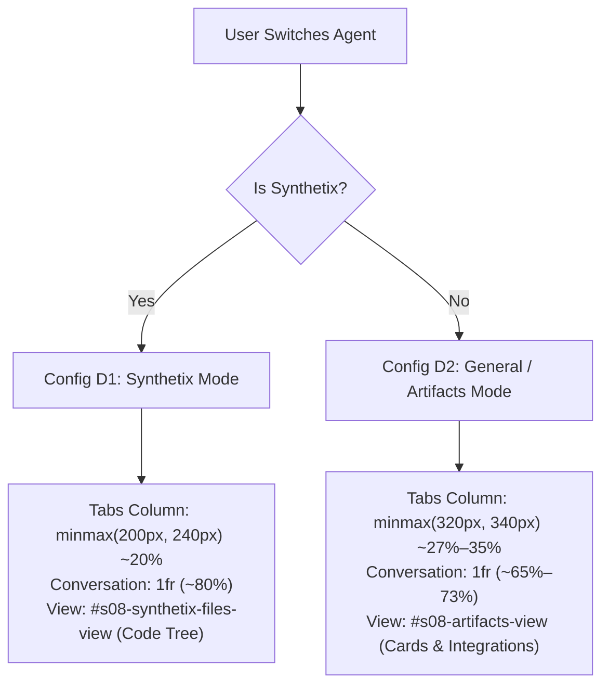

# Sutra UI: Comprehensive Agent Workspace Layout Configurations & Audit

## 1. Architectural Overview & Hierarchy

The **Sutra UI Layout Architecture** is structured as a multi-tier hierarchy:

```
[ App-Level Shell ]
 ├── Primary Dock (64px / 50px mobile)
 └── App View Container:
      ├── View 1: Agent Catalogue View (Full-canvas grid directory)
      └── View 2: Agent Workspace View (Three-zone split architecture)
           ├── Zone 1: Secondary Nav Sidebar (256px / 0px collapsed / 280px mobile drawer)
           └── Zone 2: Inset Body Canvas (Two-Column Workspace)
                ├── Column 1: Conversational Section (25%–80% width)
                │    ├── Column Header (48px) [Breadcrumbs + Collapse Trigger + New Task]
                │    ├── 2-Level Scope Bar (Workspace / Folder cascading selector)
                │    ├── Interactive Dialogue Message Stream
                │    └── Bottom Composer & Input Box (with embedded Agent Pill)
                │
                ├── Canvas Split Resizer (0px channel, interactive drag & snap)
                │
                └── Column 2: Tabs Canvas Section (20%–100% width)
                     ├── Tabs Bar Header (48px) [Zen Toggle + Scrollable Tabs + Add Tab + Close]
                     └── Tab Views Container
                          └── Internal Panes (1, 2, or 3 panes simultaneously)
```



---

## 2. Master Matrix of Macro Workspace Configurations (Level 1)

This matrix defines all macro workspace layouts across the Secondary Sidebar, Conversation Column, and Tabs Column:

| Config | Configuration Name | Secondary Sidebar | Conversation Column | Tabs Canvas Column | Max Active Panes | Trigger & Behavioral Intent |
| :--- | :--- | :--- | :--- | :--- | :--- | :--- |
| **A** | **Standard 2-Column Split** | Open (`256px`) | `38%` ($\approx 409\text{px}$) | `62%` ($\approx 667\text{px}$) | **2 Panes** | Default deep-work state; browsing files or code while chatting |
| **B** | **Focus 2-Column Split** | Collapsed (`0px`) | `38%` ($\approx 512\text{px}$) | `62%` ($\approx 836\text{px}$) | **2 Panes** | Sidebar collapsed for extra breathing room during review |
| **C** | **3-Pane Adaptive Studio** | Auto-Collapsed (`0px`) | `25%` ($\approx 337\text{px}$) | `75%` ($\approx 1011\text{px}$) | **3 Panes** | Proactive studio layout: Sources (left) + Stage (top-right) + Logs (bottom-right) |
| **D1** | **Synthetix Lean Tree** | Open (`256px`) | `80%` ($\approx 858\text{px}$) | `20%` ($\approx 218\text{px}$) | **1 Pane** (Tree) | Synthetix agent active; minimal code tree alongside expansive conversation |
| **D2** | **Artifacts Hub Dominant** | Open (`256px`) | `65%–73%` ($\approx 700\text{px}$) | `27%–35%` ($\approx 340\text{px}$) | **1 Pane** (Hub) | Other agents active; full drag-and-drop upload cards and cloud integrations |
| **E** | **Zen Mode (Full Canvas)** | Auto-Collapsed (`0px`) | `0px` (`display: none`) | `100%` ($\approx 1348\text{px}$) | **2 Panes** | Click `|↔|` (`#s08-split-toggle-btn`); full-width deliverable review |
| **F** | **Full Conversation** | Open or Collapsed | `100%` ($\approx 1076\text{px}$ / $1348\text{px}$) | `0px` (`display: none`) | **0 Panes** | Click `✕` (`#s08-close-tabs-btn`) or drag resizer below 260px; reopen via pill |
| **G** | **Custom User Resized** | Free drag ($180–420\text{px}$) | Free drag ($\ge 25\%$ or $220\text{px}$) | Free drag ($\ge 35\%$ or $460\text{px}$) | Adaptive | User dynamically drags vertical splitters to custom pixel proportions |
| **H** | **Constrained Fallback** | Adaptive | Adaptive | $< 680\text{px}$ | **1 Pane** | Space too narrow for side-by-side; automatically falls back to single active tab |

---

## 3. Concrete Pixel Allocations by Standard Screen Resolutions

Calculations assume standard window maximized view with 64px dock and window chrome:

### Desktop (1440 × 900) — *Net Available Canvas $\approx 1348\text{px}$*

| Configuration | Secondary Sidebar | Conversation Col | Tabs Col | Internal Tabs Breakdown |
| :--- | :--- | :--- | :--- | :--- |
| **Config A: Standard 2-Col** | `256px` (19%) | `409px` (30%) | `667px` (50%) | Left Sources: `220px` \| Right Stage: `447px` |
| **Config B: Focus 2-Col** | `0px` (0%) | `512px` (38%) | `836px` (62%) | Left Sources: `240px` \| Right Stage: `596px` |
| **Config C: 3-Pane Studio** | `0px` (0%) | `337px` (25%) | `1011px` (75%) | Left Sources: `240px` \| Right Stage: `771px` (H: 58%) \| Logs: `771px` (H: 42%) |
| **Config D1: Synthetix Tree** | `256px` (19%) | `858px` (64%) | `218px` (16%) | Sources File Tree: `218px` (Full Height) |
| **Config D2: Artifacts Hub** | `256px` (19%) | `748px` (55%) | `340px` (25%) | Artifacts Cards & Uploads: `340px` (Full Height) |
| **Config E: Zen Mode** | `0px` (0%) | `0px` (0%) | `1348px` (100%) | Left Editor: `674px` \| Right Browser: `674px` |
| **Config F: Full Chat** | `256px` (19%) | `1076px` (81%) | `0px` (0%) | Reopen Pill: `32px` docked right |

---

### Compact Laptop (1280 × 800) — *Net Available Canvas $\approx 1188\text{px}$*

| Configuration | Secondary Sidebar | Conversation Col | Tabs Col | Internal Tabs Breakdown |
| :--- | :--- | :--- | :--- | :--- |
| **Config A: Standard 2-Col** | `256px` (22%) | `348px` (29%) | `568px` (49%) | Left Sources: `200px` \| Right Stage: `368px` |
| **Config B: Focus 2-Col** | `0px` (0%) | `451px` (38%) | `737px` (62%) | Left Sources: `220px` \| Right Stage: `517px` |
| **Config C: 3-Pane Studio** | `0px` (0%) | `297px` (25%) | `891px` (75%) | Left Sources: `220px` \| Right Stage: `671px` (H: 58%) \| Logs: `671px` (H: 42%) |
| **Config D1: Synthetix Tree** | `256px` (22%) | `730px` (61%) | `202px` (17%) | Sources File Tree: `202px` (Full Height) |
| **Config D2: Artifacts Hub** | `256px` (22%) | `602px` (51%) | `330px` (27%) | Artifacts Cards: `330px` (Full Height) |
| **Config E: Zen Mode** | `0px` (0%) | `0px` (0%) | `1188px` (100%) | Left Editor: `594px` \| Right Browser: `594px` |

---

### Full HD / Ultrawide (1920 × 1080) — *Net Available Canvas $\approx 1828\text{px}$*

| Configuration | Secondary Sidebar | Conversation Col | Tabs Col | Internal Tabs Breakdown |
| :--- | :--- | :--- | :--- | :--- |
| **Config A: Standard 2-Col** | `256px` (14%) | `591px` (32%) | `965px` (54%) | Left Sources: `260px` \| Right Stage: `705px` |
| **Config B: Focus 2-Col** | `0px` (0%) | `695px` (38%) | `1133px` (62%) | Left Sources: `260px` \| Right Stage: `873px` |
| **Config C: 3-Pane Studio** | `0px` (0%) | `457px` (25%) | `1371px` (75%) | Left Sources: `260px` \| Right Stage: `1111px` (H: 58%) \| Logs: `1111px` (H: 42%) |
| **Config E: Zen Mode** | `0px` (0%) | `0px` (0%) | `1828px` (100%) | Left Editor: `914px` \| Right Browser: `914px` |

---

## 4. Internal Sub-Pane Allocations inside Column 2 (Level 2)

Within the Tabs Canvas column, Sutra UI dynamically computes grid proportions based on open tab keys:

```
┌─────────────────────────────────────────────────────────────┐
│ 3-PANE STUDIO GRID (.layout-three-pane)                     │
│                                                             │
│ ┌──────────────────────┬──────────────────────────────────┐ │
│ │                      │ Stage (Browser / Editor)         │ │
│ │                      │ Height: minmax(180px, 58%)       │ │
│ │ Left Anchor          ├──────────────────────────────────┤ │
│ │ (Sources / Tree)     │ Resizer Grip (#s08-tab-resizer-h)│ │
│ │ Width: 200px–260px   ├──────────────────────────────────┤ │
│ │ Height: 100%         │ Monitor (Log Viewer)             │ │
│ │                      │ Height: minmax(140px, 1fr)       │ │
│ └──────────────────────┴──────────────────────────────────┘ │
└─────────────────────────────────────────────────────────────┘
```

### Supported Combinations Matrix

| ID | Open Tabs Combination | Applied CSS Grid Class | Horizontal Grid | Vertical Grid |
| :--- | :--- | :--- | :--- | :--- |
| **T1** | Single Tab Open | `none` (default single) | `1fr` (100% width) | `1fr` (100% height) |
| **T2** | Sources + Editor / File | `.layout-sources-editor` | `minmax(200px, 260px) 0px 1fr` | `1fr` (Full height) |
| **T3** | Sources + Browser | `.layout-sources-browser`| `minmax(200px, 260px) 0px 1fr` | `1fr` (Full height) |
| **T4** | Sources + Log Viewer | `.layout-sources-logs` | `minmax(200px, 260px) 0px 1fr` | `1fr` (Full height) |
| **T5** | Browser + Log Viewer | `.layout-browser-logs` | `1fr` (Single column) | `minmax(180px, 58%) 0px minmax(140px, 1fr)` |
| **T6** | Editor + Log Viewer | `.layout-editor-logs` | `1fr` (Single column) | `minmax(180px, 58%) 0px minmax(140px, 1fr)` |
| **T7** | Browser + Editor | `.layout-browser-editor` | `minmax(320px, 1fr) 0px minmax(320px, 1fr)`| `1fr` (Full height) |
| **T8** | Sources + Stage + Logs | `.layout-three-pane` | `minmax(200px, 260px) 0px 1fr` | Left: 100% H \| Right: `58% / 42%` |
| **T9** | All 4 Tabs Open Concurrently | `.layout-three-pane` | `minmax(200px, 260px) 0px 1fr` | Stage slot dynamically shares Browser & Editor |
| **T10**| Zero Tabs Open | `.s08-no-tabs-view` | `100%` (Centered Empty State) | `100%` |
| **T11**| Any Combo on $<680\text{px}$ | `.is-fallback-single` | `100%` (Only Active Tab Renders) | `100%` |

---

## 5. Agent-Specific Asymmetric Split Configurations

When only the **Sources** tab is active in the workspace, Sutra UI dynamically adapts the physical width based on the active agent:



- **Synthetix Agent Mode**:
  - Purpose: Software engineering, code editing, directory navigation.
  - Active View: `#s08-synthetix-files-view` (Hierarchical code file tree with modified/added status badges).
  - Width Rule: `targetW = Math.round(rect.width * 0.20)` (clamped `160px–260px`).
  - Stored Setting: `savedSynthetixTabsWidth`.

- **Other Agents (Agent General, Design Engineer, Sales Copilot, etc.)**:
  - Purpose: Deliverables, file uploads, cloud asset synchronization.
  - Active View: `#s08-artifacts-view` (Drag-and-drop upload card, Google Drive/OneDrive integrations, filter pill tabs, artifact cards).
  - Width Rule: `targetW = Math.round(rect.width * 0.27)` (clamped `320px–480px`).
  - Stored Setting: `savedArtifactsTabsWidth`.

---

## 6. 4-Tabs Concurrency State & Stage Delegation Architecture

When all 4 tabs are open concurrently (**Sources + Browser + Editor + Log Viewer**):

1. **Routing**: `updateTabsLayout()` detects `hasSources && stageKeys.length > 0 && hasLogs`.
2. **Applied Grid**: Activates `.layout-three-pane`.
3. **Stage-Slot Delegation**:
   - The top-right stage slot is shared by Browser and Editor.
   - When the user clicks the Browser tab pill, `activeStageKey = 'browser'`: `#s08-view-browser` displays at top-right while `#s08-view-editor` is hidden.
   - When the user clicks an Editor or deliverable tab pill, `activeStageKey = 'editor'`: `#s08-view-editor` displays at top-right while `#s08-view-browser` is hidden.
   - Neither Sources (left) nor Log Viewer (bottom-right) is disturbed during this switch.
4. **Tab Strip Overflow Handling**:
   - Tab overflow wrap (`#s08-tab-overflow-wrap`) activates.
   - Count badge displays `4` (`#s08-tab-count-badge`).
   - Clicking `[▼]` opens the full list of all 4 open tabs with quick-close and quick-focus buttons.

---

## 7. Stage Deliverable Sub-Layout Modes (Inside `#s08-view-editor`)

The Stage viewer dynamically renders 4 distinct internal layouts based on the active file or deliverable:

```
┌─────────────────────────────────────────────────────────────┐
│ STAGE TOPBAR: [File Icon] [Filename]     [Diff] [Copy] [DL] │
├─────────────────────────────────────────────────────────────┤
│                                                             │
│ Sub-Layout 1: Markdown Spec View (HTML Spec vs Raw MD)      │
│ Sub-Layout 2: Unified Git Diff View (Side-by-side / Unified)│
│ Sub-Layout 3: SVG Diagram Topology View (with Zoom Dock)    │
│ Sub-Layout 4: Code & JSON Config View (Monospace syntax)    │
│                                                             │
└─────────────────────────────────────────────────────────────┘
```

1. **Markdown Spec View (`#s08-stage-markdown-view`)**:
   - Trigger: `.md` files (e.g. `architecture-spec.md`).
   - Topbar Toggle: Segmented control (`#s08-stage-view-toggles`) appears with Preview (formatted typography) vs Raw (monospace markdown).
2. **Unified Git Diff View (`#s08-stage-diff-view`)**:
   - Trigger: Modified code files (e.g. `app.tsx`, `forecast.ts`).
   - Topbar Toggle: Git Diff button (`#s08-stage-diff-btn`) toggles between standard code and side-by-side/unified git diff with green `+` additions and red `-` deletions.
3. **SVG Diagram Topology View (`#s08-stage-diagram-view`)**:
   - Trigger: Architecture diagrams, system topology charts.
   - Bottom Dock: Floating Diagram Zoom Dock (`#s08-stage-zoom-controls`) provides Zoom Out (`-`), Zoom Level (`100%`), Zoom In (`+`), and Reset Fit (`Fit`).
4. **Code / JSON View (`#s08-stage-code-view`)**:
   - Trigger: `.json`, `.ts`, `.js`, `.css` files.
   - Formatted pre/code block with syntax highlighting.

---

## 8. Browser Canvas Sub-Layout Modes (Inside `#s08-view-browser`)

The embedded browser contains 2 distinct internal layout configurations:

1. **Blank / Search Canvas (`#s08-browser-blank-canvas`)**:
   - Centered art box layout with browser illustration.
   - Hero header: *"Web Browser & Application Preview"*.
   - Integrated search box (`#s08-canvas-search-input`) with action button.
   - Quick Launch chips dock (`localhost:3000`, `localhost:5173`, `docs.github.com`).
2. **Connected Web Application Frame (`.s08-browser-app-frame`)**:
   - Active status bar with pulsing green dot (`.s08-status-dot-pulse`).
   - Live URL display with copy action.
   - "Active Preview" badge pill.
   - App reload button and "New Search / URL" button.

---

## 9. App-Level Shell & Responsive Breakpoint Layouts

Defined in `css/layout.css`:

```
┌─────────────────────────────────────────────────────────────┐
│ 1. Large Desktop (>= 1200px): Dock 68px | Sidebar 256px | Inset 1fr
│ 2. Tablet / Laptop (900px–1200px): Dock 68px | Sidebar 250px | Inset 1fr
│ 3. Compact Tablet (640px–900px): Dock 68px | Sidebar 0px (Floating Drawer 280px)
│ 4. Mobile (< 640px): Dock 50px | Full Canvas 1fr
│ 5. Short Screens (< 600px H): Full-height scrollable window
└─────────────────────────────────────────────────────────────┘
```

1. **Top-Level View Toggling (Primary Dock Zone 1)**:
   - **Catalogue View (`#sutra-catalogue-view`)**: Full-width Agent Directory grid with search, categories, and role cards.
   - **Workspace View (`#sutra-workspace-view`)**: Three-zone agent studio shell.
2. **Tablet Breakpoint (`@media (max-width: 900px)`)**:
   - Secondary Sidebar collapses (`display: none`).
   - `.sutra-nav-sidebar.mobile-open`: Slides out as a floating drawer (`position: absolute; left: 68px; width: 280px; z-index: 20; box-shadow: ...`).
3. **Mobile Breakpoint (`@media (max-width: 640px)`)**:
   - Dock shrinks to `50px`.
   - Dock buttons shrink to `36px × 36px`.
4. **Short Screen Breakpoint (`@media (max-height: 600px)`)**:
   - Removes fixed 100vh constraint; enables vertical window scrolling.

---

## 10. Scope Bar Adaptive Layout & Modal / Flyout Overlays

1. **Scope Bar Adaptive Positioning**:
   - 2-level cascading dropdown (Workspace $\rightarrow$ Folder).
   - If conversation column width $< 360\text{px}$ or viewport space on the right $< 225\text{px}$, the Level 2 submenu dynamically applies `.flip-left` (opens to the left) or `.inline-mode` to prevent clipping against the canvas splitter.
2. **Conversation Header "+ New Task" Button Adaptation**:
   - Visible only when the secondary sidebar is collapsed (`#s08-chat-new-task-btn`).
   - Automatically hidden when the secondary sidebar is open (since the sidebar has its own "+ New task" button).
3. **Floating Contextual Kebab Menus**:
   - Task Kebab Menu (`#s08-kebab-menu`): Rename, Pin, Share, Archive, Delete, Move to project.
   - Folder Kebab Menu (`#s08-folder-kebab-menu`): New task in folder, Rename folder, Delete folder.
4. **Modal Dialogs**:
   - **Confirm Undo Modal (`#s08-confirm-undo-modal`)**: Centered 3-change confirmation card (Restore Prompt, Clear Agent Outputs, Rollback Context).
   - **Button Variations Showcase Modal (`#sutra-button-showcase-modal`)**: Design system showcase stage.

---

## 11. break-ui Adversarial Stress-Test Layout States

Configured in `js/break-ui-harness.js` via URL query param `?data=<state>`:

| State ID | Label | Layout Stress Condition Tested |
| :--- | :--- | :--- |
| `demo` | Demo Data | Standard single-tab layout with baseline dataset |
| `worst` | Worst Case (2-Col Squeeze) | 2-column squeeze with long unbroken strings, compressed chat, overflowing labels |
| `four-tabs` | 4-Tabs Concurrency | 4 tabs open simultaneously with long overflowing titles and overflow chevron test |
| `three-pane` | 3-Pane Layout | 3-pane layout under high load with 35+ rapid log entries and vertical height stress |
| `zero-tabs` | Zero Tabs (Empty) | Empty placeholder state (`#s08-no-tabs-view`) with centered reopen button |

---

## 12. Interactive User Gestures & Transition Table

| Action | User Trigger / Gesture | Transitions To | Restores To |
| :--- | :--- | :--- | :--- |
| **Expand to Full Width (Zen Mode)** | Click `|↔|` (`#s08-split-toggle-btn`) | **Config E** (Sidebar & Chat close, Tabs 100%) | Previous 2-col & Sidebar state |
| **Close Tabs Panel** | Click `✕` (`#s08-close-tabs-btn`) | **Config F** (Tabs close, Chat 100%) | Clicking floating right reopen pill |
| **Toggle Secondary Sidebar** | Click `[|]` (`#s08-sidebar-trigger`) or `⌘B` | Collapses to `0px` / Expands to `256px` | Smooth `0.24s` transition |
| **Snap Close on Drag** | Drag resizer left until Tabs $< 260\text{px}$ | Resizer turns red $\rightarrow$ releases into **Config F** | Reopen via floating dock pill |
| **Reset Custom Resizing** | Double-click `#s08-canvas-resizer` | Resets to default `38% / 62%` ratio | Instant reset |
| **Reset Vertical Stage Split** | Double-click `#s08-tab-resizer-h` | Resets Stage to `58%` golden ratio | Instant reset |
| **Keyboard Tab Switching** | `⌘1` through `⌘9` | Instantly focuses respective tab pill | Contextual action updates |
| **Close Active Tab** | `⌘W` | Closes active tab pill and re-renders layout | Reopens via `+` Add Tab menu |
