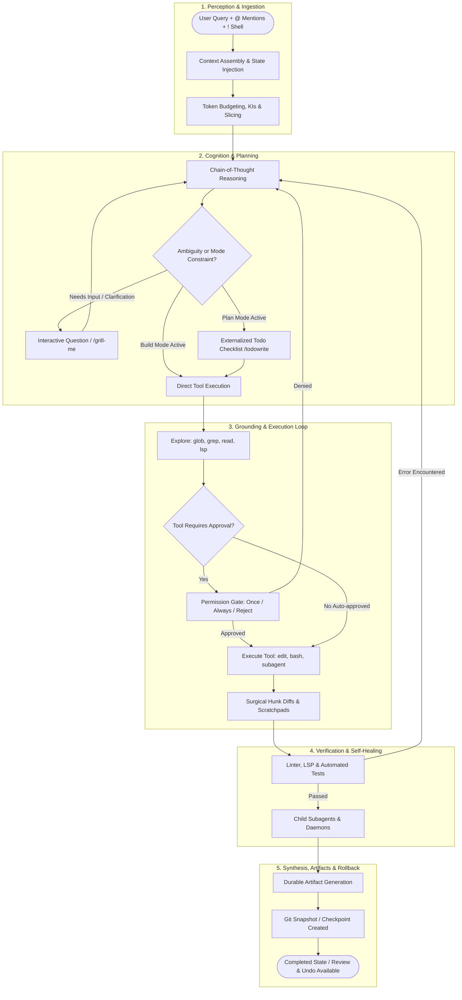

# Agentic AI Architecture & UX Design Blueprint
*A Comprehensive Engineering and Interaction Guide Inspired by Google Antigravity & OpenCode*

---

## Executive Summary

Designing interfaces for Agentic AI requires shifting mental models from **conversational chatbots** (turn-based, text-in/text-out) to **autonomous, stateful cognitive runtimes**. 

When an agent processes a user request, it acts as a reasoning kernel that continuously observes its environment, plans sequences of actions, inspects codebases, executes sandboxed tools, delegates tasks to subagents, recovers from runtime errors, and synthesizes tangible artifacts.

This document serves as the master reference for UX designers and frontend architects building agentic interfaces, design systems, and agent catalogues (such as **Project Sutra**). It synthesizes architectural and UX patterns from **Google Antigravity**, **OpenCode**, and **Cursor**.

---

## 1. The Core Paradigm: Dual-Stream & Typed Part Lifecycle

Modern agent interfaces split user interaction into two decoupled but synchronized surfaces, backed by a **typed event stream**:

```
┌──────────────────────────────────────────┬──────────────────────────────────────────┐
│             THE CHAT STREAM              │           THE ARTIFACT CANVAS            │
│         (Ephemeral & Temporal)           │          (Persistent & Durable)          │
├──────────────────────────────────────────┼──────────────────────────────────────────┤
│ • Chronological timeline of dialogue     │ • Pinned living documents & specifications│
│ • In-place mutating tool rows            │ • Live code & multi-file diff inspectors │
│ • Reasoning / Chain-of-Thought drawers   │ • Interactive prototype canvases / iframes│
│ • Interactive human-in-the-loop prompts  │ • Executable implementation plans        │
│ • Child-session subagent drill-downs     │ • Multi-step walkthrough carousels       │
│ • Compaction & checkpoint markers        │ • Session-level change reviews & undo    │
└──────────────────────────────────────────┴──────────────────────────────────────────┘
```

### The Architectural Law: The Typed Part Model
Agents do **not** stream raw strings into a chat log. An agent turn is a collection of discrete, typed **Message Parts**:
*   `ReasoningPart`: Extended thinking tokens with elapsed timer and collapse state.
*   `ToolCallPart`: Tool name, target arguments, execution status (`proposed` $\rightarrow$ `awaiting_permission` $\rightarrow$ `running` $\rightarrow$ `completed` / `error` / `denied`).
*   `ToolResultPart`: Truncated stdout, exit code, diff preview, or error trace.
*   `TodoPart`: Externalized task checklist (`pending`, `in_progress`, `completed`, `cancelled`).
*   `SystemMarkerPart`: Memory compaction notices, git checkpoints, retry loops.

> [!IMPORTANT]
> **Stream and Mutate In-Place:** Never append a new chat bubble just to update a tool's status from "running" to "done". The UI must stream tokens into the part, mutate the part's state in-place, and re-render only the affected component.

---

## 2. The 9 Phases of the Agentic Lifecycle (With Non-Linear Realities)



### Phase 1: Context Ingestion & The Composer Grammar
Before execution begins, the runtime packages state:
*   **Composer Input Grammar:**
    *   `@` mentions: Fuzzy autocomplete for files, folders, or specific subagents.
    *   `!` shell execution: Runs a command immediately (e.g., `! git status`) and appends stdout as context.
    *   `/` slash commands: Mode shifts (`/plan`, `/init`), shortcuts, and memory compaction (`/compact`).
*   **Workspace State:** Active document, cursor line/col, active browser viewport, running dev servers.
*   **Knowledge Items (KIs):** Repository architecture summaries, coding rules, and past bug resolutions.
*   **Dynamic Project Rules (`AGENTS.md`):** Committed project-level constraints and testing standards.

### Phase 2: Agent Modes & Tool Availability
Tool access is gated upfront by the user's selected **Mode**:
*   **Build Mode:** Full autonomous tool palette. Can edit files, create directories, run bash, and call formatters.
*   **Plan Mode:** Read-only exploration (`read`, `grep`, `glob`, `lsp`). Prohibited from editing code or running mutating commands without explicit user permission. Focuses on drafting specs and checklists.
*   **Ask Mode:** Pure advisory and research mode. Never modifies workspace files.

### Phase 3: Cognitive Reasoning vs. Externalized Planning
*   **Reasoning Streams (CoT):** Hidden or collapsed by default. Explains *why* the model is taking an approach.
*   **Externalized Planning (`todowrite`):** The model externalizes its goals into a structured todo list (`pending`, `in_progress`, `completed`, `cancelled`). The model re-reads this list on every turn to prevent plan drift.

### Phase 4: Grounding & Progressive Context Loading
*   **Cheap Indexing First:** Skills are not loaded entirely into context; only their names, descriptions, and paths are loaded. Full `SKILL.md` files are retrieved via `read` only on demand.
*   **Targeted Retrieval:** `glob` for matching file paths $\rightarrow$ `grep` for symbols $\rightarrow$ `read` with byte/line offsets $\rightarrow$ `lsp` for call hierarchies.

### Phase 5: The ReAct Action Loop & Permission Gates
*   Tools emit structured calls.
*   **3-Way Gate Decisions:** When a gate triggers, user can select:
    1.  `Allow Once`: Runs this specific invocation.
    2.  `Always Allow [pattern]`: Adds a scoped session rule (e.g., always allow `npm test *`).
    3.  `Reject`: Injects a rejection notice into context so the agent can adapt and try another strategy.

### Phase 6: Code Synthesis & Surgical Diffs
*   File mutations are applied as surgical hunks (`replace_file_content`, `apply_patch`), never wiping entire files.
*   Scratchpad scripts are saved to `<conversation-id>/scratch/` to prevent repository pollution.

### Phase 7: Verification & Autonomous Self-Healing
*   Post-edit linter and test suite runs (`npm test`, `pytest`).
*   **Error as Model Context:** Compiler failures are fed directly back into context as tool results. The agent diagnoses the error and issues a secondary corrective edit autonomously.

### Phase 8: Child Subagents & Context Isolation
*   Complex or parallel research is delegated to a **Subagent** with an isolated, clean context window.
*   The child agent conducts its work independently and returns a condensed summary to the parent agent.
*   The parent transcript remains clean, while the user retains full drill-down access to the child's session transcript.

### Phase 9: Synthesis, Checkpoints & Reversibility
*   **Git-Backed Snapshots:** A snapshot is created before significant mutations.
*   **Full Reversibility:** The user can trigger `/undo` to revert both the assistant's turn and the associated filesystem mutations in one step.
*   **Durable Artifacts:** Spec sheets, UI walkthroughs, and checklists are pinned to the Artifact Canvas.

---

## 3. The 14 Discrete States of an Agentic Interface

| State ID | State Name | Trigger / Condition | Visual Indicator | Available User Actions |
| :--- | :--- | :--- | :--- | :--- |
| `ST-01` | **Idle** | Ready for instruction | Prompt box with `@`, `/`, `!` hints | Enter prompt, toggle mode (Build/Plan/Ask), attach files |
| `ST-02` | **Ingesting Context** | Prompt sent; packaging workspace state | Pulsing breadcrumb: `Assembling context...` | Cancel |
| `ST-03` | **Streaming Reasoning** | Extended thinking tokens generating | Collapsible drawer: `Thinking (3.4s)...` | Collapse/Expand, Abort |
| `ST-04` | **Exploring** | Calling `glob`, `grep`, `read`, `lsp` | One-line activity ticker with item count | Expand raw query, Abort |
| `ST-05` | **Tool Proposed** | Tool call emitted; awaiting execution | Neutral badge: `[Proposed: bash npm test]` | Inspect payload |
| `ST-06` | **Tool Running** | Active process executing in sandbox | Pulsing spinner + elapsed timer (`4.2s`) | Abort, Send Input (stdin) |
| `ST-07` | **Tool Complete** | Process exited with code 0 | Green check + summary (`2 files changed`) | Expand output, view diff |
| `ST-08` | **Tool Error / Self-Healing**| Process failed (exit $\neq$ 0) or linter error | Amber retry badge: `Type error, self-correcting...` | Inspect error trace, Abort |
| `ST-09` | **Blocked: Permission** | Action requires elevation | Yellow alert card with command & diff preview | Allow Once, Always Allow, Reject |
| `ST-10` | **Blocked: Question** | Agent called `ask_question` | Radio/Checkbox choice card with write-in box | Select choice, Submit, Skip |
| `ST-11` | **Subagent Running** | Child task spawned | Nested worker card with session link & mini-log | Drill down into child session, Cancel subagent |
| `ST-12` | **Compacting Memory** | Context window threshold reached | Compact banner: `Memory compacted (92% → 38%)` | Expand summary details |
| `ST-13` | **Interrupted / Cancelled**| User clicked Abort or sent steer input | Muted stop badge: `Action aborted by user` | Resume, Steer, Undo |
| `ST-14` | **Completed & Checkpointed**| Work finished, verification passed | Green success pill + `[View Diff]` + `[Undo Turn]` | Undo/Redo, Export, Review diff |

---

## 4. Security, Sandboxing & Safety Guards

### The 3 Safety Guards
1.  **Doom-Loop Guard:** If the agent emits identical tool calls with identical arguments multiple times, the runtime automatically halts execution and flags a doom-loop warning to the user.
2.  **Secret / `.env` Guard:** Access to sensitive files (`.env`, `.npmrc`, private keys) is denied by default; only example templates (`.env.example`) are readable.
3.  **External Path Guard:** Any file read or write outside the active repository root triggers an explicit permission block.

### The 3-Tier Permission Hierarchy
```
┌────────────────────────────────────────────────────────────────────────┐
│ TIER 1: Auto-Approved (Zero Friction)                                 │
│ Sandboxed reads, repo greps, LSP queries, workspace file edits.       │
│ UI: Ambient, single-line collapsible tool rows.                       │
├────────────────────────────────────────────────────────────────────────┤
│ TIER 2: Pattern-Matched Auto-Approval (Learned Trust)                  │
│ Commands matching previously approved shapes (e.g. `npm run test *`).  │
│ UI: Subtle indicator badge ("Auto-approved via session rule").         │
├────────────────────────────────────────────────────────────────────────┤
│ TIER 3: Explicit Gatekeeping (High Friction, High Safety)              │
│ External network calls, git push, package publishing, destructive rm, │
│ accessing files outside workspace, sandbox bypass.                     │
│ UI: High-contrast modal banner with command preview & diff preview.   │
└────────────────────────────────────────────────────────────────────────┘
```

---

## 5. Context Window Management & The Desk Metaphor

```
┌──────────────────────── CONTEXT WINDOW ────────────────────────┐
│ Static Rules: System prompt + AGENTS.md + Tool Schemas         │
│ Skills Catalog: Index only (name + description, not contents)  │
│ User Request: Text prompt + @file attachments + ! shell outputs│
│ Dynamic State: Live Todo checklist + Conversation trace        │
│ Acquired Context: Grep matches + File reads + Linter outputs   │
│ . . . . . . . . . . . . . . . FREE SPACE . . . . . . . . . . . │
└────────────────────────────────────────────────────────────────┘
```

*   **Context Pressure Ring:** The UI renders a subtle ring or percentage bar in the composer (e.g., `68%`).
*   **Compaction Agent:** When context exceeds threshold (~85%), a background summarizer condenses older conversational turns into a high-density summary and inserts a `CompactionMarker` into the stream.
*   **Step Limits:** Configurable max step caps (e.g., 25 steps) prevent runaway token expenditures.

---

## 6. UI Component Specifications (Sutra Design System)

The following 12 component specifications expand the **Sutra UI** agent component library:

### 1. `ModeSwitcher`
*   **Purpose:** Lets user choose the autonomy level before prompting.
*   **Variants:** `Build` (Full access), `Plan` (Read-only + todos), `Ask` (Q&A only).
*   **Anatomy:** Segmented control or dropdown situated in the composer header.

### 2. `ComposerInputGrammar`
*   **Purpose:** Fast, keyboard-first context injection.
*   **Anatomy:** 
    *   `@` triggers fuzzy dropdown for files/agents.
    *   `!` triggers terminal command inline execution.
    *   `/` opens slash command palette (`/plan`, `/compact`, `/undo`).
    *   Worktree toggle button (Local vs Isolated Git Worktree).

### 3. `ContextRingGauge`
*   **Purpose:** Visualizes context window consumption to prevent unexpected compaction.
*   **Anatomy:** Circular or horizontal progress bar displaying tokens used vs total limit (e.g., `42k / 128k`).

### 4. `ReasoningDrawer`
*   **Purpose:** Progressive disclosure of Chain-of-Thought tokens.
*   **Anatomy:** Dimmed, collapsible row with pulsing indicator, elapsed time counter (`Thinking (4.2s)...`), and toggle chevron.

### 5. `GenericToolRow`
*   **Purpose:** One-line scannable record of tool executions.
*   **Anatomy:** `[Status Icon] [Tool Verb] [Target Object] ──── [Outcome / Timing]`
    *   Example: `✓ Read  src/components/ag/composer.tsx  142 lines (120ms)`
*   **Behavior:** Clicking row expands drawer showing raw JSON arguments and truncated stdout.

### 6. `LiveTodoChecklist`
*   **Purpose:** Externalized, shared plan between human and agent.
*   **Anatomy:** Live checklist with status icons:
    *   `[ ]` Pending
    *   `[~]` In-Progress (highlighted/pulsing)
    *   `[✓]` Completed (dimmed)
    *   `[-]` Cancelled (strikethrough)
*   **Interactivity:** Allows user to click and steer/reorder tasks.

### 7. `PermissionGateCard`
*   **Purpose:** Human gate for risky or out-of-sandbox actions.
*   **Anatomy:**
    *   Warning header: `Permission Required`.
    *   Reason banner: `Command requires external network access`.
    *   Command box with syntax highlighting.
    *   Diff preview box (if file mutation).
    *   Buttons: `[ Allow Once ]`, `[ Always Allow for this Pattern ]`, `[ Reject ]`.

### 8. `InteractiveQuestionCard`
*   **Purpose:** Replaces ambiguous chat back-and-forth with structured forms.
*   **Anatomy:** Question title, multi-choice radio/checkbox options with `(Recommended)` badge, and custom write-in text field.

### 9. `SubagentWorkerCard`
*   **Purpose:** Visualizes delegated child agents.
*   **Anatomy:** Child agent title, task summary, running status badge, and a **"Drill Down into Session"** button that opens the child transcript in a slide-out drawer.

### 10. `CompactionMarker`
*   **Purpose:** Explains why earlier conversation details were summarized.
*   **Anatomy:** Subtle divider line: `⚡ Context compacted (92% → 41%) • 14 messages summarized [View Summary]`.

### 11. `UndoRollbackBar`
*   **Purpose:** Provides instant reversibility after code modifications.
*   **Anatomy:** Completion footer bar: `✓ Done — 3 files changed. [Review Diff] [Undo Turn & Revert Files]`.

### 12. `RuntimeSteerBar`
*   **Purpose:** Mid-execution flight control.
*   **Anatomy:** Sticky footer appearing while agent is executing:
    *   `[ ⏸ Pause ]`
    *   `[ 🛑 Abort ]`
    *   Steer input field: *"Redirect agent..."* (submits high-priority steering interrupt).

### 13. `DockedReviewTray` (Pending Changes Staging Dock)
*   **Purpose:** An ambient, bottom-docked staging drawer attached directly above the composer input. Keeps unaccepted file mutations immediately visible right where the user types their next instruction.
*   **The Three Review Surfaces Rule:**
    1.  *In-Stream Hunk Diff:* Micro-diffs inside the conversational timeline.
    2.  *Docked Review Tray:* Macro-list of all dirty files pinned right above the composer with one-click `[Reject all]` and `[Accept all ▼]`.
    3.  *Sidecar Review Pane:* Full-screen side-by-side split editor for line-by-line inspection and commenting.
*   **Anatomy:**
    *   File rows with status dots, color-coded deltas (`+88 -10`), filename, and relative path.
    *   Click-to-diff: Clicking any row opens that specific file in the editor or sidecar.
    *   Collapse bar: `[←] [📄] 5 Files With Changes` toggles drawer height.
    *   Batch Action Bar: Text button `[ Reject all ]` + Primary split pill `[ Accept all ▼ ]` (options: *Accept & Save*, *Accept & Commit*, *Accept & Run Tests*).

---

## 7. The Worked Trace: Visualizing the Agent Stream

### Example A: Happy Path (Build Mode)
```
> Add a dark mode toggle to the settings page

| Thinking                                            [collapsed (2.1s)]
| Glob  **/settings/**                                2 files found
| Read  app/settings/page.tsx                         142 lines
| Grep  "theme"                                       6 matches
| TodoWrite                                           4 tasks
    [✓] Inspect existing theme provider
    [~] Add Toggle switch to page.tsx       <- in progress
    [ ] Persist user preference in localStorage
    [ ] Verify accessibility contrast
| Edit  app/settings/page.tsx                         +18 -2 lines [view diff]
| Bash  npm run typecheck                             ok (3.4s)
| TodoWrite                                           4/4 tasks completed
✓ Done — 1 file changed.  [View Diff]  [Undo Turn]
```

### Example B: Permission Denied & Adaptive Recovery
```
| Bash  rm -rf .cache/build                           Permission Required
|   Command: rm -rf .cache/build
|   Reason: Destructive file deletion
|   [Allow Once]  [Always Allow rm -rf .cache/*]  [Reject]
> User clicked [Reject]
| Bash  rm -rf .cache/build                           denied by user
| Thinking: User rejected cache wipe. Switching to targeted cache invalidation...
| Bash  git clean -nd .cache/build                    ok (120ms)
```

### Example C: Tool Error & Autonomous Self-Healing
```
| Edit  src/theme.ts                                  +4 -1 lines
| Bash  npm run build                                 error (exit code 1)
|   stderr: TS2304: Cannot find name 'ThemeVariant' in line 42
| Thinking: Missing import for ThemeVariant. Reading imports in src/theme.ts...
| Read  src/theme.ts (lines 1-25)                     25 lines
| Edit  src/theme.ts                                  +1 -0 lines (added import)
| Bash  npm run build                                 ok (4.1s)
✓ Self-healing complete — Build verified successfully.
```

---

## 8. The 16 Agentic UX Anti-Patterns

1.  **The Infinite Spinner:** Spinning indicator without elapsed time or current activity label.
2.  **Disappearing Error Toasts:** Flashing critical build failures in temporary toasts that fade before the user can read them.
3.  **Wall of Chain-of-Thought:** Dumping raw, unformatted model monologue as the primary chat body.
4.  **Silent Actions:** Mutating files or executing commands without creating a visible trace row.
5.  **Context-Obscuring Modals:** Blocking the screen with a confirmation modal that covers the code the user needs to inspect to make the decision.
6.  **Auto-Scroll Hijacking:** Forcibly scrolling the page down while the user is actively scrolling up to read earlier diffs.
7.  **Fake / Linear Steppers:** Forcing a rigid "Think $\rightarrow$ Plan $\rightarrow$ Act $\rightarrow$ Verify" wizard UI when the actual agent loop is non-linear, branching, and iterative.
8.  **"Done" Without Verification:** Declaring a task complete without running tests, linters, or checking return codes.
9.  **Permission Gates Without Previews:** Asking the user to approve a script or edit without showing the exact command or diff preview.
10. **Irreversible Mutations:** Editing files without git-backed snapshots, undo affordances, or backup hunks.
11. **Nested Subagent Clutter:** Flooding the main chat river with every micro-step taken by child subagents instead of keeping them in drill-down sessions.
12. **Alarmist Token Meters:** Showing alarming red context gauges without explaining *what* is using space or offering a compaction trigger.
13. **Anthropomorphic "Thinking" Theatre:** Adding artificial delays and conversational fluff instead of fast, transparent execution.
14. **Hiding Tool Output:** Completely concealing stdout/stderr so the user cannot debug unexpected behavior.
15. **Uninterruptible Runs:** Forcing the user to watch an agent run in the wrong direction with no Pause, Steer, or Abort controls.
16. **Plan Drift:** Abandoning the initial todo plan midway through without marking tasks cancelled or explaining the deviation.
