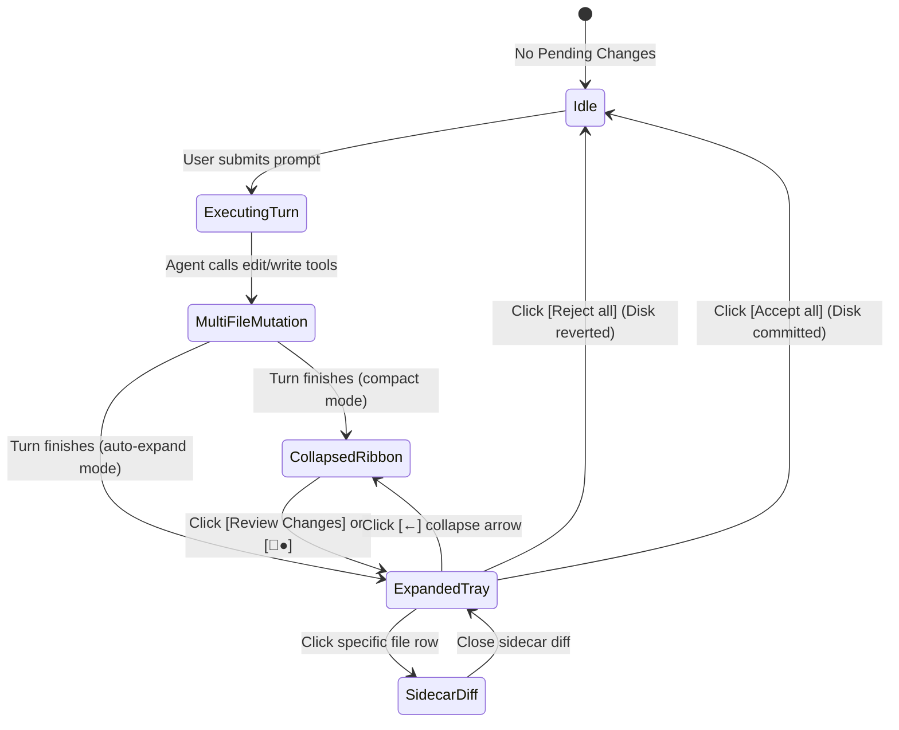

# Component Specification: Docked Review Ribbon & Staging Tray
*A Dedicated Design & Interaction Guide for Sutra UI's Ambient Staging Dock*

---

## 1. Overview & Problem Statement

In an agentic IDE workspace, the agent frequently performs multi-file mutations, runs terminal commands, generates design artifacts, and controls browser sessions. 

Traditional interfaces bury these outcomes across multiple tabs or let them scroll away in the chat stream. This leads to two critical UX failures:
1. **Accidental Prompt Collisions:** The user types a new prompt without realizing unreviewed dirty files exist on disk, causing merge conflicts or model hallucinations.
2. **Review Friction:** The user has to manually hunt through the file tree or Git tabs to approve changes.

**The Solution:** The **Docked Review Ribbon & Staging Tray** is a persistent, ambient staging dock anchored directly above the composer input box. It operates in two synchronized states:
*   **State A (Collapsed):** The **Multi-Surface Ribbon**, providing ambient peripheral awareness of where the agent touched the workspace via blue notification dots (`●`), plus a primary `[Review Changes]` action trigger.
*   **State B (Expanded):** The **Pending Changes Staging Tray**, listing every modified file with color-coded line deltas, click-to-diff row triggers, and batch decision gates (`Reject all`, `Accept all ▼`).

---

## 2. Visual Anatomy & State Representations

### State A: The Collapsed Multi-Surface Ribbon
*Used when screen real estate must be preserved, or when the agent has completed a turn and is waiting for user prompt input.*

```
┌────────────────────────────────────────────────────────────────────────────────────────┐
│  [📄●]   [>_]   [🗔●]   [🌐]                                        [📄+ Review Changes]│
├────────────────────────────────────────────────────────────────────────────────────────┤
│ |Ask anything, @ to mention, / for actions                                             │
│                                                                                        │
│ [+]  Gemini 3.8 Flash High ^                                                     🎤 [→]│
└────────────────────────────────────────────────────────────────────────────────────────┘
```

#### Left Elements: The 4 Workspace Modalities
1.  **`[📄●]` Files & Diffs Surface:**
    *   **Icon:** Document glyph.
    *   **Notification Pip (`●` Blue Dot):** Signals that unreviewed/unaccepted file modifications exist on disk.
    *   **Action:** Clicking switches editor to the diff view or toggles the Expanded Staging Tray.
2.  **`[>_]` Terminal / Process Surface:**
    *   **Icon:** Terminal prompt glyph.
    *   **Badge:** Lights up when background daemons, servers, or active CLI scripts are running.
    *   **Action:** Clicking brings the terminal drawer or command log to the front.
3.  **`[🗔●]` Artifacts & Canvas Surface:**
    *   **Icon:** Window / Canvas glyph.
    *   **Notification Pip (`●` Blue Dot):** Signals that an implementation plan, design document, or UI preview was newly generated or updated.
    *   **Action:** Clicking slides out or focuses the right-hand Artifact Canvas.
4.  **`[🌐]` Browser Subagent & Webview:**
    *   **Icon:** Chrome / Web globe glyph.
    *   **Action:** Clicking opens the live dev-server preview (`localhost:5500`) or the browser subagent viewport.

#### Right Element: The Primary Review CTA
*   **`[📄+ Review Changes]` Pill Button:** A high-contrast rounded button that acts as the primary visual magnet. Clicking it transitions the component into **State B (Expanded)**.

---

### State B: The Expanded Pending Changes Staging Tray
*Triggered by clicking `[Review Changes]` or immediately after a multi-file mutation turn completes.*

```
┌────────────────────────────────────────────────────────────────────────────────────────┐
│ [●] +88 -10  index.html        c:\Users\...\sutra-ui\index.html                        │
│ [●] +22 -14  components.css    c:\Users\...\sutra-ui\css\components.css                │
│ [●] +172 -6  main.js           c:\Users\...\sutra-ui\js\main.js                        │
│ [●] +18 -2   DESIGN_SYSTEM.md  c:\Users\...\sutra-ui\DESIGN_SYSTEM.md                  │
│ [●] +18 -0   tooltip.js        c:\Users\...\sutra-ui\js\tooltip.js                     │
├────────────────────────────────────────────────────────────────────────────────────────┤
│ [←] [📄] 5 Files With Changes                                Reject all  [Accept all ▼]│
├────────────────────────────────────────────────────────────────────────────────────────┤
│ Ask anything, @ to mention, / for actions                                              │
│                                                                                        │
│ [+]  Gemini 3.8 Flash High ^                                                    🎤 [■] │
└────────────────────────────────────────────────────────────────────────────────────────┘
```

#### Anatomy Breakdown:
1.  **File Modification Rows:**
    *   **Git Status Dot `[●]`:** Amber for modified, Green for new/added, Red for deleted.
    *   **Delta Telemetry (`+88 -10`):** Color-coded additions (emerald green) and deletions (rose red) providing an instant heuristic of change severity.
    *   **Filename & Path Hierarchy:** High-contrast, bold primary filename (`index.html`) followed by truncated, dimmed absolute/relative directory paths.
    *   **Hover & Click Behavior:** Hovering highlights the row. Clicking opens the file directly in the Sidecar Diff Inspector.
2.  **Staging Tray Header / Collapse Rail:**
    *   **`[←] [📄] 5 Files With Changes`:** Clicking the back arrow `[←]` collapses the tray back into State A.
    *   **`Reject all` Action:** A subtle, muted text button. When clicked, executes a git-backed rollback, restoring all 5 files to their clean pre-turn snapshot.
    *   **`Accept all ▼` Split Pill Button:**
        *   **Primary Action (Clicking Pill):** Accepts all staged changes, commits them to the local disk, and dismisses the tray.
        *   **Dropdown Menu (Clicking `▼`):**
            *   `Accept all & Save` (Default)
            *   `Accept all & Git Commit` (Prompts for commit message or auto-generates one)
            *   `Accept all & Run Tests` (Triggers test suite to verify changes)

---

## 3. Composer State Coordination

Notice the runtime coordination between the staging tray and the bottom-right composer button:

| Agent Execution State | Staging Tray State | Composer Action Button | Description |
| :--- | :--- | :--- | :--- |
| **Agent Executing** | Expanded or Ingesting | **Red Square `[■]` (Stop)** | The model or subagent is actively writing files or running commands. The user can abort at any second. |
| **Turn Completed / Awaiting Review** | Expanded or Collapsed with `●` | **Right Arrow `[→]` (Send / Idle)** | Execution is paused; pending changes are staged. The user can either accept/reject or type their next instruction. |

---

## 4. The Three Review Surfaces Framework

Agentic design systems must support three distinct zoom levels for reviewing code changes:

```
┌────────────────────────────────────────────────────────────────────────┐
│ 1. MICRO: In-Stream Hunk Diff                                          │
│ Inline within the chat trace. Shows local context of a single tool.   │
├────────────────────────────────────────────────────────────────────────┤
│ 2. MESO: Docked Review Tray (This Component)                          │
│ Macro-overview of all dirty files docked above composer. One-click     │
│ batch approval (Accept all / Reject all) before typing next prompt.    │
├────────────────────────────────────────────────────────────────────────┤
│ 3. MACRO: Sidecar Review Canvas                                        │
│ Full-screen split editor. Line-by-line comments, hunk accept/reject,   │
│ and deep manual editing.                                               │
└────────────────────────────────────────────────────────────────────────┘
```

---

## 5. Interaction State Machine



---

## 6. Technical Implementation Specification (TypeScript / React)

### Component Props & Types

```typescript
export interface ChangedFileItem {
  id: string;
  fileName: string;
  filePath: string;
  relativePath: string;
  additions: number;
  deletions: number;
  status: 'modified' | 'added' | 'deleted';
}

export interface SurfaceState {
  hasUnreadFiles: boolean;
  hasRunningTerminal: boolean;
  hasUnreadArtifacts: boolean;
  hasActiveBrowser: boolean;
}

export interface DockedReviewDockProps {
  /** List of currently dirty/staged files modified by the agent */
  changedFiles: ChangedFileItem[];
  /** Surface notification status */
  surfaces: SurfaceState;
  /** Whether the tray is expanded showing the file list or collapsed into the ribbon */
  isExpanded: boolean;
  /** State toggles */
  onToggleExpand: () => void;
  /** Surface navigation callbacks */
  onSelectSurface: (surface: 'files' | 'terminal' | 'artifacts' | 'browser') => void;
  /** File click handler to open deep-dive diff */
  onOpenFileDiff: (file: ChangedFileItem) => void;
  /** Batch resolution actions */
  onAcceptAll: (mode: 'save' | 'commit' | 'test') => void;
  onRejectAll: () => void;
}
```

---

## 7. Design Tokens & Styling Guide (Sutra UI)

| Token / Element | Recommended CSS / Style | Purpose |
| :--- | :--- | :--- |
| **Dock Background** | `rgba(24, 24, 27, 0.95)` / `#18181b` | Sleek dark glassmorphism docked above composer |
| **Border Divider** | `1px solid rgba(255, 255, 255, 0.08)` | Subtle demarcation from chat stream and composer |
| **Notification Dot (`●`)** | `#3b82f6` (Blue-500) with `box-shadow: 0 0 8px #3b82f6` | Ambient glow indicating unreviewed output |
| **Additions Badge (`+88`)** | `#10b981` (Emerald-500), Monospace, 12px | High-visibility addition counter |
| **Deletions Badge (`-10`)** | `#ef4444` (Rose-500), Monospace, 12px | High-visibility deletion counter |
| **Filename** | `#f4f4f5` (Zinc-100), Semi-bold, 13px | Primary text legibility |
| **File Path** | `#71717a` (Zinc-500), Regular, 11px | Truncated secondary context (`text-overflow: ellipsis`) |
| **Accept All Button** | `#2563eb` (Blue-600) hover `#1d4ed8` | Primary pill button with crisp white typography |
| **Reject All Button** | `#a1a1aa` (Zinc-400) hover `#ef4444` | Subtle until hovered to prevent accidental deletion |

---

## 8. UX Edge Cases & Accessibility

1. **Large Number of Files (15+ Changes):**
   * Do not let the expanded tray consume the entire viewport. Cap maximum height at `240px` with an internal smooth scrollbar and a sticky header/footer.
2. **Long File Paths:**
   * Always prioritize the file name on the left; apply middle or left truncation to the path (`.../sutra-ui/css/components.css`).
3. **Keyboard Accessibility:**
   * `Cmd/Ctrl + Shift + R`: Toggle the review tray open/closed.
   * `Cmd/Ctrl + Enter` (while tray focused): Trigger `Accept all`.
   * `Escape`: Collapse tray back to the ribbon.
4. **Zero-File Transition:**
   * When `Accept all` or `Reject all` is clicked, animate the tray closing with a smooth 150ms ease-out transition back to an idle composer state.
