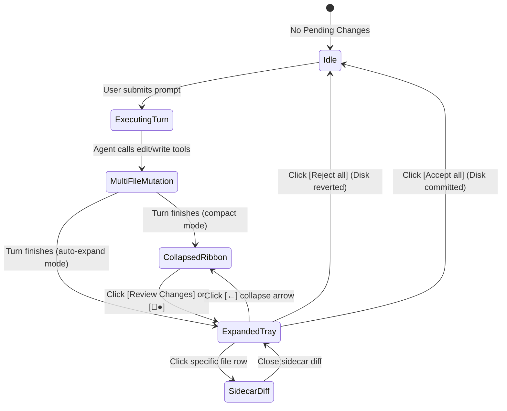
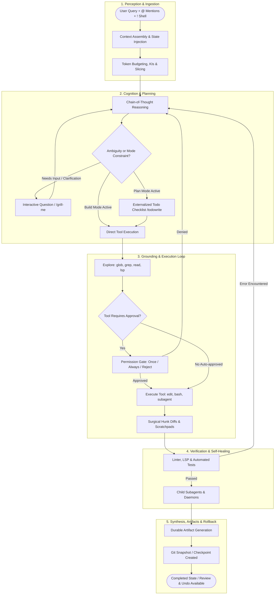

# Unified Agentic AI UX Architecture & Deep Interface Synthesis
*A Comprehensive Analysis and Master Synthesis of Sutra UI Specifications, Google Antigravity Architecture, and OpenCode Agent Runtime Research*

---

## Executive Overview

This document synthesizes and unifies the architectural models, design systems, interface specifications, and gap analyses documented across three foundational research artifacts:
1. **Docked Review Ribbon & Staging Tray Specification** (`docked-review-ribbon-specification.md`)
2. **Agentic AI UX Architecture & Design Blueprint** (`agentic_ai_ux_architecture_guide.md`)
3. **OpenCode Agent Interface Deep Research & Workspace Mapping** (`opencode-agent-interface-research.md`)

Together, these documents form the blueprint for building next-generation, agent-first developer workspaces (such as **Project Sutra** and Google Antigravity-style agent managers).

---

## Table of Contents
- [1. Master Architectural Paradigm & System Synthesis](#1-master-architectural-paradigm--system-synthesis)
  - [1.1 The Shift from Chatbots to Cognitive Runtimes](#11-the-shift-from-chatbots-to-cognitive-runtimes)
  - [1.2 The Dual-Surface Split: Chat Stream vs. Artifact Canvas](#12-the-dual-surface-split-chat-stream-vs-artifact-canvas)
  - [1.3 The Architectural Law: The Typed Part Model](#13-the-architectural-law-the-typed-part-model)
  - [1.4 The Desk Metaphor for Context Window Management](#14-the-desk-metaphor-for-context-window-management)
- [2. Component Specification: Docked Review Ribbon & Staging Tray](#2-component-specification-docked-review-ribbon--staging-tray)
  - [2.1 Problem Statement & UX Failures Solved](#21-problem-statement--ux-failures-solved)
  - [2.2 Dual-State Anatomy: State A (Ribbon) vs. State B (Staging Tray)](#22-dual-state-anatomy-state-a-ribbon-vs-state-b-staging-tray)
  - [2.3 Composer Action Button Coordination](#23-composer-action-button-coordination)
  - [2.4 The Three Review Surfaces Framework (Micro, Meso, Macro)](#24-the-three-review-surfaces-framework-micro-meso-macro)
  - [2.5 Interaction State Machine & TypeScript Contracts](#25-interaction-state-machine--typescript-contracts)
  - [2.6 Design Tokens & Accessibility Guidelines](#26-design-tokens--accessibility-guidelines)
- [3. Master Agentic UX Architecture Blueprint](#3-master-agentic-ux-architecture-blueprint)
  - [3.1 The 9 Lifecycle Phases & Non-Linear Realities](#31-the-9-lifecycle-phases--non-linear-realities)
  - [3.2 The 14 Discrete States of an Agentic Interface](#32-the-14-discrete-states-of-an-agentic-interface)
  - [3.3 Security Guards & The 3-Tier Permission Hierarchy](#33-security-guards--the-3-tier-permission-hierarchy)
  - [3.4 The 13 Sutra UI Core Component Specifications](#34-the-13-sutra-ui-core-component-specifications)
  - [3.5 The 16 Agentic UX Anti-Patterns](#35-the-16-agentic-ux-anti-patterns)
- [4. OpenCode Agent Interface Research & Comparative Audit](#4-opencode-agent-interface-research--comparative-audit)
  - [4.1 Positioning: OpenCode vs. Cursor vs. Antigravity](#41-positioning-opencode-vs-cursor-vs-antigravity)
  - [4.2 Control at Four Critical Moments](#42-control-at-four-critical-moments)
  - [4.3 Comprehensive Element-by-Element Mapping against `src/components/ag/`](#43-comprehensive-element-by-element-mapping-against-srccomponentsag)
- [5. Prioritized Actionable Backlog for Sutra UI](#5-prioritized-actionable-backlog-for-sutra-ui)
  - [5.1 Priority P0: Core Agent-Loop Credibility](#51-priority-p0-core-agent-loop-credibility)
  - [5.2 Priority P1: Trust, Orientation & Reversibility](#52-priority-p1-trust-orientation--reversibility)
  - [5.3 Priority P2: Scale, Extensibility & Polish](#53-priority-p2-scale-extensibility--polish)
  - [5.4 Deliberate Non-Goals](#54-deliberate-non-goals)
- [6. Worked Traces & Runtime Flow Comparisons](#6-worked-traces--runtime-flow-comparisons)
  - [6.1 Autonomous Loop with Self-Healing](#61-autonomous-loop-with-self-healing)
  - [6.2 Permission Denied & Recovery Loop](#62-permission-denied--recovery-loop)
  - [6.3 Transition to the Meso Staging Dock](#63-transition-to-the-meso-staging-dock)
- [7. Core Takeaways & Architectural Principles](#7-core-takeaways--architectural-principles)

---

## 1. Master Architectural Paradigm & System Synthesis

### 1.1 The Shift from Chatbots to Cognitive Runtimes
Traditional conversational chatbots are turn-based, text-in/text-out interfaces. By contrast, an **Agentic AI interface** governs an autonomous, stateful cognitive kernel that:
1. **Perceives:** Assembles dynamic workspace context, open buffers, git status, environment variables, and project constraints.
2. **Reasons:** Generates extended Chain-of-Thought (CoT) tokens to formulate testable hypotheses.
3. **Acts:** Invokes tools within sandboxed shells (reading code, executing terminal commands, modifying files, spawning browser subagents).
4. **Verifies:** Executes automated linters, compilers, and test suites to evaluate outcomes.
5. **Self-Heals:** Feeds errors back into context as first-class observations to autonomously repair code without human intervention.
6. **Synthesizes:** Creates durable artifacts (plans, diffs, prototypes) and checkpoints filesystem snapshots for full reversibility.

### 1.2 The Dual-Surface Split: Chat Stream vs. Artifact Canvas
Modern agent workspaces decouple temporal execution from durable outcomes:

```
┌──────────────────────────────────────────┬──────────────────────────────────────────┐
│             THE CHAT STREAM              │           THE ARTIFACT CANVAS            │
│         (Ephemeral & Temporal)           │          (Persistent & Durable)          │
├──────────────────────────────────────────┼──────────────────────────────────────────┤
│ • Chronological timeline of dialogue     │ • Pinned living documents & specifications│
│ • In-place mutating tool rows            │ • Live code & multi-file diff inspectors │
│ • Reasoning / Chain-of-Thought drawers   │ • Interactive prototype canvases / iframes│
│ • Interactive human-in-the-loop prompts  │ • Executable implementation plans        │
│ • Child-session subagent drill-downs     │ • Multi-step walkthrough carousels       │
│ • Compaction & checkpoint markers        │ • Session-level change reviews & undo    │
└──────────────────────────────────────────┴──────────────────────────────────────────┘
```

### 1.3 The Architectural Law: The Typed Part Model
The UI must **never** treat the agent stream as plain text strings or append dummy chat bubbles to indicate state changes:
* An agent turn is an ordered sequence of discrete, typed **Message Parts**:
  * `ReasoningPart`: Extended thinking tokens with elapsed timer and collapse state.
  * `ToolCallPart`: Tool name, target arguments, and execution state (`proposed` $\rightarrow$ `awaiting_permission` $\rightarrow$ `running` $\rightarrow$ `completed` / `error` / `denied`).
  * `ToolResultPart`: Truncated stdout/stderr, return code, line counts, or error stack.
  * `TodoPart`: Externalized task state (`pending`, `in_progress`, `completed`, `cancelled`).
  * `SystemMarkerPart`: Compaction events, git checkpoints, retry loops, interruptions.
* **The In-Place Mutation Law:** When a tool completes or streaming ends, the UI mutates the existing part's state in-place. The transcript is a projection of an event-driven state machine, not an append-only log.

### 1.4 The Desk Metaphor for Context Window Management
Context is a finite physical desk. The runtime packages information into strict tiers:
* **Static Layer:** System prompt, agent identity, dynamic project rules (`AGENTS.md`), tool schemas.
* **Skills Catalog:** Names, descriptions, and file paths only (~cheap indexing). Full `SKILL.md` bodies are loaded on-demand via the `skill` tool.
* **Conversational Layer:** User prompt, fuzzy `@` file mentions, image attachments, `!` inline shell executions.
* **Acquired Layer:** Results fetched via `glob`, `grep`, `read` (with line/byte slices), `lsp`, and `websearch`.
* **Dynamic Planning State:** The live `todowrite` checklist that is re-read by the model on every single turn to prevent plan drift.
* **Compressed Layer:** Compacted conversational summaries generated when context pressure exceeds ~85%.

---

## 2. Component Specification: Docked Review Ribbon & Staging Tray

### 2.1 Problem Statement & UX Failures Solved
In an agentic IDE workspace, the agent mutates files, runs terminal commands, generates design artifacts, and controls browser sessions. Traditional interfaces bury these outcomes across multiple tabs or let them scroll away in the chat stream, causing two major UX failures:
1. **Accidental Prompt Collisions:** The user types a new prompt without realizing unreviewed dirty files exist on disk, causing merge conflicts or model hallucinations.
2. **Review Friction:** The user has to manually hunt through the file tree or Git tabs to approve changes.

**The Solution:** The **Docked Review Ribbon & Staging Tray** is a persistent, ambient staging dock anchored directly above the composer input box.

### 2.2 Dual-State Anatomy: State A (Ribbon) vs. State B (Staging Tray)

#### State A: The Collapsed Multi-Surface Ribbon
Used when screen real estate must be preserved, or when the agent has completed a turn and is waiting for user prompt input.

```
┌────────────────────────────────────────────────────────────────────────────────────────┐
│  [📄●]   [>_]   [🗔●]   [🌐]                                        [📄+ Review Changes]│
├────────────────────────────────────────────────────────────────────────────────────────┤
│ Ask anything, @ to mention, / for actions                                              │
│                                                                                        │
│ [+]  Gemini 3.8 Flash High ^                                                     🎤 [→]│
└────────────────────────────────────────────────────────────────────────────────────────┘
```

**Left Elements: The 4 Workspace Modalities**
1. `[📄●]` **Files & Diffs Surface:**
   * Icon: Document glyph.
   * Notification Pip (`●` Blue Dot): Signals unreviewed/unaccepted file modifications on disk.
   * Action: Clicking switches editor to the diff view or toggles the Expanded Staging Tray.
2. `[>_]` **Terminal / Process Surface:**
   * Icon: Terminal prompt glyph.
   * Badge: Lights up when background daemons, servers, or active CLI scripts are running.
   * Action: Clicking brings the terminal drawer or command log forward.
3. `[🗔●]` **Artifacts & Canvas Surface:**
   * Icon: Window / Canvas glyph.
   * Notification Pip (`●` Blue Dot): Signals that an implementation plan, design document, or UI preview was newly generated or updated.
   * Action: Clicking slides out or focuses the right-hand Artifact Canvas.
4. `[🌐]` **Browser Subagent & Webview:**
   * Icon: Chrome / Web globe glyph.
   * Action: Clicking opens the live dev-server preview (`localhost:5500`) or browser subagent viewport.

**Right Element: Primary Review CTA**
* `[📄+ Review Changes]` Pill Button: High-contrast rounded button that transitions the component into **State B (Expanded)**.

---

#### State B: The Expanded Pending Changes Staging Tray
Triggered by clicking `[Review Changes]`, `[📄●]`, or immediately after a multi-file mutation turn completes.

```
┌────────────────────────────────────────────────────────────────────────────────────────┐
│ [●] +88 -10  index.html        c:\Users\...\sutra-ui\index.html                        │
│ [●] +22 -14  components.css    c:\Users\...\sutra-ui\css\components.css                │
│ [●] +172 -6  main.js           c:\Users\...\sutra-ui\js\main.js                        │
│ [●] +18 -2   DESIGN_SYSTEM.md  c:\Users\...\sutra-ui\DESIGN_SYSTEM.md                  │
│ [●] +18 -0   tooltip.js        c:\Users\...\sutra-ui\js\tooltip.js                     │
├────────────────────────────────────────────────────────────────────────────────────────┤
│ [←] [📄] 5 Files With Changes                                Reject all  [Accept all ▼]│
├────────────────────────────────────────────────────────────────────────────────────────┤
│ Ask anything, @ to mention, / for actions                                              │
│                                                                                        │
│ [+]  Gemini 3.8 Flash High ^                                                    🎤 [■] │
└────────────────────────────────────────────────────────────────────────────────────────┘
```

**Anatomy Breakdown:**
1. **File Modification Rows:**
   * **Git Status Dot `[●]`:** Amber for modified, Green for new/added, Red for deleted.
   * **Delta Telemetry (`+88 -10`):** Color-coded additions (emerald green) and deletions (rose red) providing an instant heuristic of change severity.
   * **Filename & Path Hierarchy:** High-contrast, bold primary filename (`index.html`) followed by truncated, dimmed directory paths.
   * **Hover & Click Behavior:** Hover highlights row. Clicking opens the file directly in the Sidecar Diff Inspector.
2. **Staging Tray Header / Collapse Rail:**
   * `[←] [📄] 5 Files With Changes`: Clicking the back arrow `[←]` collapses the tray back into State A.
   * `Reject all` Action: Muted text button. When clicked, executes a git-backed rollback, restoring all dirty files to their clean pre-turn snapshot.
   * `Accept all ▼` Split Pill Button:
     * **Primary Action:** Accepts all staged changes, commits them to the local disk, and dismisses the tray.
     * **Dropdown Menu (`▼`):**
       * `Accept all & Save` (Default).
       * `Accept all & Git Commit` (Prompts for commit message or auto-generates one).
       * `Accept all & Run Tests` (Triggers test suite to verify changes).

### 2.3 Composer Action Button Coordination
The composer button state machine coordinates tightly with the staging tray:

| Agent Execution State | Staging Tray State | Composer Action Button | Description |
| :--- | :--- | :--- | :--- |
| **Agent Executing** | Expanded or Ingesting | **Red Square `[■]` (Stop)** | The model or subagent is actively writing files or running commands. The user can abort at any second. |
| **Turn Completed / Awaiting Review** | Expanded or Collapsed with `●` | **Right Arrow `[→]` (Send / Idle)** | Execution is paused; pending changes are staged. The user can either accept/reject or type their next instruction. |

### 2.4 The Three Review Surfaces Framework
Agentic design systems must support three distinct zoom levels for reviewing code changes:
1. **MICRO (In-Stream Hunk Diff):** Inline within the chat trace. Shows local context of a single tool.
2. **MESO (Docked Review Tray):** Macro-overview of all dirty files docked above composer. One-click batch approval before typing the next prompt.
3. **MACRO (Sidecar Review Canvas):** Full-screen split editor. Line-by-line comments, hunk accept/reject, and deep manual editing.

### 2.5 Interaction State Machine & TypeScript Contracts



```typescript
export interface ChangedFileItem {
  id: string;
  fileName: string;
  filePath: string;
  relativePath: string;
  additions: number;
  deletions: number;
  status: 'modified' | 'added' | 'deleted';
}

export interface SurfaceState {
  hasUnreadFiles: boolean;
  hasRunningTerminal: boolean;
  hasUnreadArtifacts: boolean;
  hasActiveBrowser: boolean;
}

export interface DockedReviewDockProps {
  /** List of currently dirty/staged files modified by the agent */
  changedFiles: ChangedFileItem[];
  /** Surface notification status */
  surfaces: SurfaceState;
  /** Whether the tray is expanded showing the file list or collapsed into the ribbon */
  isExpanded: boolean;
  /** State toggles */
  onToggleExpand: () => void;
  /** Surface navigation callbacks */
  onSelectSurface: (surface: 'files' | 'terminal' | 'artifacts' | 'browser') => void;
  /** File click handler to open deep-dive diff */
  onOpenFileDiff: (file: ChangedFileItem) => void;
  /** Batch resolution actions */
  onAcceptAll: (mode: 'save' | 'commit' | 'test') => void;
  onRejectAll: () => void;
}
```

### 2.6 Design Tokens & Accessibility Guidelines

| Token / Element | Recommended CSS / Style | Purpose |
| :--- | :--- | :--- |
| **Dock Background** | `rgba(24, 24, 27, 0.95)` / `#18181b` | Sleek dark glassmorphism docked above composer |
| **Border Divider** | `1px solid rgba(255, 255, 255, 0.08)` | Subtle demarcation from chat stream and composer |
| **Notification Dot (`●`)** | `#3b82f6` with `box-shadow: 0 0 8px #3b82f6` | Ambient glow indicating unreviewed output |
| **Additions Badge (`+88`)** | `#10b981` (Emerald-500), Monospace, 12px | High-visibility addition counter |
| **Deletions Badge (`-10`)** | `#ef4444` (Rose-500), Monospace, 12px | High-visibility deletion counter |
| **Filename** | `#f4f4f5` (Zinc-100), Semi-bold, 13px | Primary text legibility |
| **File Path** | `#71717a` (Zinc-500), Regular, 11px | Truncated secondary context (`text-overflow: ellipsis`) |
| **Accept All Button** | `#2563eb` (Blue-600) hover `#1d4ed8` | Primary pill button with crisp white typography |
| **Reject All Button** | `#a1a1aa` (Zinc-400) hover `#ef4444` | Subtle until hovered to prevent accidental deletion |

**Edge Cases & Accessibility:**
* **Large File Counts (15+ Changes):** Cap height at `240px` with an internal smooth scrollbar and sticky headers/footers.
* **Long Paths:** Middle or left truncation (`.../sutra-ui/css/components.css`).
* **Keyboard Navigation:**
  * `Cmd/Ctrl + Shift + R`: Toggle the review tray open/closed.
  * `Cmd/Ctrl + Enter`: Trigger `Accept all`.
  * `Escape`: Collapse tray back to State A.
* **Zero-File Transition:** 150ms ease-out dismiss transition back to idle composer state.

---

## 3. Master Agentic UX Architecture Blueprint

### 3.1 The 9 Lifecycle Phases & Non-Linear Realities



**Non-Linear Realities:**
* Reasoning, text, and tool calls **interleave** within one turn.
* The model can emit **multiple tool calls** in parallel that execute asynchronously and return out of order.
* The plan adapts mid-loop as new evidence arrives.
* Tool errors re-enter context as model-visible observations, initiating an autonomous corrective loop.

### 3.2 The 14 Discrete States of an Agentic Interface

| State ID | State Name | Trigger / Condition | Visual Indicator | Available User Actions |
| :--- | :--- | :--- | :--- | :--- |
| `ST-01` | **Idle** | Ready for instruction | Prompt box with `@`, `/`, `!` hints | Enter prompt, toggle mode (Build/Plan/Ask), attach files |
| `ST-02` | **Ingesting Context** | Prompt sent; packaging workspace state | Pulsing breadcrumb: `Assembling context...` | Cancel |
| `ST-03` | **Streaming Reasoning** | Extended thinking tokens generating | Collapsible drawer: `Thinking (3.4s)...` | Collapse/Expand, Abort |
| `ST-04` | **Exploring** | Calling `glob`, `grep`, `read`, `lsp` | One-line activity ticker with item count | Expand raw query, Abort |
| `ST-05` | **Tool Proposed** | Tool call emitted; awaiting execution | Neutral badge: `[Proposed: bash npm test]` | Inspect payload |
| `ST-06` | **Tool Running** | Active process executing in sandbox | Pulsing spinner + elapsed timer (`4.2s`) | Abort, Send Input (stdin) |
| `ST-07` | **Tool Complete** | Process exited with code 0 | Green check + summary (`2 files changed`) | Expand output, view diff |
| `ST-08` | **Tool Error / Self-Healing**| Process failed (exit $\neq$ 0) or linter error | Amber retry badge: `Type error, self-correcting...` | Inspect error trace, Abort |
| `ST-09` | **Blocked: Permission** | Action requires elevation | Yellow alert card with command & diff preview | Allow Once, Always Allow, Reject |
| `ST-10` | **Blocked: Question** | Agent called `ask_question` | Radio/Checkbox choice card with write-in box | Select choice, Submit, Skip |
| `ST-11` | **Subagent Running** | Child task spawned | Nested worker card with session link & mini-log | Drill down into child session, Cancel subagent |
| `ST-12` | **Compacting Memory** | Context window threshold reached | Compact banner: `Memory compacted (92% → 38%)` | Expand summary details |
| `ST-13` | **Interrupted / Cancelled**| User clicked Abort or sent steer input | Muted stop badge: `Action aborted by user` | Resume, Steer, Undo |
| `ST-14` | **Completed & Checkpointed**| Work finished, verification passed | Green success pill + `[View Diff]` + `[Undo Turn]` | Undo/Redo, Export, Review diff |

### 3.3 Security Guards & The 3-Tier Permission Hierarchy

#### The 3 Safety Guards
1. **Doom-Loop Guard:** If the agent emits identical tool calls with identical arguments repeatedly, the runtime halts execution and flags a warning.
2. **Secret / `.env` Guard:** Access to `.env`, credentials, and private keys is blocked by default (`.env.example` is allowed).
3. **External Path Guard:** Any file read or write outside the active repository root triggers an explicit permission block.

#### The 3-Tier Permission Hierarchy
```
┌────────────────────────────────────────────────────────────────────────┐
│ TIER 1: Auto-Approved (Zero Friction)                                 │
│ Sandboxed reads, repo greps, LSP queries, workspace file edits.       │
│ UI: Ambient, single-line collapsible tool rows.                       │
├────────────────────────────────────────────────────────────────────────┤
│ TIER 2: Pattern-Matched Auto-Approval (Learned Trust)                  │
│ Commands matching previously approved shapes (e.g. `npm run test *`).  │
│ UI: Subtle indicator badge ("Auto-approved via session rule").         │
├────────────────────────────────────────────────────────────────────────┤
│ TIER 3: Explicit Gatekeeping (High Friction, High Safety)              │
│ External network calls, git push, package publishing, destructive rm, │
│ accessing files outside workspace, sandbox bypass.                     │
│ UI: High-contrast modal banner with command preview & diff preview.   │
└────────────────────────────────────────────────────────────────────────┘
```

### 3.4 The 13 Sutra UI Core Component Specifications
1. `ModeSwitcher`: Segmented control in composer (`Build` / `Plan` / `Ask`).
2. `ComposerInputGrammar`: Autocomplete dropdown for `@` files/agents, `!` shell execution, `/` slash commands, and worktree toggles.
3. `ContextRingGauge`: Visualizes context window usage (`42k / 128k`, percentage ring).
4. `ReasoningDrawer`: Collapsible row displaying Chain-of-Thought tokens with elapsed timer.
5. `GenericToolRow`: Single-line record (`[Icon] [Verb] [Target] ─── [Outcome/Time]`), expandable to arguments and raw stdout/stderr.
6. `LiveTodoChecklist`: Shared boundary object rendering `pending`, `in_progress`, `completed`, and `cancelled` items.
7. `PermissionGateCard`: Structured elevation prompt with syntax-highlighted command, diff preview, and `[Allow Once]`, `[Always Allow]`, `[Reject]` actions.
8. `InteractiveQuestionCard`: Structured multiple-choice/checkbox prompt with `(Recommended)` flags and custom write-in input.
9. `SubagentWorkerCard`: Child runtime status card with direct drill-down link to the child session transcript.
10. `CompactionMarker`: Divider explaining context compression (`⚡ Context compacted (92% → 41%) • 14 messages summarized`).
11. `UndoRollbackBar`: Completion bar offering one-click `[Undo Turn & Revert Files]`.
12. `RuntimeSteerBar`: Sticky execution footer with `[Pause]`, `[Abort]`, and high-priority steer text input.
13. `DockedReviewTray`: The Meso staging dock anchoring pending changes directly above the composer.

### 3.5 The 16 Agentic UX Anti-Patterns
1. *The Infinite Spinner* (spinning with no elapsed time or activity label).
2. *Disappearing Error Toasts* (flashing build errors in auto-dismissing toasts).
3. *Wall of Chain-of-Thought* (dumping unformatted reasoning monologues into chat).
4. *Silent Actions* (mutating disk or running bash without a trace row).
5. *Context-Obscuring Modals* (dialogs that block the code needed to make a decision).
6. *Auto-Scroll Hijacking* (forcing viewport down while the user tries to read earlier diffs).
7. *Fake / Linear Steppers* (forcing a rigid wizard UI over an iterative ReAct loop).
8. *"Done" Without Verification* (declaring completion without running tests/linters).
9. *Permission Gates Without Previews* (asking for approval without showing command or diff).
10. *Irreversible Mutations* (editing code without git snapshots or undo affordances).
11. *Nested Subagent Clutter* (flooding parent chat with child agent micro-steps).
12. *Alarmist Token Meters* (red gauges without explanations or compaction options).
13. *Anthropomorphic "Thinking" Theatre* (artificial delays and conversational fluff).
14. *Hiding Tool Output* (concealing stdout/stderr so users cannot diagnose errors).
15. *Uninterruptible Runs* (no pause, steer, or abort controls during execution).
16. *Plan Drift* (abandoning todo items midway without updating status or explaining why).

---

## 4. OpenCode Agent Interface Research & Comparative Audit

### 4.1 Positioning: OpenCode vs. Cursor vs. Antigravity
* **Cursor:** Optimizes for an IDE-integrated agent with a rich inline diff review surface.
* **OpenCode:** Optimizes for a **transparent, composable agent runtime** with an OpenAPI server and terminal-first client.
* **Antigravity / Sutra UI:** Desktop-style Agent Manager with a three-pane shell (Rail on left, Conversation in middle, Artifact Canvas on right), combining OpenCode's event-stream transparency with Cursor's deep review canvas.

### 4.2 Control at Four Critical Moments
1. **Before work starts:** `@` context references, `AGENTS.md` project rules, skills catalog, agent mode (Build/Plan), model variant, permission rules.
2. **While work runs:** Streaming reasoning, 1-line tool rows, live todos, permission gates, structured questions, abort/steer.
3. **After work finishes:** Diffs, verification results, session diffs, undo/redo, revert, export.
4. **Across many tasks:** Session resume, child sessions, compaction summaries, auto-titles, peripheral attention notifications.

### 4.3 Comprehensive Element-by-Element Mapping against `src/components/ag/`

#### 1. Shell & Navigation
* `app-header.tsx`: App identity, logo, version badge, avatar $\rightarrow$ **Implemented**.
* Header `SquarePen` + sidebar "New Conversation": Start fresh work $\rightarrow$ **Implemented** (mock: selects first thread).
* `chrome-dialogs.tsx` (`HistoryDialog`) + sidebar "Conversation History": Session history $\rightarrow$ **Partial** (flat mock list, no search/filter).
* `sidebar-left.tsx`: Projects and threads under active project $\rightarrow$ **Partial** (mock data, only one project has threads).
* `STATUS_DOT`: Status indicators $\rightarrow$ **Partial** (has pulse/warning/muted; lacks "needs attention" count or filter).
* `PROJECTS` dropdown in composer: Workspace routing $\rightarrow$ **Partial** (hardcoded mock data, disconnected from workspace state).
* `SettingsDialog`: User preferences $\rightarrow$ **Partial** (dark mode, default model, worktrees; lacks approval policy or run modes).
* `ChromeToast`: Non-blocking alerts $\rightarrow$ **Partial** (exported in code, completely unused).
* `RestartDialog` & `OpenIdeDialog`: Update and editor handoff $\rightarrow$ **Partial** (dialogs exist, header buttons un-wired).
* Plans sidebar, Child session list, Command palette $\rightarrow$ **Missing**.

#### 2. Thread & Timeline
* `thread-view.tsx` right-aligned bubble: User prompts $\rightarrow$ **Implemented**.
* `note.workedFor`: Elapsed time label $\rightarrow$ **Partial** (no reasoning text body, no toggle).
* `note` message kind: Assistant prose $\rightarrow$ **Implemented**.
* `working` kind + `Spinner` + `aria-live`: Live activity ticker $\rightarrow$ **Implemented**.
* `folders` and `files` collapsibles: Tool calls $\rightarrow$ **Partial** (specialized mock kinds; no generic tool row, no raw stdout/stderr).
* File names + line ranges: Tool results $\rightarrow$ **Partial** (labels only; no truncation markers, no full-output path).
* Edit/diff chips: File mutations $\rightarrow$ **Partial** (only in `artifact-tabs.tsx`, absent from the thread).
* `permission-card.tsx`: Human gate $\rightarrow$ **Partial** (displays command and Blocked badge; lacks Once/Always/Reject, lacks reason banner, lacks diff preview).
* Subagent cards: Visual delegation $\rightarrow$ **Implemented** (visually polished running/done cards; no real child session transcript).
* Clarifying questions, Queued messages, Steering, Stop/Abort, Checkpoints, Todo checklist, Compaction markers, Error/Retry states, Walkthrough links $\rightarrow$ **Missing / Non-functional**.

#### 3. Composer
* Auto-grow textarea with Enter-send $\rightarrow$ **Implemented** (160px cap, Shift+Enter for newline).
* Project selector $\rightarrow$ **Implemented** (mock dropdown).
* Model selector $\rightarrow$ **Implemented** (model dropdown).
* Reasoning effort $\rightarrow$ **Partial** (static `(High)` text suffix).
* `@` mention autocomplete, `/` command palette, `!` shell execution $\rightarrow$ **Missing** (placeholders only).
* Attachment and mic buttons $\rightarrow$ **Partial** (visual icon stubs).
* Local vs Worktree toggle $\rightarrow$ **Implemented** (mock dropdown).
* Context ring gauge, Queue while running, Stop/Abort button, Auto-mode indicator $\rightarrow$ **Missing**.

#### 4. Permission & Control
* Permission card visual $\rightarrow$ **Implemented** (`permission-card.tsx`).
* Command preview $\rightarrow$ **Implemented** (`$ command` string).
* Once / Always / Reject $\rightarrow$ **Partial** (only binary Approve / Deny).
* Reason / "Why paused" $\rightarrow$ **Partial** ("Permission required" label only).
* Diff preview inside permission gate $\rightarrow$ **Missing**.
* Granular policy rules, Auto mode, Doom-loop guard, External path guard, `.env` protection $\rightarrow$ **Missing**.
* Denial feedback loop $\rightarrow$ **Partial** (mock injects denial text).

#### 5. Plan, Artifact, and Review
* `artifact-panel.tsx` with Overview / Plan / Review tabs $\rightarrow$ **Implemented**.
* `PlanTab`: Review-before-code plan $\rightarrow$ **Partial** (static read-only plan with User Review Required and Open Questions; not editable).
* "Proceed" button in plan footer $\rightarrow$ **Implemented** (mock visual toggle).
* Task progress $\rightarrow$ **Partial** (static 3/5 `Progress` bar).
* Overview sections: Subagents, Files Changed, Artifacts, Background Tasks $\rightarrow$ **Implemented** (mock data).
* `ReviewPane` diff viewer $\rightarrow$ **Partial** (mock diff; no accept/reject controls, fake diff content).
* Review comments thread $\rightarrow$ **Implemented** (inline commenting and "Post comment" interaction).
* Automated verification checks, Session-level diffs, Reusable plan library, Checkpoint restoration $\rightarrow$ **Missing**.

#### 6. Memory, Recovery & Cross-Cutting
* Session list and resume $\rightarrow$ **Partial** (sidebar and dialog exist with static mock titles).
* Session summaries, Compaction, Undo/Redo (`/undo`), Snapshots, Export/Share/Fork, Max step limits, Cost readouts $\rightarrow$ **Missing**.
* Subagent child sessions, Skills indexing, `AGENTS.md` project rules, MCP/LSP tools, Sound/Attention settings $\rightarrow$ **Missing**.
* Accessibility $\rightarrow$ **Partial** (good foundations: `aria-live` on working ticker, `aria-label`s on icon buttons, `MotionConfig reducedMotion="user"`, focus-visible rings).

---

## 5. Prioritized Actionable Backlog for Sutra UI

### 5.1 Priority P0: Core Agent-Loop Credibility
1. **Composer Mode Switcher (`Build` / `Plan` / `Ask`):** Add segmented control in composer header to gate tool capabilities.
2. **Stop / Abort + Runtime Steering:** Replace send button with Red Square `[■]` during execution; add steer input to redirect running turns.
3. **True Permission Semantics:** Upgrade `permission-card.tsx` to support `Allow Once`, `Always Allow [pattern]`, and `Reject`, with a clear explanation reason and diff preview.
4. **Reasoning Drawer & Generic Tool Row:** Build atomic message parts: collapsible thinking drawer (`Thinking (3.2s)...`) and a generic `[Icon] [Verb] [Target] [Outcome]` tool row expandable to arguments and raw stdout/stderr.
5. **Live Todo Checklist:** Replace static 3/5 progress bar with an interactive `LiveTodoChecklist` (`pending`, `in_progress`, `completed`, `cancelled`).
6. **Editable Plan & Actionable Proceed Gate:** Make the plan document editable so users can refine steps before clicking Proceed.

### 5.2 Priority P1: Trust, Orientation & Reversibility
7. **Git Checkpoints & One-Click Undo (`/undo`):** Snapshot workspace state before multi-file edits; provide instant rollback in the completion bar.
8. **Context Ring Gauge & Compaction Marker:** Circular percentage meter in composer and in-stream divider explaining memory summarization.
9. **Inline Tool Errors & Self-Healing Traces:** Show compiler/typecheck errors directly inside tool rows with retry badges.
10. **Structured Question Card:** Render multiple-choice options with write-in inputs when the agent calls `ask_question`.
11. **Diff Accept / Reject Controls:** Add row-level and batch approval to the review surface.
12. **Wire Orphaned Chrome:** Connect `RestartDialog`, `OpenIdeDialog`, and `ChromeToast`.

### 5.3 Priority P2: Scale, Extensibility & Polish
13. **Subagent Child Sessions:** Enable clicking subagent cards to slide out and inspect isolated child transcripts.
14. **Composer Grammar Engine:** Implement autocomplete for `@` files/agents, `/` slash commands, and `!` shell executions.
15. **Context & Rules Inspector:** Panel surfacing active `AGENTS.md` rules, indexed skills, and connected MCP servers.
16. **Session Export, Share & Fork:** Export session transcripts as JSONL or markdown.
17. **Model Reasoning Effort Variants:** Cycle through low/medium/high reasoning effort.
18. **Peripheral Attention & Audio Cues:** Subtle non-intrusive sounds and blurred-window notifications for permissions and completion.

### 5.4 Deliberate Non-Goals
* Full terminal emulator or custom editor fork.
* Provider management and enterprise billing controls.
* Cloud agent fleet orchestration before the single-agent loop is verified.
* Complex multi-agent worktree orchestration before the control surface is credible.

---

## 6. Worked Traces & Runtime Flow Comparisons

### 6.1 Autonomous Loop with Self-Healing
```
User: > Add a dark mode toggle to the settings page

[ST-03] | Thinking (2.1s)                              [collapsed]
[ST-04] | Glob  **/settings/**                         2 files found
[ST-04] | Read  app/settings/page.tsx                  142 lines
[ST-04] | Grep  "theme"                                6 matches
[ST-01] | TodoWrite                                    4 tasks
            [✓] Inspect existing theme provider
            [~] Add Toggle switch to page.tsx          <- in progress
            [ ] Persist user preference in localStorage
            [ ] Verify accessibility contrast
[ST-06] | Edit  app/settings/page.tsx                  +18 -2 lines [view diff]
[ST-08] | Bash  npm run build                          error (exit code 1)
        |   stderr: TS2304: Cannot find name 'ThemeVariant' in line 42
[ST-03] | Thinking: Missing import for ThemeVariant. Reading imports in src/theme.ts...
[ST-04] | Read  src/theme.ts (lines 1-25)              25 lines
[ST-06] | Edit  src/theme.ts                           +1 -0 lines (added import)
[ST-06] | Bash  npm run build                          ok (3.4s)
[ST-07] | TodoWrite                                    4/4 tasks completed
[ST-14] ✓ Done — 2 files changed.  [View Diff]  [Undo Turn]
```

### 6.2 Permission Denied & Recovery Loop
```
[ST-09] | Bash  rm -rf .cache/build                    Permission Required
        |   Command: rm -rf .cache/build
        |   Reason: Destructive file deletion
        |   [Allow Once]  [Always Allow rm -rf .cache/*]  [Reject]
> User clicked [Reject]
[ST-08] | Bash  rm -rf .cache/build                    denied by user
[ST-03] | Thinking: User rejected cache wipe. Switching to targeted cache invalidation...
[ST-06] | Bash  git clean -nd .cache/build             ok (120ms)
```

### 6.3 Transition to the Meso Staging Dock
Immediately upon turn completion, the **Docked Review Ribbon** transitions to State B:
```
┌────────────────────────────────────────────────────────────────────────────────────────┐
│ [●] +18 -2   page.tsx          app/settings/page.tsx                                   │
│ [●] +1 -0    theme.ts          src/theme.ts                                            │
├────────────────────────────────────────────────────────────────────────────────────────┤
│ [←] [📄] 2 Files With Changes                                Reject all  [Accept all ▼]│
├────────────────────────────────────────────────────────────────────────────────────────┤
│ Ask anything, @ to mention, / for actions                                              │
│                                                                                        │
│ [+]  Gemini 3.8 Flash High ^                                                     🎤 [→]│
└────────────────────────────────────────────────────────────────────────────────────────┘
```

---

## 7. Core Takeaways & Architectural Principles

1. **The Three Review Surfaces:**
   * *Micro (In-Stream):* Local tool hunk diffs.
   * *Meso (Docked Ribbon):* Macro-overview above the composer for instant one-click approval before prompting.
   * *Macro (Sidecar Canvas):* Full side-by-side editor for line-by-line review and manual adjustments.
2. **The Staging Tray Prevents Collisions:** Anchoring dirty file reviews directly above the input box prevents accidental prompt submissions while uncommitted changes exist on disk.
3. **The Typed Part Model is Essential:** Streaming tokens into discrete, typed parts and mutating them in-place is the foundational architectural pattern that makes real agentic interfaces reliable.
4. **Intentional Lossiness:** The UI must be a deliberate, scannable projection: collapse extended reasoning by default, truncate massive outputs, and keep child subagents behind drill-down drawers.
