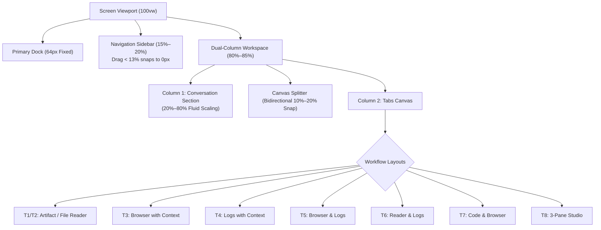
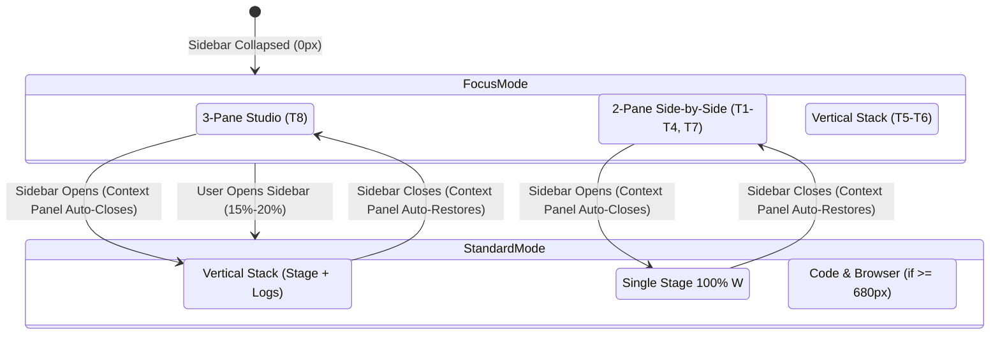

# Sutra UI: Workspace Layout & Resizing Specification

> **Document Version**: 2.3  
> **Status**: Approved Official Specification  
> **Applies to**: `sutra-ui` (Macro Workspace Shell, Dual-Column Workspace, Conversation Section, Tabs Canvas)

---

## 1. Architectural Hierarchy & Layout Tree

The Sutra UI workspace operates as an integrated, multi-tier layout system:

```
SCREEN VIEWPORT (100vw × 100vh)
 ├── LEVEL 1: MAIN WORKSPACE (Screen Division)
 │    ├── Primary Dock (Fixed 64px)
 │    ├── Navigation Sidebar (15% to 20% width • Drag < 13% snaps closed to 0px)
 │    └── Dual-Column Workspace (Remaining 80% to 85% width • 100% when sidebar is closed)
 │         ├── Column 1: Conversation Section (Prompt composer, chat stream, agent selector)
 │         ├── Canvas Splitter (Interactive draggable splitter with bidirectional 10%–20% snap)
 │         └── Column 2: Tabs Section / Tabs Canvas (Header bar with pills + multi-pane body)
 │
 ├── LEVEL 2: TABS CANVAS WORKFLOW LAYOUTS (Inside Column 2)
 │    ├── T1 & T2: Artifact / File Reader (Agent Context Panel + Reader/Editor)
 │    ├── T3: Browser with Context (Agent Context Panel + Browser Canvas)
 │    ├── T4: Logs with Context (Agent Context Panel + Log Viewer)
 │    ├── T5: Browser & Logs (Browser Top + Log Viewer Bottom)
 │    ├── T6: Reader & Logs (Reader/Editor Top + Log Viewer Bottom)
 │    ├── T7: Code & Browser (Editor Left + Browser Right side-by-side)
 │    ├── T8: 3-Pane Studio (Agent Context Panel Left + Stage Top-R + Logs Bot-R)
 │    └── Single: Full View (Single active pane occupying 100% canvas)
 │
 └── CROSS-TIER INTERPLAY (Navigation Sidebar ⟷ Tabs Canvas)
      ├── Navigation Sidebar Opens: Auto-stows Agent Context Panel; converts 3-Pane to Stage + Logs
      ├── Navigation Sidebar Closes: Auto-restores Agent Context Panel & 3-Pane Studio
      ├── 3-Pane Launches: Proactively auto-collapses Navigation Sidebar to 0px
      └── Fullscreen / Zen Mode: Proactively collapses Navigation Sidebar and Conversation Section
```



---

## 2. LEVEL 1: Main Workspace Specification

| Zone / Component | Target Width | Min Boundary | Max Boundary | Snap-to-Close Threshold | Fallback & Clamping |
| :--- | :--- | :--- | :--- | :--- | :--- |
| **Primary Dock** | `64px` | `64px` | `64px` | None (Fixed anchor) | Compresses to `50px` on mobile screens ($<640\text{px}$) |
| **Navigation Sidebar** | `15%` to `20%` | `15%` ($\approx 180\text{px}–200\text{px}$) | `20%` ($\approx 260\text{px}–280\text{px}$) | **Dragging left below 13% (< 130px) snaps closed to 0px** | Clamped via `clamp(180px, 18vw, 280px)` to prevent ultrawide bloating |
| **Dual-Column Workspace** | Remaining `80%` to `85%` | `80%` | `100%` (when sidebar is closed) | None (Takes all remaining canvas) | Houses Column 1 (Conversation Section) and Column 2 (Tabs Section) |

### Drag & Snap Interactions for Navigation Sidebar
1. **Interactive Dragging**: The user drags `#s08-sidebar-resizer` horizontally with pointer capture.
2. **Snap-to-Close Threshold**: When candidate width drops below `13%` (or $< 130\text{px}$), the splitter indicator highlights soft rose (`.will-snap-close`), and releasing the drag instantly collapses the sidebar to `0px` (`.s08-sidebar.collapsed` and `body.s08-sidebar-collapsed`).
3. **Reopening**: The sidebar can be restored at any time by:
   - Clicking the `[|]` expand button (`#s08-sidebar-trigger`) in the conversation header.
   - Using the global keyboard shortcut `⌘B` (or `Ctrl+B`).
   - Dragging from the left margin.

---

## 3. LEVEL 2: Tabs Section Workflow Layouts (Inside Column 2)

Within the Tabs Section (Column 2), all multi-pane configurations strictly follow the approved proportion, fluid scaling, and non-destructive snapping specifications:

---

### T1 & T2: Artifact / File Reader (Agent Context Panel + Reader/Editor)
```
┌─────────────────────────────────┬──────────────────────────────────────────────────┐
│ Agent Context Panel             │ Reader / Editor                                  │
│ (Files tree or Artifacts list)  │ (Code, Markdown, Document preview)               │
│ Width: 15% to 85%               │ Width: 85% to 15%                                │
│ Height: 100%                    │ Height: 100%                                     │
└─────────────────────────────────┴──────────────────────────────────────────────────┘
```
* **Proportions & Dynamic Range**:
  * **Default State**: Context Panel takes **$28\%$**; Reader/Editor takes **$72\%$**.
  * **Fluid Dynamic Range**: Either pane can be dynamically scaled from **$15\%$ to $85\%$** of the canvas width without arbitrary lockups.
* **Resizing & Snapping Behaviors**:
  * **Drag Left Below Minimum Limit ($< 15\%$ or $< 130\text{px}$)**: Resizer turns soft rose (`#FB7185`); releasing snaps **Context Panel closed**. Reader/Editor expands to **$100\%$ full width**.
  * **Drag Right Below Minimum Limit (Reader Width $< 15\%$ or $< 130\text{px}$)**: Resizer turns soft rose; releasing snaps **Reader/Editor closed**. Context Panel expands to **$100\%$ full width**.
  * **Tab Context Preserved**: The snapped tab's pill **remains visible in the tab section header** (in a closed/minimized state with dashed outline). Clicking it instantly restores the pane.
  * **Selection Sync**: Clicking or focusing inside either pane body instantly highlights its tab pill in the header as active (`.active`) and updates the header context action button.

---

### T3: Browser with Context (Agent Context Panel + Browser Canvas)
```
┌─────────────────────────────────┬──────────────────────────────────────────────────┐
│ Agent Context Panel             │ Web Browser Canvas                               │
│ (Files tree or Artifacts list)  │ (Live web preview & address bar)                 │
│ Width: 15% to 85%               │ Width: 85% to 15%                                │
│ Height: 100%                    │ Height: 100%                                     │
└─────────────────────────────────┴──────────────────────────────────────────────────┘
```
* **Proportions & Dynamic Range**:
  * **Default State**: Context Panel takes **$28\%$**; Browser takes **$72\%$**.
  * **Fluid Dynamic Range**: Full bi-directional scaling from **$15\%$ to $85\%$**. Context Panel can expand freely, while the Browser smoothly scales down to **$10\%–20\%$** before snapping.
* **Resizing & Snapping Behaviors**:
  * **Drag Left Below Minimum Limit ($< 15\%$ or $< 130\text{px}$)**: Snaps **Context Panel closed**. Browser takes **$100\%$ full width**.
  * **Drag Right Below Minimum Limit (Browser Width $< 15\%$ or $< 130\text{px}$)**: Resizer turns soft rose; releasing snaps **Browser closed**. Context Panel expands to **$100\%$ full width**.
  * **Zero Stickiness**: Uses Pointer Capture (`setPointerCapture`) so mouse drag never gets swallowed over web previews, iframes, or inputs.
  * **Tab Context Preserved**: The `[Browser ×]` tab pill **remains in the tab section header** in minimized state. Clicking it restores the browser.
  * **Selection Sync**: Clicking inside the Browser canvas or address bar highlights the `[Browser]` tab pill as active (`.active`) and focuses the pane.

---

### T4: Logs with Context (Agent Context Panel + Log Viewer)
```
┌─────────────────────────────────┬──────────────────────────────────────────────────┐
│ Agent Context Panel             │ Log Viewer                                       │
│ (Files tree or Artifacts list)  │ (Real-time execution telemetry & stream)         │
│ Width: 15% to 85%               │ Width: 85% to 15%                                │
│ Height: 100%                    │ Height: 100%                                     │
└─────────────────────────────────┴──────────────────────────────────────────────────┘
```
* **Proportions & Dynamic Range**:
  * **Default State**: Sources takes **$28\%$**; Log Viewer takes **$72\%$**.
  * **Fluid Dynamic Range**: Scales between **$15\%$ and $85\%$**.
* **Resizing & Snapping Behaviors**:
  * **Drag Left Below Minimum Limit ($< 15\%$)**: Snaps Sources pane closed; Log Viewer expands to **$100\%$ full width**.
  * **Drag Right Below Minimum Limit ($< 15\%$)**: Snaps Log Viewer closed; Sources expands to **$100\%$ full width**.
  * **Tab Context Preserved**: Snapped tab pill remains in the header; 1 click restores it. Tab is removed only if user explicitly clicks `×`.
  * **Selection Sync**: Clicking inside Log Viewer updates the active tab pill to `[Log Viewer]` and contextual action icon to clear stream.

---

### T5: Browser & Logs
```
┌────────────────────────────────────────────────────────────────────────────────────┐
│ Browser Preview Canvas                                                             │
│ Height: 15% to 85% • Width: 100%                                                   │
├────────────────────────────────────────────────────────────────────────────────────┤
│ Horizontal Resizer Grip (#s08-tab-resizer-h)                                       │
├────────────────────────────────────────────────────────────────────────────────────┤
│ Log Viewer (Execution Monitor)                                                     │
│ Height: 85% to 15% • Width: 100%                                                   │
└────────────────────────────────────────────────────────────────────────────────────┘
```
* **Proportions & Dynamic Range**:
  * **Default Golden Ratio**: Browser takes **$65\%$**; Log Viewer takes **$35\%$** height.
  * **Fluid Dynamic Range**: Either pane can be scaled vertically down to **$10\%–20\%$** ($15\%$ threshold) before snapping.
* **Resizing & Snapping Behaviors**:
  * **Drag Downward Past Limit (Log Viewer Height $< 15\%$ or $< 90\text{px}$)**: Turns grip soft rose (`#FB7185`) and **snaps Log Viewer collapsed**; Browser takes **$100\%$ full height**.
  * **Drag Upward Past Limit (Browser Height $< 15\%$ or $< 100\text{px}$)**: Turns grip soft rose and **snaps Browser collapsed**; Log Viewer takes **$100\%$ full height**.
  * **Tab Context Preserved**: Snapped pane's tab pill remains in tab section header (minimized). 1-click restore. Tab is only deleted on explicit `×` click.
  * **Selection Sync**: Clicking inside Browser focuses Browser pill; clicking inside Log Viewer focuses Log Viewer pill.

---

### T6: Reader & Logs
```
┌────────────────────────────────────────────────────────────────────────────────────┐
│ Reader / Editor (Stage Deliverable)                                                │
│ Height: 15% to 85% • Width: 100%                                                   │
├────────────────────────────────────────────────────────────────────────────────────┤
│ Horizontal Resizer Grip (#s08-tab-resizer-h)                                       │
├────────────────────────────────────────────────────────────────────────────────────┤
│ Log Viewer (Execution Monitor)                                                     │
│ Height: 85% to 15% • Width: 100%                                                   │
└────────────────────────────────────────────────────────────────────────────────────┘
```
* **Proportions & Dynamic Range**:
  * **Default Golden Ratio**: Reader/Editor takes **$65\%$**; Log Viewer takes **$35\%$**.
  * **Fluid Dynamic Range**: Scales vertically between **$15\%$ and $85\%$**.
* **Resizing & Snapping Behaviors**:
  * **Drag Downward (Logs $< 15\%$)**: Snaps Log Viewer closed; Reader/Editor takes **$100\%$ full height**.
  * **Drag Upward (Reader $< 15\%$)**: Snaps Reader/Editor closed; Log Viewer takes **$100\%$ full height**.
  * **Tab Context Preserved**: Pill preserved in header in minimized state.

---

### T7: Code & Browser
```
┌──────────────────────────────────────────┬─────────────────────────────────────────┐
│ Reader / Editor (Code Deliverable)       │ Web Browser Preview                     │
│ Width: 15% to 85%                        │ Width: 85% to 15%                       │
│ Height: 100%                             │ Height: 100%                            │
└──────────────────────────────────────────┴─────────────────────────────────────────┘
```
* **Proportions & Dynamic Range**:
  * **Default State**: Symmetrical **$50\% / 50\%$** split.
  * **Permitted Dynamic Range**: **$15\% / 85\%$ to $85\% / 15\%$** fluid scaling.
* **Resizing & Snapping Behaviors**:
  * **Drag Left Below Limit ($< 15\%$)**: Snaps Editor closed; Browser takes **$100\%$ full width**.
  * **Drag Right Below Limit ($< 15\%$)**: Snaps Browser closed; Editor takes **$100\%$ full width**.
  * **Tab Context Preserved**: Both tab pills stay intact in header.
  * **Selection Sync**: Interacting in Editor highlights Editor pill; interacting in Browser highlights Browser pill.

---

### T8: 3-Pane Studio (Agent Context Panel + Stage + Log Viewer)
```
┌───────────────────────────────────────────┬────────────────────────────────────────────────────────┐
│ Left Pane: Agent Context Panel            │ Right Pane (Top): Reader / Browser                     │
│ (Files tree or Artifacts list)            │ Height: 60% to 70% • Width: 70% to 85%                 │
│ Width: 15% to 85%                         ├────────────────────────────────────────────────────────┤
│ Height: 100%                              │ Horizontal Resizer Grip (#s08-tab-resizer-h)           │
│                                           ├────────────────────────────────────────────────────────┤
│                                           │ Right Pane (Bottom): Log Viewer                        │
│                                           │ Height: 30% to 40% • Width: 70% to 85%                 │
└───────────────────────────────────────────┴────────────────────────────────────────────────────────┘
```
* **Proportions & Dynamic Range**:
  * **Horizontal Division**:
    * **Left Pane (Agent Context Panel)**: Default **$28\%$**, fluidly scalable between **$15\%$ and $85\%$**.
    * **Right Column (Stage + Log Viewer)**: Takes remaining width (**$85\%$ down to $15\%$**).
  * **Vertical Division (Right Column)**:
    * **Stage (Top - Reader or Browser)**: Default **$65\%$** height, scalable **$15\%$ to $85\%$**.
    * **Log Viewer (Bottom)**: Default **$35\%$** height, scalable **$85\%$ down to $15\%$**.
* **Dual Snap-to-Close Synergy**:
  * **Vertical Splitter Dragged Left ($< 15\%$)**: Snaps Agent Context Panel closed $\longrightarrow$ Transitions automatically to **T5/T6 (Browser/Reader & Logs)**.
  * **Horizontal Splitter Dragged Down ($< 15\%$ Logs Height or $> 85\%$ Stage Height)**: Snaps Log Viewer closed $\longrightarrow$ Transitions automatically to **T1/T3 (Artifact/File Reader or Browser with Context)**.

---

## 4. Column 1: Dynamic Conversation Scaling Matrix

The Conversation section (Column 1) dynamically scales according to the cognitive focus of the active tab scenario:

| Scenario | Active Mode in Tabs Canvas | Conversation Width | Tabs Canvas Width | Rationale & User Experience |
| :--- | :--- | :---: | :---: | :--- |
| **C1: 3-Pane Studio** | **T8**: 3-Pane Studio (Context + Stage + Logs) | **25%** ($\approx 300–340\text{px}$) | **75%** ($\approx 900–1020\text{px}$) | Maximum horizontal canvas for 3 concurrent panes so code, web, and logs remain readable. |
| **C2: 2-Pane Side-by-Side** | **T1–T4**: Artifact/File Reader, Browser/Logs with Context<br>**T7**: Code & Browser | **30%** ($\approx 380–420\text{px}$) | **70%** ($\approx 880–940\text{px}$) | Two horizontal columns side-by-side receive 70% canvas. |
| **C3: Vertical Stack** | **T5 & T6**: Browser & Logs, Reader & Logs | **30%** ($\approx 380–420\text{px}$) | **70%** ($\approx 880–940\text{px}$) | Stage + Logs stack vertically with optimal 70% viewport width. |
| **C4: Full View** | Single Tab Open (Browser, Reader/Editor, or Logs) | **30%** ($\approx 380–420\text{px}$) | **70%** ($\approx 880–940\text{px}$) | **User-approved 30%/70% default**: Tabs Canvas receives 70% max viewport, resizable up to 75% canvas (25% conversation). |
| **C5: Context Only** | Only Agent Context Panel (File Tree or Artifacts) | **75% to 80%** ($\approx 960–1020\text{px}$) | **20% to 25%** ($\approx 260–320\text{px}$) | Conversation dominance: context panel only needs $20\%–25\%$, allowing chat to be the primary focus. |
| **C6: Tabs Collapsed** | Snapped to min or user clicked `[|]` | **100%** (Full Canvas) | **0%** (`display: none`) | Dedicated chat with floating right reopen toggle (`#s08-right-sidebar-trigger`). Conversational section remains 100% clean and pristine visually. |
| **C7: Zen Mode** | User clicks `|↔|` on Tab Bar | **0%** (`display: none`) | **100%** (Full Canvas) | Pure deliverable review mode (code or app preview takes the whole display). |

### Non-Destructive Tab Pill Preservation & Snapping Rules
1. **Tabs Belong Strictly to Column 2 (Tabs Canvas)**: Tab pills are part of the second column (Tabs Canvas) and are only shown when this column is visible. When Conversation takes 100% of the workspace, the conversation section is unaffected visually.
2. **Context Preservation Inside Tabs Header**: Dragging/snapping an internal divider (`#s08-tab-resizer-v` or `#s08-tab-resizer-h`) minimizes that specific pane, but **NEVER destroys or removes the tab pill in the tabs header bar**.
3. **Minimized Indicator in Tabs Header**: A snapped pane's pill in the tabs header receives `.is-minimized` styling (subtle dashed border, 65% opacity, and tooltip). Clicking the pill instantly restores the pane.
4. **Strict Close Rule**: Tab pills are **only closed/removed if the user takes an explicit close action** (clicking the `×` button on the pill or menu).
5. **Softer Muted Rose Feedback**: All snap-to-close indicators use soft muted rose **`#FB7185`** with ambient glow `box-shadow: 0 0 8px rgba(251, 113, 133, 0.4)` instead of harsh alarm red.

### Manual Dragging Boundaries for Conversation (Canvas Resizer)
* **Absolute Minimum Floor**: **$25\%$** (hard floor of **$220\text{px}$**), allowing Tabs Canvas to expand up to **$75\%$**.
* **Absolute Maximum Ceiling**: Clamped so the Tabs Canvas never drops below **$460\text{px}$** (or $25\%$). Dragging below $260\text{px}$ highlights soft rose `#FB7185` and snaps closed into collapsed tabs chips.
* **Double-Click Reset**: Double-clicking `#s08-canvas-resizer` restores Conversation to the optimal default proportion (30% / 70%).

---

## 5. Cross-Tier Interplay: Navigation Sidebar ⟷ Tabs Canvas

Defines exact rules for how the Navigation Sidebar and Tabs Canvas interact during state changes:



### Scenario A: User OPENS Navigation Sidebar (Expands from `0px` to `15%–20%`)
*Workspace adapts to accommodate the navigation tree:*

1. **T8: 3-Pane Studio (Context Panel + Stage + Logs)**:
   * **Rule**: `Agent Context Panel` auto-closes $\longrightarrow$ Converts to **T5/T6 (Browser & Logs / Reader & Logs)** vertical stack.
   * *Rationale*: 3 horizontal sections cannot fit comfortably alongside an open sidebar. Closing Context Panel leaves Stage (top) and Logs (bottom) at full readability.
2. **T1–T3: Context + Stage (Artifact/File Reader or Browser with Context)**:
   * **Rule**: `Agent Context Panel` auto-closes $\longrightarrow$ Stage takes **$100\%$ width**.
   * *Rationale*: The navigation sidebar already provides workspace/folder navigation. Keeping both open cramps the primary stage. *(User can still re-open Context Panel manually).*
3. **T4: Logs with Context**:
   * **Rule**: `Agent Context Panel` auto-closes $\longrightarrow$ Logs takes **$100\%$ width**.
4. **T5 & T6: Vertical Stack (Browser & Logs / Reader & Logs)**:
   * **Rule**: **Stays OPEN (No change)**. Fits comfortably alongside the sidebar.
5. **T7: Code & Browser**:
   * **Rule**: Stays open side-by-side if remaining tabs width $\ge 680\text{px}$; otherwise temporarily falls back to the active tab.
6. **Zen Mode (`|↔|` Full Width)**:
   * **Rule**: **Exits Zen Mode $\longrightarrow$ Restores 2-Column split**.

---

### Scenario B: User CLOSES / COLLAPSES Navigation Sidebar (`15%–20%` $\rightarrow$ `0px`)
*Workspace gains extra horizontal space:*

1. **Context Panel was auto-closed by Sidebar**:
   * **Rule**: `Agent Context Panel` **AUTO-RESTORES** to its open state.
2. **T5/T6 was converted from 3-Pane Studio**:
   * **Rule**: **AUTO-RESTORES to T8 (3-Pane Studio)** (Context Panel left, Stage top-right, Logs bottom-right).
3. **Single-Tab Fallback was active due to narrow width**:
   * **Rule**: Automatically re-mounts into its multi-pane grid.
4. **User had manually closed tabs**:
   * **Rule**: Respects deliberate user close actions; does **not** force-reopen manually closed tabs.

---

### Scenario C: Tabs Canvas Actions that TRIGGER the Navigation Sidebar
1. **User opens 3-Pane Studio (T8)**:
   * **Rule**: Proactively **collapses Navigation Sidebar to `0px`** so all 3 panes get $75\%$ width immediately.
2. **User clicks Zen Mode `|↔|` (`#s08-split-toggle-btn`)**:
   * **Rule**: Proactively **collapses Navigation Sidebar and Conversation to `0px`**, giving Tabs $100\%$ of the screen.
   * Clicking `|↔|` again restores both to their previous widths.

---

## 6. Master Transition & Snap Table

| Mode | Active Tabs | Primary Resizer Action | Threshold | Resulting State | User Restoration Path |
| :--- | :--- | :--- | :--- | :--- | :--- |
| **Navigation Sidebar** | Navigation Tree | Drag resizer left | $< 13\%$ or $< 130\text{px}$ | Sidebar snaps to `0px` | Click `[|]` trigger or `⌘B` |
| **T1 / T2 (Artifact / File Reader)** | Context + Reader | Drag vertical resizer left | $< 15\%$ or $< 130\text{px}$ | Context collapses $\rightarrow$ Reader 100% | Click `[Files]` / `[Artifacts]` pill in header |
| **T3 (Browser with Context)** | Context + Browser | Drag vertical resizer left | $< 15\%$ or $< 130\text{px}$ | Context collapses $\rightarrow$ Browser 100% | Click `[Files]` / `[Artifacts]` pill in header |
| **T4 (Logs with Context)** | Context + Logs | Drag vertical resizer left | $< 15\%$ or $< 130\text{px}$ | Context collapses $\rightarrow$ Logs 100% | Click `[Files]` / `[Artifacts]` pill in header |
| **T5 (Browser & Logs)** | Browser + Logs | Drag horizontal resizer down | $< 15\%$ Logs H ($> 85\%$ Browser) | Logs collapses $\rightarrow$ Browser 100% | Click `[Log Viewer]` pill in header |
| **T6 (Reader & Logs)** | Reader + Logs | Drag horizontal resizer down | $< 15\%$ Logs H ($> 85\%$ Reader) | Logs collapses $\rightarrow$ Reader 100% | Click `[Log Viewer]` pill in header |
| **T7 (Code & Browser)** | Reader + Browser | Drag vertical resizer either way | $< 15\%$ either pane | Compressed pane collapses $\rightarrow$ Other 100% | Click compressed tab pill in header |
| **T8 (3-Pane Studio - Left)** | Context + Stage + Logs | Drag vertical resizer left | $< 15\%$ Context W | Context collapses $\rightarrow$ Stage+Logs stack | Click `[Files]` / `[Artifacts]` pill in header |
| **T8 (3-Pane Studio - Right)**| Context + Stage + Logs | Drag horizontal resizer down | $< 15\%$ Logs H | Logs collapses $\rightarrow$ Context+Stage split | Click `[Log Viewer]` pill in header |

---

## 7. Physical Pixel Translation Reference

Values calculated across standard industry display resolutions:

### Standard Laptop (1280 × 800) — *Net Available Canvas $\approx 1188\text{px}$*
* **Primary Dock (Fixed)**: `64px`
* **Navigation Sidebar (15%–20%)**: `180px – 240px`
* **Net Inset Body (Dual-Column Workspace)**: `948px – 1008px`
* **Conversation in 3-Pane (25%)**: `237px – 252px`
* **Tabs in 3-Pane (75%)**: `711px – 756px`
* **T1–T4: Agent Context Panel (28%)**: `199px – 211px`
* **T1–T4: Stage/Logs (72%)**: `512px – 545px`
* **T5–T6: Stage Height (65%)**: `434px` (assuming ~668px available canvas height)
* **T5–T6: Logs Height (35%)**: `234px`
* **T7: Code / Browser (50%)**: `355px / 355px`

### Standard Desktop (1440 × 900) — *Net Available Canvas $\approx 1348\text{px}$*
* **Primary Dock (Fixed)**: `64px`
* **Navigation Sidebar (15%–20%)**: `200px – 270px`
* **Net Inset Body (Dual-Column Workspace)**: `1078px – 1148px`
* **Conversation in 3-Pane (25%)**: `269px – 287px`
* **Tabs in 3-Pane (75%)**: `809px – 861px`
* **T1–T4: Agent Context Panel (28%)**: `226px – 241px`
* **T1–T4: Stage/Logs (72%)**: `583px – 620px`
* **T5–T6: Stage Height (65%)**: `500px` (assuming ~768px available canvas height)
* **T5–T6: Logs Height (35%)**: `268px`
* **T7: Code / Browser (50%)**: `404px / 404px`

### Large Monitor / Full HD (1920 × 1080) — *Net Available Canvas $\approx 1828\text{px}$*
* **Primary Dock (Fixed)**: `64px`
* **Navigation Sidebar (Clamped 15%–20%)**: `280px` *(clamped)*
* **Net Inset Body (Dual-Column Workspace)**: `1548px`
* **Conversation in 3-Pane (25%)**: `387px`
* **Tabs in 3-Pane (75%)**: `1161px`
* **T1–T4: Agent Context Panel (28%)**: `325px`
* **T1–T4: Stage/Logs (72%)**: `836px`
* **T5–T6: Stage Height (65%)**: `617px` (assuming ~950px available canvas height)
* **T5–T6: Logs Height (35%)**: `333px`
* **T7: Code / Browser (50%)**: `580px / 580px`
