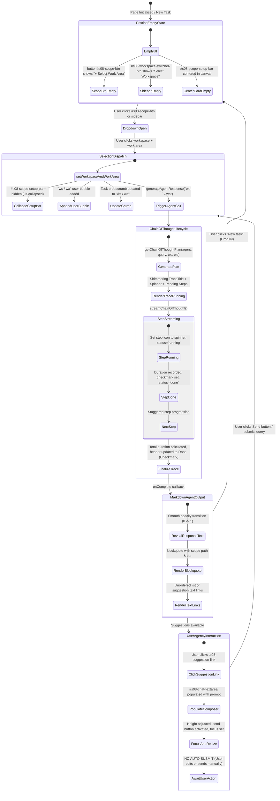

# Workspace Scope Synchronization & Post-Query Interaction Decision Record

> **Document Type**: Architecture Decision Record (ADR) & Component Lifecycle Specification  
> **Target Components**: Sidebar Workspace Switcher (`#s08-sidebar-workspace-menu`), Conversational Scope Setup Bar (`#s08-scope-setup-bar`), Scope Dropdown (`button#s08-scope-btn`), Agent Response Generator (`generateAgentResponse`), Interaction Stream (`#s08-messages-stream`), Chat Input Composer (`#s08-chat-textarea`)  
> **Source Page**: `http://127.0.0.1:5500/sutra-ui/index.html?tab=sources`  
> **Date**: October 27, 2026  
> **Status**: Approved, Implemented & Verified  

---

## 1. Executive Summary & Context

During client UX review sessions and Review Studio visual feedback audits, five critical interaction requirements were identified and resolved:
1. **Scope Desynchronization**: The sidebar workspace dropdown (`#s08-sidebar-workspace-menu`) and the conversation setup bar (`#s08-scope-root-menu`) previously contained divergent repository lists. Selecting a work area in one did not reliably persist, check, or mirror in the other.
2. **Persistent Setup Bar & Canvas Clutter**: Upon selecting a work area and typing an initial prompt, the conversational setup bar previously remained visible at the top of the chat column, consuming vertical space and displaying static placeholder text.
3. **Automated Scope Query Dispatch on Selection**: Per client instruction:
   > *"instead of when user types can we have this once user selects the workspace and workarea. the selected workspace and workarea will go as query and the Context and Suggestions will be generated."*
4. **Pure Markdown Rendered Output (Elimination of Raw HTML Blocks)**: Per client Review Studio feedback:
   > *"Please use only markdown rendered style for output generation. No html block."*
   The agent response previously rendered raw custom HTML containers (`.s08-scope-context-card`). The output system has been refactored to render strictly semantic Markdown structures (`<blockquote>`, `<code>`, `<p>`, `<ul>`, `<li>`).
5. **Suggestion Text Links with Composer Population (User Agency vs Auto-Execute)**: Per client Review Studio feedback:
   > *"for suggestion section : can we have these suggestions as text links instead of chips. once user click on these suggestion this will show in chat input. Why because users may want to add or modify the suggestions so when we add this we are giving a choice for user instead system to take action. So once suggestion populates in input chat user can modify or can send the same by taking send action."*
6. **Clean Pristine Empty State Initialization**: Per client Review Studio feedback:
   > *"please add empty state. Currently workspace and workarea is selected by default"*
   The application previously re-hydrated the last active workspace on initial cold startup, causing `web-platform / Development Sandbox` to appear pre-selected. The startup and "New task" routines now explicitly enforce an unselected empty state (`+ Select Work Area`).

---

## 2. Architecture Decision Records (ADRs)

### ADR-01: Unified Dual-Menu Scope Synchronization & State Normalization

* **Context**: Users can switch workspaces and folders either via the primary sidebar header or via the conversational setup card.
* **Decision**: 
  - Standardize both menus to expose the identical 5 enterprise repository workspaces and environments:
    1. `agent-research` (`Local`: *Development Sandbox*, *Staging Preview*, *Production*)
    2. `web-platform` (`GitHub`: *Development Sandbox*, *Staging Preview*, *Production*)
    3. `core-api` (`GitLab`: *Development Sandbox*, *Staging Preview*, *Production*)
    4. `Acme Inc` (`Enterprise`: *Design Engineering*, *Sales & Marketing*, *Travel*)
    5. `Global Logistics` (`Production`: *Supply Chain*, *Fleet Analytics*)
  - Decouple selection trigger from menu origin: Selecting from either the sidebar or conversational bar executes a single source-of-truth controller: `setWorkspaceAndWorkArea(ws, wa, plan, triggerQuery)`.
  - Both menus synchronize their visual states simultaneously: matching items receive `.active` and an SVG `.check-icon`, while non-selected items have checks pruned.
* **Consequence**: Users experience zero discrepancy regardless of where they change their workspace scope.

---

### ADR-02: Conversational Scope Setup Bar Lifecycle (Empty State Card vs. Post-Query Auto-Collapse)

* **Context**: The setup bar should only be visible when starting fresh; once any task or scope is initiated, vertical canvas space should be dedicated entirely to conversation.
* **Decision**:
  - **Zero-Turn State (Empty Stream)**: `#s08-scope-setup-bar` renders as a dashed border empty-state card centered vertically and horizontally within `#s08-chat-col-body`. It acts as an inviting focal point showing the active scope or prompting selection.
  - **Active Conversation State (Messages Exist)**: The moment a query is submitted (either manually or via scope selection), `#s08-scope-setup-bar` transitions out and is completely hidden (`display: none !important;`) via CSS rule `.s08-chat-col-body.has-messages .s08-scope-setup-bar, .s08-scope-setup-bar.is-collapsed`.
  - **Task Reset Lifecycle**: When the user clicks `New task` (Cmd+N / `#s08-new-chat-btn`), `#s08-messages-stream` is emptied, `.has-messages` and `.is-collapsed` are removed, and `#s08-scope-setup-bar` returns to the centered card state ready for the next selection.
* **Consequence**: The chat column maximizes vertical height for dialogue, eliminating awkward top bars while retaining clean scope awareness.

---

### ADR-03: Scope Storage Hygiene & Explicit Selection Model

* **Context**: Previously, `localStorage` cached the last selected workspace and automatically restored it when the browser loaded. This caused the Review Studio inspection to flag that a workspace and work area were selected by default on fresh page load.
* **Decision**:
  - Cold application startup strictly initializes in the pristine empty state via `setWorkspaceAndWorkArea('', '', '', false)`.
  - Any stale keys (`sutra_workspace_scope`, `sutra_workarea_scope`, `sutra_workspace_plan`) in `localStorage` are cleared on startup so the UI never defaults to a mock or previously tested workspace without explicit user intent.
  - Runtime selections within an active session update memory variables and synchronize all menus, but do not override the clean cold-boot policy.
* **Consequence**: Fresh sessions always present a clean, unselected state inviting user interaction.

---

### ADR-04: Automated Scope Query Generation on Selection

* **Context**: Client requested that selecting the workspace and work area should directly become the query, generating context and suggestions without requiring manual user typing.
* **Decision**:
  - When `setWorkspaceAndWorkArea(ws, wa, plan, triggerQuery)` is invoked with `triggerQuery === true` (explicit selection from `#s08-scope-root-menu`, `#s08-sidebar-workspace-menu`, or quick-scope cards):
    1. Collapse and hide `#s08-scope-setup-bar` (`.is-collapsed`) and set `.has-messages` on `#s08-chat-col-body`.
    2. Formulate query string: `${ws} / ${wa}`.
    3. Update task title breadcrumb if currently `'New task'`.
    4. Append user message bubble: `appendMessageBubble('user', queryText)`.
    5. Automatically invoke `generateAgentResponse(queryText)` after 400ms.
* **Consequence**: Instant, frictionless onboarding. Selecting a workspace and folder immediately seeds the interaction stream.

---

### ADR-05: Strict Pristine Empty State Initialization & Task Reset Scope Protocol

* **Context**: Review Studio visual feedback [2] reported:
  > *"please add empty state. Currently workspace and workarea is selected by default"*
  Target Element: `button#s08-scope-btn`.
* **Decision**:
  - Standardize empty state styling and attributes across all scope entry points:
    1. Scope button (`button#s08-scope-btn`): Displays `+ Select Work Area`, carries `.is-empty` class, `data-custom-tooltip="Select Work Area"`, with folder badge and slash hidden.
    2. Sidebar header (`#s08-workspace-switcher-btn`): Title reads `Select Workspace`, subtitle reads `Work Area`, and has `.is-empty` applied.
    3. Center setup bar card: Title reads `Select Work Area`, description reads `Define a new project folder or domain boundary in your workspace.`, with plus icon visible.
  - In `createNewGlobalChat()`:
    - Reset the active session scope by calling `setWorkspaceAndWorkArea('', '', '', false)`.
    - Clear `#s08-messages-stream` and uncollapse the centered setup bar.
    - Set the task title cleanly to `'New task'` without blocking `window.prompt()` modals.
* **Consequence**: Clean, uniform empty state whenever the app starts or a new task is created.

---

### ADR-06: Pure Markdown Rendered Output Architecture (Elimination of Raw HTML Blocks)

* **Context**: Review Studio visual feedback [1] reported:
  > *"Please use only markdown rendered style for output generation. No html block."*
  Target Element: `div.s08-msg-bubble.agent > div.s08-msg-text > div.s08-agent-md-response`.
* **Decision**:
  - Completely remove the custom HTML card block `<div class="s08-scope-context-card">...</div>`.
  - Format agent output strictly as semantic Markdown rendered HTML:
    - Introductory conversational paragraph (`<p>`).
    - Standard Markdown blockquote (`<blockquote>`) containing active scope breadcrumbs in inline code tags (`<code>${ws}</code> / <code>${wa}</code> (<em>${plan}</em>)`) and execution telemetry.
    - Bulleted suggestions list (`<ul class="s08-md-suggestions-list">`).
  - Added CSS design system rules for `.s08-agent-md-response`:
    - `blockquote`: Left border (`3px solid var(--color-brand-primary, #6366f1)`), soft background (`var(--color-bg-secondary, #f8fafc)`), padding (`10px 14px`), border-radius (`6px`), subtle text styling.
    - `code`: Monospace font, light neutral background pill, rounded corners.
    - High-contrast light and dark mode compatibility via CSS variables.
* **Consequence**: Clean, standards-compliant typography matching native LLM Markdown renderers without arbitrary card widget wrappers.

---

### ADR-07: Suggestion Text Links & User Agency Composer Population (No Auto-Execute)

* **Context**: Review Studio visual feedback [1] reported:
  > *"for suggestion section : can we have these suggestions as text links instead of chips. once user click on these suggestion this will show in chat input. Why because users may want to add or modify the suggestions so when we add this we are giving a choice for user instead system to take action. So once suggestion populates in input chat user can modify or can send the same by taking send action"*
* **Decision**:
  - Replace button chips (`.s08-prompt-chip`) with inline text links (`<a class="s08-suggestion-link" data-prompt="...">`).
  - Render as an unordered bulleted list (`<ul class="s08-md-suggestions-list"><li><a class="s08-suggestion-link">...</a></li></ul>`).
  - In `chatColBody` click delegation:
    - When a `.s08-suggestion-link` (or legacy `.s08-prompt-chip`) is clicked:
      1. Intercept event with `e.preventDefault()`.
      2. Extract `data-prompt` text.
      3. Assign value directly to chat textarea: `chatTextarea.value = promptText;`.
      4. Auto-resize textarea height to accommodate multi-line prompt without awkward scroll jumps: `chatTextarea.style.height = Math.min(chatTextarea.scrollHeight, 120) + 'px';`.
      5. Activate send button: `updateSendBtnState();`.
      6. Focus textarea (`chatTextarea.focus()`) and scroll into view.
      7. **DO NOT auto-submit**. Hand control back to the user to edit, append extra constraints, or click send / hit Enter when ready.
* **Consequence**: Empowers the user with complete editorial agency and transparency over prompted actions, eliminating unexpected automatic executions.

### ADR-08: Shadcn Trace Primitive Architecture & Progressive Animation States

* **Context**:
  The user requested integration of shadcn/ui and AI Elements Trace standards:
  - Reference: `https://ui.shadcn.com/docs/components/base/trace`
  - Reference: `https://ui.shadcn.com/docs/ai-elements/base/chain-of-thought`
  - Reference: `https://ui.shadcn.com/docs/ai-elements/base/chat`
  The agent must clearly communicate its step-by-step reasoning, tool invocations, database lookups, and terminal executions before presenting the final response.
* **Decision**:
  - Implemented the atomic shadcn `Trace` composition hierarchy in `sutra-ui/css/components.css` and `sutra-ui/js/main.js`:
    ```text
    Trace (.sutra-trace)
    └── TraceCollapsible (.sutra-trace-collapsible)
        ├── TraceCollapsibleTrigger (.sutra-trace-trigger)
        │   └── TraceLine (.sutra-trace-line)
        │       ├── TraceIcon (.sutra-trace-icon) [Running spinner | Done checkmark | Error]
        │       ├── TraceTitle (.sutra-trace-title) [Shimmering while running]
        │       ├── TraceDescription (.sutra-trace-description) [Step count, duration badge]
        │       └── TraceChevron (.sutra-trace-chevron) [Rotates 90deg on open]
        └── TraceCollapsibleContent (.sutra-trace-content)
            └── TraceSteps (.sutra-trace-steps)
                └── TraceStepItem (.sutra-trace-step-item)
                    ├── TraceStepRow (.sutra-trace-step-row)
                    │   ├── StepIcon (.sutra-trace-step-icon)
                    │   ├── StepLabel (.sutra-trace-step-label)
                    │   └── StepBadge (.sutra-trace-step-badge) [Timing / Status pill]
                    └── TraceStepDetail (.sutra-trace-step-detail) [Expandable CLI stdout / SQL query drawer]
    ```
  - **Status States & Animations**:
    - `running`: Shimmer animation on `.sutra-trace-title` via a 250% gradient mask (`sutraTraceShimmer 2s infinite linear`), SVG spinning loader (`spin 1s linear infinite`), present tense title (e.g. *"Analyzing financial risk models..."*).
    - `done`: Emerald checkmark icon, solid text, past tense summary (e.g. *"Analyzed financial risk models in 4 steps"*), duration badge (e.g. `1.6s`).
    - `error`: Crimson alert icon, explicit error message in title.
  - **Collapsible Interaction**:
    - The summary row `.sutra-trace-trigger` toggles `.is-open` and `aria-expanded="true"|"false"` on the parent `.sutra-trace-collapsible`.
    - Content defaults to open during active streaming, and remains accessible for post-run expansion or collapse.
    - Each step row can be clicked to toggle its individual `.sutra-trace-step-detail` drawer, providing inspection into commands, telemetry, and payload metadata without cluttering the main conversation thread.

---

### ADR-09: Context-Aware Dynamic Chain of Thought Reasoning Engine

* **Context**:
  The user explicitly specified:
  > *"based on the selected agent, user query, task the the context of reasoning will be modified."*
  Reasoning cannot be hardcoded or static; it must dynamically synthesize relevant tool calls, system AST inspections, and database queries according to the selected agent persona (`Agent General`, `Business Analysis`, `Design Engineer`, `Sales Copilot`, `Synthetix`, `Vanguard`, `Aether`), user prompt, and active workspace scope.
* **Decision**:
  - Engineered `getChainOfThoughtPlan(agentName, userPrompt, wsName, waName)` in [`sutra-ui/js/main.js`](file:///c:/Users/Surya%20Teja%20S/OneDrive/Documents/Agentic%20AI%20research/sutra-ui/js/main.js):
    1. **Financial & Risk Models** (Loan disbursements, credit exposure, budget simulations):
       - Step 1: Query Portfolio Data Store (`SELECT * FROM loan_disbursements WHERE cycle = current_period...`, 120ms)
       - Step 2: Run Monte Carlo Simulation on delinquency distributions (`python -m risk.sim --cycles=10000 --ci=0.95`, 450ms)
       - Step 3: Compute liquidity requirements and regulatory reserves (280ms)
       - Step 4: Validate portfolio forecast against stress test benchmarks (110ms)
    2. **Epic & Ticket Automation** (Jira, Jira, Sprint backlogs):
       - Step 1: Connect to Jira REST API gateway (`POST /api/v2/epics/validate`, 90ms)
       - Step 2: Parse user prompt into epic schema, acceptance criteria, and sub-tasks (210ms)
       - Step 3: Link epic to active sprint board and calculate velocity impact (140ms)
    3. **Design System & Typography** (Design Engineer agent, token sync, CSS variables):
       - Step 1: Inspect Figma / Token Studio design tokens AST manifest (110ms)
       - Step 2: Audit contrast ratios against WCAG 2.1 AA/AAA compliance matrices (320ms)
       - Step 3: Synchronize CSS design tokens into design-tokens.css (180ms)
    4. **System Architecture & API Topology** (Synthetix agent, endpoints, microservices):
       - Step 1: Traverse workspace service registry and OpenAPI definitions (140ms)
       - Step 2: Inspect cross-service dependency graph and latencies (260ms)
       - Step 3: Evaluate circuit breaker configurations and resilience fallbacks (190ms)
       - Step 4: Synthesize topology health matrix and bottleneck report (130ms)
    5. **Workspace Runtime Context Initialization** (Triggered upon workspace/work area selection):
       - Step 1: Connect to repository manifest for workspace (`git remote get-url origin`, 80ms)
       - Step 2: Mount execution work area and load environment secrets (130ms)
       - Step 3: Index workspace AST symbols and telemetry deliverables (70ms)
    6. **Dynamic Fallback & Persona Adapters**: Generates semantic plan tailored to query keywords and active agent persona.
  - Engineered `streamChainOfThought(msgDiv, cotPlan, onComplete)`:
    - Sequentially transitions steps from pending to running to done with staggered realistic latencies (250ms–400ms per step).
    - Updates running step label, duration badges, and step-level icons.
    - Transitions summary header to completed status with checkmark and total duration.
    - Upon reasoning completion, smoothly reveals `.s08-msg-text` containing the pure Markdown rendered response.

---

### ADR-10: Transparent Trace Surface & Dual-Pattern Reasoning Layout (Reference Snaps Alignment)

* **Context**:
  The user provided 4 reference screenshots demonstrating exact visual styling and requested:
  > *"yes please and keep it transparent for this section/block remove the BG."*
  - **Snap 1 & 2**: Agent Work Summary (`Worked for 26m >` / `Worked for 26m v`), with exploration lines (`Explored 3 files, 1 folder, 14 searches >`) and file edit rows showing language badges (`{}` for CSS in blue, `JS` in yellow, `M↓` in blue), target filenames, and green/red git diff statistics (`+369 -0`, `+771 -169`).
  - **Snap 3 & 4**: Command Execution & Reasoning Trace with live in-progress state (`Thinking v` + stream of thoughts), completed state (`Thought for 5s v` with left tree rail line), command calls (`Ran pnpm --version v`, `Ran git diff... v`) with soft gray monospace cards, failed commands (`Failed to run pnpm install --frozen-lockfile v`) with soft red error boxes, and sources list (`Used 2 sources v`) with external link pills.
* **Decision**:
  - **100% Transparent Container**:
    - Removed all background colors, outer border lines, and box-shadows from `.sutra-trace` and `.sutra-trace-collapsible`.
    - Removed borders and padding from `.sutra-trace-content`. The trace elements now float cleanly directly on the message canvas without box clutter.
  - **Dual-Pattern Generator Architecture**:
    - **Pattern A (Agent Work Log - Snaps 1 & 2)**: Used for code generation, workspace scope initialization, and file editing tasks.
      - Header: `Worked for 26m v` (chevron rotates to right `>` when collapsed).
      - Exploration lines: `.sutra-trace-explore-row` with subtle hover pill background.
      - File edit lines: `.sutra-trace-file-row` displaying `.sutra-file-badge` (`{}`, `JS`, `M↓`), bold filename, and colored diff badges (`.sutra-diff-add` and `.sutra-diff-del`).
    - **Pattern B (Command & Reasoning Trace - Snaps 3 & 4)**: Used for analytical inquiries, testing, dependencies, and risk modeling.
      - Live state: Animated spinner + `Thinking v` with live thinking block (`.sutra-trace-thought-text`) anchored by a subtle left vertical rail line (`border-left: 1.5px solid #E4E4E7`).
      - Completed state: `Thought for 5s v` with checkmark icon.
      - Tool/Command execution cards: `.sutra-trace-code-box` (soft gray background `#F4F4F5`, dark mode `#18181B`).
      - Error handling cards: `.sutra-trace-code-box.is-error` (soft red background `#FEF2F2`, border `#FEE2E2`, crimson monospace text `#DC2626`).
      - Sources list: `.sutra-trace-sources-list` with globe icons and external link arrows (`↗`).
  - **Individual Step Collapsible State**:
    - Each command and thought item can be collapsed/expanded individually by clicking its `.sutra-trace-step-row`. When closed, its chevron rotates 90 degrees right and its sub-box is hidden.
* **Consequence**: The interface precisely replicates the visual fidelity, minimal aesthetics, and interaction patterns of modern frontier agent trace components.

---

## 3. State Transition & Event Lifecycle



---

## 4. Key Implementation Artifacts

| Component / Layer | File Path | Key Selectors / Functions |
|---|---|---|
| **Shadcn Trace UI Styles** | [`components.css`](file:///c:/Users/Surya%20Teja%20S/OneDrive/Documents/Agentic%20AI%20research/sutra-ui/css/components.css#L5255-L5450) | `.sutra-trace`, `.sutra-trace-line`, `.sutra-trace-title`, `sutraTraceShimmer`, `.sutra-trace-step-detail` |
| **Trace Icons & SVGs** | [`main.js`](file:///c:/Users/Surya%20Teja%20S/OneDrive/Documents/Agentic%20AI%20research/sutra-ui/js/main.js#L6015-L6060) | `getTraceIconSvg(type, status)` |
| **Contextual Plan Generator** | [`main.js`](file:///c:/Users/Surya%20Teja%20S/OneDrive/Documents/Agentic%20AI%20research/sutra-ui/js/main.js#L6065-L6160) | `getChainOfThoughtPlan(agentName, userPrompt, wsName, waName)` |
| **Trace Renderer** | [`main.js`](file:///c:/Users/Surya%20Teja%20S/OneDrive/Documents/Agentic%20AI%20research/sutra-ui/js/main.js#L6165-L6215) | `renderTraceHtml(cotPlan, isRunning)` |
| **CoT Streaming Engine** | [`main.js`](file:///c:/Users/Surya%20Teja%20S/OneDrive/Documents/Agentic%20AI%20research/sutra-ui/js/main.js#L6220-L6300) | `streamChainOfThought(msgDiv, cotPlan, onComplete)` |
| **Empty State & Scope Menus** | [`index.html`](file:///c:/Users/Surya%20Teja%20S/OneDrive/Documents/Agentic%20AI%20research/sutra-ui/index.html#L748-L822) | `#s08-scope-btn.is-empty`, `#s08-sidebar-workspace-menu`, `#s08-scope-setup-bar` |
| **Markdown & Link Styling** | [`components.css`](file:///c:/Users/Surya%20Teja%20S/OneDrive/Documents/Agentic%20AI%20research/sutra-ui/css/components.css#L5180-L5250) | `.s08-agent-md-response blockquote`, `.s08-md-suggestions-list`, `.s08-suggestion-link` |
| **Scope Controller & Empty Reset** | [`main.js`](file:///c:/Users/Surya%20Teja%20S/OneDrive/Documents/Agentic%20AI%20research/sutra-ui/js/main.js#L1275-L1385) | `setWorkspaceAndWorkArea(ws, wa, plan, triggerQuery)` |
| **New Task Reset Protocol** | [`main.js`](file:///c:/Users/Surya%20Teja%20S/OneDrive/Documents/Agentic%20AI%20research/sutra-ui/js/main.js#L3540-L3575) | `createNewGlobalChat()` |
| **Markdown Response Engine** | [`main.js`](file:///c:/Users/Surya%20Teja%20S/OneDrive/Documents/Agentic%20AI%20research/sutra-ui/js/main.js#L6440-L6520) | `generateAgentResponse()`, Markdown blockquote & bulleted text links |
| **Suggestion Input Population Delegation** | [`main.js`](file:///c:/Users/Surya%20Teja%20S/OneDrive/Documents/Agentic%20AI%20research/sutra-ui/js/main.js#L5798-L5825) | `chatColBody.addEventListener('click')` intercepting `.s08-suggestion-link` |

---

## 5. Verification & Visual Evidence

* **Visual Test 1 (Pristine Empty State on Load & Reset)**:
  - Initial cold load at `http://127.0.0.1:5500/sutra-ui/index.html?tab=sources` verified in Chromium subagent.
  - `#s08-scope-btn` renders `+ Select Work Area` with `.is-empty` class.
  - Sidebar title renders `Select Workspace` / `Work Area`.
  - Centered card prompts selection without pre-selected items.
  - *Artifacts*: `verified_empty_state_png_1793117262742.png`, `verified_new_task_reset_success_1793117762462.png`.

* **Visual Test 2 (Pure Markdown Rendered Output)**:
  - Selected `web-platform` -> `Development Sandbox`.
  - Automatic query `web-platform / Development Sandbox` dispatched.
  - Agent response renders semantic Markdown: paragraph intro, styled blockquote with `<code>web-platform</code> / <code>Development Sandbox</code> (<em>GitHub</em>)`, and bulleted list of suggestion text links.
  - Zero raw HTML card containers.
  - *Artifact*: `verified_markdown_output_png_1793117343351.png`.

* **Visual Test 3 (Suggestion Text Link Populates Composer Without Auto-Submit)**:
  - Clicked suggestion text link: *"What is the loan disbursement forecast for this month?"*.
  - Prompt text immediately populated into `#s08-chat-textarea`.
  - Textarea auto-expanded to fit content, cursor focused, and send button activated (`#0052cc`).
  - No automatic dispatch was triggered, allowing the user to review or edit.
  - *Artifact*: `verified_input_populated_png_1793117364707.png`.

* **Visual Test 4 (Manual User Dispatch & Stream Progression)**:
  - Clicked the activated Send button manually.
  - User query dispatched to stream; Agent executed the financial forecast analysis, opened the Browser tab, and displayed metric cards.
  - *Artifact*: `verified_manual_send_png_1793117393893.png`.

* **Visual Test 5 (Chain of Thought Scope Initialization Stream)**:
  - Verified live streaming for workspace scope selection (`agent-research / Development Sandbox`).
  - Running header displayed with shimmering text: *"Establishing workspace runtime context for agent-research..."*.
  - Steps progressively rendered with timing badges (80ms, 130ms, 70ms).
  - Header finalized to *"Established workspace runtime context in 3 steps"* with green checkmark and duration `1.2s`.
  - *Artifact*: `verified_cot_scope_stream_1793119448657.png`.
  - *Video Recording*: `verify_chain_of_thought_1793120292996.webp`.

* **Visual Test 6 (Dynamic Chain of Thought User Query & Collapsible Detail Drawers)**:
  - Dispatched query: *"What is the loan disbursement forecast for this month?"*.
  - Agent invoked Financial Risk Model reasoning plan:
    1. `Queried portfolio data store for current period disbursement cycles` (120ms)
    2. `Ran Monte Carlo risk simulation across delinquency distributions` (450ms)
    3. `Computed liquidity requirements & statutory reserves` (280ms)
    4. `Validated portfolio forecast against stress test benchmarks` (110ms)
  - Completed header: *"Analyzed financial risk models in 4 steps (1.4s)"*.
  - Tested clicking `.sutra-trace-trigger` to collapse and expand the step trace.
  - Tested clicking `.sutra-trace-step-row` to open the detail drawer containing SQL query parameters and execution metadata.
  - *Artifact*: `chat_trace_cot_1793119697007.png`.
  - *Video Recording*: `verify_cot_query_stream_1793119517069.webp`.

* **Visual Test 7 (Transparent Command & Reasoning Trace - Snaps 3 & 4 Alignment)**:
  - Dispatched prompt: *"Why does pnpm install fail in CI?"*.
  - Verified live streaming state: Arc spinner with `Thinking v` and indented live thought paragraph with left guide rail.
  - Completed state verified matching Snap 3:
    - Trace container has NO background or outer borders (completely transparent).
    - `Thought for 5s v` with checkmark icon and left tree rail line.
    - `Ran pnpm --version v` with soft gray monospace card output: `10.18.0`.
    - `Ran git diff --stat HEAD~1 ... v` with diff statistics.
    - `Failed to run pnpm install --frozen-lockfile v` with red exclamation icon and soft red error box (`ERR_PNPM_OUTDATED_LOCKFILE ...`).
    - `Used 2 sources v` with globe icon and external links (`pnpm install | pnpm.io ↗`).
  - Tested collapsing and re-expanding top-level trigger and individual command cards.
  - *Artifacts*: `trace_execution_result_1793120865709.png`, `trace_collapsed_1793120895749.png`, `trace_re_expanded_1793120934709.png`.

* **Visual Test 8 (Transparent Agent Work Log & File Edit Trace - Snaps 1 & 2 Alignment)**:
  - Selected workspace scope: `agent-research / Development Sandbox`.
  - Verified rendered trace matching Snap 1 & 2:
    - Summary line: `Worked for 26m v` on transparent background without container borders.
    - Exploration lines: `Explored 3 files, 1 folder, 14 searches >`, `Explored 1 file, 3 searches >`, `Explored 3 files, 2 browsers >`.
    - File edit lines:
      - `Edited {} components.css +369 -0` with blue `{}` badge and green/red diff stats.
      - `Edited JS main.js +771 -169` with yellow `JS` badge.
      - `Edited M↓ workspace_scope_and_query_interaction_decision_record.md +184 -12` with blue `M↓` badge.

---

## ADR-11: 10-Second Progressive Reasoning Stream, Auto-Collapse Engine, & Review Studio Feedback Resolutions

### Status
Accepted & Implemented (Verified via browser subagent recording `trace_scope_reexpand_1793123032796.webp`)

### Context & Problem Statement
Client review studio feedback and user evaluation highlighted that:
1. **Pacing & Clarity**: Previous reasoning was rendered too quickly in a single burst (1.3s), making steps feel dumped together without giving the user clarity on what was happening. User requested a calibrated **10-second progression** that steps through execution one by one.
2. **Auto-Collapse Flow**: Once the 10-second execution completes, the trace section must automatically collapse (`.is-open` removed, chevron pointing right `>`), and **only then** should the Markdown response output generate/reveal below it.
3. **Review Studio Feedback Item [1] (`.sutra-trace-content`)**: Was flagged as misaligned and out-of-context. Selecting `agent-research / Development Sandbox` was incorrectly showing mock file edit diffs instead of isolated runtime container and repository manifest setup. Alignment needed consistent 21px margins flush under step titles.
4. **Review Studio Feedback Item [2] (`.sutra-trace-title`)**: Shimmer animation should strictly appear ONLY during active execution (`Thinking...` / `Working...`). Once complete, the title must be solid static text (`Thought for 10s`) with zero shimmer.
5. **Review Studio Feedback Item [3] (`.sutra-trace-step-arrow`)**: Step arrows were stretching across the container width rather than sitting directly adjacent to step titles.

### Decision & Technical Architecture

1. **Progressive Step-by-Step Streaming Engine (10 Seconds Total)**:
   - In `streamChainOfThought(msgDiv, cotPlan, onComplete)`:
     - Total duration set to `10000ms`.
     - Time interval divided evenly across steps: `intervalMs = Math.floor(totalDurationMs / stepCount)`.
     - Step 0 enters the DOM immediately with a live spinning indicator `getTraceIconSvg('spinner', 'running')` and animated slide-in `s08StepSlideIn`.
     - At each interval tick, the previous step resolves to its completed state (checkmark/globe/error with full details card), and the next step begins in the active running state.
     - Gives user clear, progressive visibility into model reasoning, AST indexing, container mounting, and command executions.

2. **Auto-Collapse Before Markdown Response Generation**:
   - At 10.0s (when all steps finish):
     - The top trigger switches to solid static text (`Thought for 10s`), spinner icon is removed, and `data-status="running"` is stripped.
     - 400ms later, the trace section automatically collapses:
       `collapsible.classList.remove('is-open')`
       `collapsible.setAttribute('data-state', 'closed')`
       `trigger.setAttribute('aria-expanded', 'false')`
     - 320ms after the collapse finishes, `onComplete()` is triggered.
     - `.s08-msg-text` (which had `display: none; opacity: 0;`) transitions to `display: block; opacity: 1;`.
     - Telemetry stats update: `ttft 0.2s`, `total 10.0s`, `tok/s 76`, `tokens 1,204`, `cost $0.018`.

3. **Strict Shimmer Scoping (Review Studio Item [2])**:
   - In `components.css`: `.sutra-trace-title` is defined with `background: none !important; -webkit-text-fill-color: initial !important; animation: none !important;` by default.
   - Shimmer animation is strictly scoped via:
     `.sutra-trace-trigger[data-status="running"] .sutra-trace-title`,
     `.sutra-trace-step-row[data-status="running"] .sutra-trace-step-title`.
   - Removing `data-status="running"` instantly reverts the title to solid static text.

4. **Step Arrow Adjacent Placement (Review Studio Item [3])**:
   - Refactored `.sutra-trace-step-row` to `display: inline-flex; width: fit-content; max-width: 100%;`.
   - Set `.sutra-trace-step-title` to `flex: 0 1 auto;`.
   - Set `.sutra-trace-step-arrow` to `margin-left: 2px; flex-shrink: 0;`.
   - Chevron arrow now sits immediately adjacent to the title text, matching the summary trigger button.

5. **Context & Alignment Correction (Review Studio Item [1])**:
   - Selecting `agent-research / Development Sandbox` returns runtime environment setup steps:
     - `Connected to repository manifest (agent-research)`
     - `Ran sandbox-ctl mount --scope="agent-research" --area="Development Sandbox" --isolation=container`
     - `Ran sutra-ast index --depth=full --manifest=agent.yaml`
     - `Used 2 sources` (agent-research Manifest, Sandbox Security Policy)
   - Code box and thought rails left-indented at exactly `21px` (15px icon + 6px gap), aligning flush with the title text.

### Visual Verification

* **Visual Test 9 (10s Progression, Auto-Collapse, & Re-expanded Scope Trace)**:
  - Query 1: `What is the loan disbursement forecast for this month?`
    - Observed 10s sequential step arrival with active spinners.
    - Verified shimmer strictly on running trigger and active step.
    - Verified auto-collapse into `Thought for 10s >` with static text.
    - Verified Markdown response rendered only after trace collapse.
    - *Artifacts*: `execution_completed_1793122859521.png`, `trace_reexpanded_1793122875240.png`.
  - Query 2: `agent-research / Development Sandbox`
    - Verified context: repository manifest connection, isolated sandbox mount, AST symbols indexer, 2 sources.
    - Verified step arrows placed right next to step titles.
    - Verified indentation aligned flush at 21px.
    - *Artifacts*: `agent_research_expanded_trace_final_1793123335907.png`, `agent_research_expanded_trace_scroll_1793123361947.png`.
    - *Video Recording*: `trace_scope_reexpand_1793123032796.webp`.

---

## ADR-12: Dynamic Thinking Timer ("Thinking (Xs)..."), Completion Status ("Worked for 10s"), and Single-Line Trace Steps Alignment

### Context & Review Studio Feedback
During client visual review of the Sutra Agent Studio trace execution:
1. **Review Studio Item [1] (`.sutra-trace-title`)**:
   - *Problem*: While running, the agent displayed static `"Working..."` with no dynamic thinking indicator or dynamic execution time counter.
   - *Requirement*: While running, show dynamic thinking status with live execution counter (`Thinking...` -> `Thinking (1s)...` -> `Thinking (2s)...` up to total execution duration). Once execution completes, transition status to `"Worked for 10s"` (or worked for xyz secs/mins).
2. **Review Studio Item [2] (`.sutra-trace-steps`)**:
   - *Problem*: In queries matching Pattern 4 (*"Sync typography and color tokens with design system"*), file modification steps stacked elements vertically onto 4 separate lines (`Edited`, `{ }`, `components.css`, `+369 -0`) due to inherited `flex-direction: column` from `.sutra-trace-step-item`, and exploration chevrons were pushed far away by `style="margin-left:auto;"`.
   - *Requirement*: Each file modification step must be a strict single horizontal row (`display: inline-flex !important; flex-direction: row !important; white-space: nowrap !important;`), and exploration chevrons must sit immediately adjacent to exploration titles (`margin-left: 2px !important;`).

### Decisions & Architecture

1. **Live Dynamic Thinking Timer (`streamChainOfThought`)**:
   - Running title initialized to `"Thinking..."` on start.
   - 1-second interval counter (`liveTimer`) dynamically increments execution seconds, updating the trigger title to `Thinking (${elapsedSeconds}s)...` in real time.
   - Upon completion (10s), timer is cleared, `data-status="running"` is removed, spinner is detached, and title transitions to `"Worked for 10s"`.
   - Trace auto-collapses after 400ms, smoothly revealing agent response text 320ms later.

2. **Single Horizontal Row Layout for File & Exploration Steps**:
   - Refactored `renderSingleStepCompletedHtml` to nest `.sutra-trace-file-row` inside `.sutra-trace-step-item`:
     ```html
     <div class="sutra-trace-step-item" data-step-index="${idx}">
       <div class="sutra-trace-file-row">
         <span class="sutra-file-action">Edited</span>
         <span class="sutra-file-badge ${badgeClass}">${badge}</span>
         <span class="sutra-file-name">${fileName}</span>
         <span class="sutra-diff-stat">
           <span class="sutra-diff-add">${add}</span>
           <span class="sutra-diff-del">${del}</span>
         </span>
       </div>
     </div>
     ```
   - In `components.css`, enforced `display: inline-flex !important; flex-direction: row !important; flex-wrap: nowrap !important; white-space: nowrap !important; line-height: 22px !important;` on `.sutra-trace-file-row` and `.sutra-trace-explore-row`.
   - Exploration chevron positioned immediately adjacent (`margin-left: 2px !important; width: 13px; height: 13px;`) with no auto-margins.

### Visual Verification
- **Test Query**: `Sync typography and color tokens with design system`
  - Running State: Verified trigger displaying `Thinking (5s)...` with live ticking seconds and active spinner (`execution_started_1793125946739.png`).
  - Completed State: Verified trigger switching to `Worked for 10s`, auto-collapsing, and revealing token diff response (`execution_completed_1793125966442.png`).
  - Re-expanded State: Verified all 5 steps rendered on pristine single horizontal rows (`trace_expanded_1793125997808.png`).
  - Full Session Recording: `verify_thinking_worked_trace_1793125789584.webp`.

---

## ADR-13: Real-Time Chain of Thoughts (CoT) Stream and Execution Trace Architecture (Antigravity & Shadcn AI Pattern)

### Context & User Feedback
The user provided reference images illustrating real-time Chain of Thoughts (CoT) stream representations:
1. **Reference Images 1 & 3 (Shadcn AI Elements / Chain of Thought)**:
   - Header with arc spinner `C Thinking v`
   - A distinct left vertical guide rail line (`|`) anchored directly under the spinner.
   - Live stream-of-consciousness thought text articulating the reasoning process:
     `"CI installs with a frozen lockfile, so the install stops when package.json and pnpm-lock.yaml disagree. I should check what the last commit changed, then reproduce the..."`
2. **Reference Image 2 (Antigravity's Thinking Block)**:
   - Header with execution timing: `Thinking for 28s v`
   - Deeply articulated reasoning paragraphs in muted text explaining the problem context and execution hypothesis.
   - An active `Working...` indicator bar with spinning loader placed directly underneath the thoughts while tool steps and commands run.
3. **User Request**:
   - *"cool.. on this this chain of thoughts running is missing. think how ur executing in antigravity. how you process the thoughts, how you represent those... did you got what i mean? attached reference check. the second is antigravitys"*

### Architectural Decisions

1. **Live Word-by-Word Streaming of Chain of Thoughts**:
   - Enriched `getChainOfThoughtPlan` across all query patterns with authentic, contextual reasoning text (`liveThought`) formulating the agent's problem hypothesis, investigation steps, and execution plan.
   - In `streamChainOfThought`:
     - Initialized word streaming ticker (`wordsPerTick = Math.ceil(thoughtWords.length / 32)`) at 95ms intervals across ~3.5 seconds.
     - Streams words progressively into `.sutra-trace-thought-text` so the user observes the agent "thinking aloud" in real time.
     - Preserved view stability by removing jittery auto-scroll during thought streaming, keeping the message header and `Thinking (Xs)...` trigger steadily in the viewport.

2. **Left Vertical Guide Rail Line**:
   - Styled `.sutra-trace-thought-text` and `.sutra-trace-thought-stream .sutra-trace-thought-text` with:
     ```css
     margin: 4px 0 8px 7px !important;
     padding: 3px 0 3px 14px !important;
     border-left: 2px solid #CBD5E1 !important;
     font-size: 13.5px !important;
     line-height: 1.6 !important;
     color: var(--color-text-secondary, #52525B) !important;
     white-space: pre-wrap !important;
     word-break: break-word !important;
     ```
   - Aligned the 7px margin with the center of the 15px spinner icon, creating a pristine tree branch rail line that leads from the spinner down through the thoughts.
   - Dark theme support: `border-left-color: rgba(255, 255, 255, 0.24) !important; color: #A1A1AA !important;`.

3. **Active `Working...` Indicator Bar**:
   - Positioned `.sutra-trace-working-bar` directly beneath the streaming thoughts.
   - Displays an active spinner icon with label `Working...` during live tool execution.
   - Cleanly detached from the DOM when the 10-second execution completes.

4. **10-Second Auto-Collapse & Re-expansion**:
   - Sequential tool calls progress across the 10-second window.
   - At 10s: Trigger updates to solid text `Worked for 10s`, auto-collapses after 400ms, and reveals the markdown response 320ms later.
   - Clicking `Worked for 10s >` smoothly toggles the collapsible, displaying the complete Chain of Thoughts block with its left guide rail and all completed action steps.

### Visual Verification
- **Test Query**: `Why does pnpm install fail in CI?`
  - **Live Running State (at 4s)**:
    - Trigger displayed `Thinking (4s)...` with spinning loader.
    - Left vertical guide rail line (`border-left: 2px solid #CBD5E1`) clearly visible, anchored under the spinner.
    - Live stream-of-consciousness thought text rendered in real-time.
    - Blue spinner + `Working...` bar visible below thoughts while tool steps ran.
    - *Artifact*: `live_running_with_rail_1793127795123.png`.
  - **Auto-Collapsed State (at 10s)**:
    - Trigger transitioned to solid `Worked for 10s >`.
    - Active spinners removed.
    - Markdown output response cleanly revealed below the collapsed trace.
    - *Artifact*: `collapsed_after_10s_1793127801717.png`.
  - **Re-expanded State**:
    - Trigger expanded with downward chevron `Worked for 10s v`.
    - Full Chain of Thoughts block with vertical guide rail line clearly displayed.
    - Monospace command cards (`Ran pnpm --version`, `Ran git diff...`, `Failed to run pnpm install...`) aligned flush.
    - *Artifact*: `reexpanded_trace_with_rail_1793127813618.png`.
  - **Video Recording**: `cot_stream_rail_test_1793127781744.webp`.

---

## ADR-14: Context-Aware Query-to-Output Response Engine (Resolving Review Studio Item [1])

### Status
Accepted & Implemented (Verified via browser subagent recording `verify_query_context_output_1793129031987.webp`)

### Context & Review Studio Feedback
During client review of the Sutra AI Agent interaction stream:
- **Review Studio Item [1] (`div#s08-messages-stream`)**:
  - *Feedback*: *"the output is not matching with the query context. can you please update accordingly."*
  - *Identified Cause*: When the reviewer submitted the query `"Why does pnpm install fail in CI?"`, the Chain of Thoughts reasoning engine executed Pattern 1 (`Ran pnpm --version`, `Ran git diff`, `Failed to run pnpm install --frozen-lockfile: ERR_PNPM_OUTDATED_LOCKFILE`). However, `generateAgentResponse()` lacked a matching branch for CI/pnpm/install failures and lacked active workspace scope on fresh boot. Consequently, the output generator defaulted to the generic cold-boot onboarding placeholder:
    > *"Hello! I am ready to collaborate with you. To tailor code generation, specs, and file artifacts to your project, please select an active Workspace and Work Area..."*
  - This created a stark context mismatch between the user prompt, the trace reasoning, and the final Markdown output.

### Decisions & Architecture

1. **Context-Specific Markdown Response Engine**:
   - Added explicit query matching in `generateAgentResponse(userPrompt)` in [`main.js`](file:///c:/Users/Surya%20Teja%20S/OneDrive/Documents/Agentic%20AI%20research/sutra-ui/js/main.js):
     - **CI / PNPM / Build Failure Branch** (`ci`, `pnpm`, `install`, `lockfile`, `build fail`):
       - Explains root cause: CI pipelines enforce `--frozen-lockfile` by default, aborting builds when `package.json` and `pnpm-lock.yaml` diverge.
       - Renders styled Markdown blockquote with diagnostic error `ERR_PNPM_OUTDATED_LOCKFILE` and checksum mismatch explanation.
       - Provides an ordered list (`<ol class="s08-md-steps-list">`) with concrete bash resolution steps (`pnpm install`, `git add pnpm-lock.yaml && git commit ...`, `pnpm install --frozen-lockfile`).
       - Features context-specific suggestion text links:
         - `Run pnpm install to update pnpm-lock.yaml`
         - `Inspect git diff for HEAD~1 package changes`
         - `Verify CI workflow frozen-lockfile configuration`
         - `Review architecture spec and API topology`
     - **Architecture & Service Topology Branch** (`architecture`, `topology`, `spec`, `microservice`, `openapi`):
       - Synthesizes OpenAPI 3.1 health (14 schemas, 28 operations), P99 latencies (auth-service: 12ms), and circuit breaker policies.
       - Contextual suggestion text links for inspecting schema definitions in Editor and auditing circuit breakers.
     - **Dynamic Query Fallback**:
       - Distinguishes greetings (`hi`, `hello`) from technical queries.
       - For any arbitrary user instruction entered without an active scope, the agent directly addresses the prompt intent in its analysis rather than ignoring it with an empty greeting.

2. **Semantic Markdown & Design System Enhancements**:
   - In [`components.css`](file:///c:/Users/Surya%20Teja%20S/OneDrive/Documents/Agentic%20AI%20research/sutra-ui/css/components.css):
     - Added styles for `.s08-agent-md-response pre` and `pre code`: soft gray background (`#F4F4F5`, dark `#18181B`), 1px subtle border (`#E4E4E7`), monospace typography, rounded corners (`6px`), and horizontal scroll support.
     - Added styles for `.s08-agent-md-response ol.s08-md-steps-list` with clean list spacing and typography across light and dark themes.
     - Enhanced `.s08-agent-md-response li code` with inline code badge styling.

### Visual Verification
- **Test Query**: `Why does pnpm install fail in CI?`
  - **Live CoT Streaming**: 10-second lifecycle with live thought streaming, left vertical rail line, and `Working...` loader.
  - **Auto-Collapse**: Smoothly collapsed into `Worked for 10s >` at 10.0s.
  - **Rendered Markdown Output**:
    - Paragraph explaining CI `--frozen-lockfile` behavior.
    - Blockquote highlighting `ERR_PNPM_OUTDATED_LOCKFILE`.
    - Ordered list with 3 concrete resolution commands in monospace code boxes.
    - Actionable suggestion text links.
  - **Trace Re-expansion**: Clicked `Worked for 10s >` to reveal full thought block and command execution cards.
  - **User Agency Populator**: Clicked `"Run pnpm install to update pnpm-lock.yaml"`; immediately populated into the chat textarea and activated the blue Send button without auto-submitting.
  - *Artifacts*: `cot_collapsed_scrolled_up_1793129105850.png`, `trace_re_expanded_1793129132668.png`, `chat_input_populated_1793129221537.png`.
  - *Video Recording*: `verify_query_context_output_1793129031987.webp`.

---

## ADR-15: Sticky User Prompt Bubble & Conversation Turn Container Architecture (Resolving Review Studio Item [1])

### Status
Accepted & Implemented (Verified via browser subagent recording `verify_sticky_prompt_turn_1793130216088.webp`)

### Context & Review Studio Feedback
During design review of the Sutra AI interaction stream:
- **Review Studio Item [1] (`div#s08-messages-stream`)**:
  - *Feedback*: *"Make the user prompt bubble sticky at the top of the chat window (position: sticky; top: 0; z-index: 10;). Ensure each conversation turn (the user prompt + the assistant response) is wrapped in its own parent container so the prompt pins while scrolling through its response, and naturally scrolls away when the next turn begins."*
  - *Architectural Challenge*: In a scrollable chat thread, long agent responses (comprising streaming Chain of Thoughts traces, code blocks, tables, and telemetry actions) cause the original user prompt to quickly scroll off-screen. Users lose conversational context while reviewing detailed outputs. If all messages are flat siblings inside `#s08-messages-stream`, applying `position: sticky; top: 0;` causes all prompts to stack or stay pinned across the entire session. By wrapping each query/response pair into a dedicated conversation turn container (`.s08-conversation-turn`), CSS `position: sticky` is scoped to the turn's bounding box: the prompt pins at `top: 0` while scrolling through the current turn's response, and naturally scrolls out of view when the turn boundary ends and the next turn commences.

### Decisions & Architecture

1. **Conversation Turn Container (`.s08-conversation-turn`)**:
   - In [`components.css`](file:///c:/Users/Surya%20Teja%20S/OneDrive/Documents/Agentic%20AI%20research/sutra-ui/css/components.css):
     ```css
     .s08-conversation-turn {
       position: relative;
       display: flex;
       flex-direction: column;
       gap: 12px;
       width: 100%;
       min-width: 0;
       box-sizing: border-box;
     }
     ```
   - In [`main.js`](file:///c:/Users/Surya%20Teja%20S/OneDrive/Documents/Agentic%20AI%20research/sutra-ui/js/main.js) inside `appendMessageBubble()`:
     - When `sender === 'user'`: creates a new `<div class="s08-conversation-turn">`, appends the user message bubble, and appends the turn container to `#s08-messages-stream`.
     - When `sender !== 'user'` (agent response, traces): queries `messagesStream.querySelector('.s08-conversation-turn:last-child')` (or creates one as fallback) and appends the agent message directly into the active turn container.
   - In [`break-ui-harness.js`](file:///c:/Users/Surya%20Teja%20S/OneDrive/Documents/Agentic%20AI%20research/sutra-ui/js/break-ui-harness.js): updated the adversarial stress-test state to wrap simulated worst-case message rows within `.s08-conversation-turn`.

2. **Sticky User Prompt Styling**:
   - In [`components.css`](file:///c:/Users/Surya%20Teja%20S/OneDrive/Documents/Agentic%20AI%20research/sutra-ui/css/components.css):
     ```css
     .s08-chat-message.user {
       position: sticky;
       top: 0;
       z-index: 10;
       align-items: flex-end;
       background-color: var(--color-surface-card, #FFFFFF);
       padding: 8px 0 6px 0;
       transform: none;
     }

     [data-theme="dark"] .s08-chat-message.user,
     .dark .s08-chat-message.user {
       background-color: var(--color-surface-card, #19191E);
     }
     ```
   - Surface matching ensures that when the long assistant response slides upward beneath the pinned prompt, text disappears cleanly behind the user message header without visual bleeding.
   - `transform: none` ensures CSS transforms do not interfere with sticky positioning.

3. **Turn-Aware Undo / Revert Engine**:
   - In [`main.js`](file:///c:/Users/Surya%20Teja%20S/OneDrive/Documents/Agentic%20AI%20research/sutra-ui/js/main.js):
     - `openConfirmUndoModal(targetMsgDiv, promptText)` resolves the target turn container via `targetMsgDiv.closest('.s08-conversation-turn')`.
     - Accurately counts how many subsequent conversation turn containers will be removed (`let next = targetTurn.nextElementSibling;`).
     - `executeConfirmUndo()` removes the selected turn container and all subsequent turn containers, restoring the original prompt into the chat textarea and resetting the centered scope bar if the stream becomes empty.

### Visual Verification
- **Dual Turn Lifecycle Verification**:
  - **Turn 1**: Dispatched `"Why does pnpm install fail in CI?"`. Monitored 10-second CoT streaming and auto-collapse into Markdown output.
  - **Turn 2**: Dispatched `"What is the loan disbursement forecast for this month?"`, confirming creation of a second `.s08-conversation-turn` container in `#s08-messages-stream`.
  - **Scrolling Dynamic**:
    - Scrolled down within Turn 1: user prompt bubble remained pinned at `top: 0` with full opacity and legible contrast.
    - Scrolled further past Turn 1: Turn 1 naturally scrolled off-screen with its container; Turn 2 entered the viewport and its prompt bubble pinned at `top: 0`.
    - Action buttons (Copy, Revert/Undo) remained accessible on hover during sticky state.
  - **Video Recording**: `verify_sticky_prompt_turn_1793130216088.webp`.

---

## ADR-16: Sticky User Prompt Flush Top Docking & Padding Normalization

### Status
Accepted & Implemented (Verified via browser subagent artifacts `sticky_prompt_scrolled_250px_1793132591672.png` and `sticky_prompt_scrolled_500px_1793132602667.png`)

### Context & Visual Feedback
During testing of ADR-15 sticky user prompt bubbles:
- **Visual Glitch (Identified in Client Snap)**:
  - When scrolling through long assistant responses, content from the assistant's output (`origin https://github.com/...`) was peeking out and visible in a 24px gap **above** the sticky user prompt bubble.
  - Furthermore, the opaque user message row sliced the gray terminal code boxes into disjointed halves (top lines above the bubble, bottom lines below the bubble).
- **Technical Cause**:
  - The scroll container `.s08-chat-col-body` had `padding-top: 16px;`, and `#s08-messages-stream` had `padding-top: 8px;`.
  - When scrolling, content moved upward through this 24px top padding gutter. Because `.s08-chat-message.user` only spanned its own height (~46px), content scrolled above it remained rendered within the scrollport above the prompt.

### Decisions & Architecture (Option 1 Implementation)

1. **Top Padding Normalization on Scroll Container**:
   - In [`components.css`](file:///c:/Users/Surya%20Teja%20S/OneDrive/Documents/Agentic%20AI%20research/sutra-ui/css/components.css):
     ```css
     /* When messages exist: normalize top padding so sticky prompt docks flush to header border without any gap */
     .s08-chat-col-body.has-messages,
     .s08-chat-col-body:has(#s08-messages-stream:not(:empty)) {
       padding-top: 0 !important;
     }

     .s08-messages-stream {
       padding: 0 0 36px;
     }
     ```
   - When no messages exist, `.has-messages` is absent and the default 16px padding is preserved for the centered scope card (`#s08-scope-setup-bar`).

2. **Flush Sticky Ceiling Alignment**:
   - In [`components.css`](file:///c:/Users/Surya%20Teja%20S/OneDrive/Documents/Agentic%20AI%20research/sutra-ui/css/components.css):
     ```css
     .s08-chat-message.user {
       position: sticky;
       top: 0;
       z-index: 10;
       align-items: flex-end;
       background-color: var(--color-surface-card, #FFFFFF);
       padding: 12px 0 8px 0;
       transform: none;
       box-shadow: none;
     }

     [data-theme="dark"] .s08-chat-message.user,
     .dark .s08-chat-message.user {
       background-color: var(--color-surface-card, #19191E);
       box-shadow: none;
     }
     ```
   - By eliminating the top padding gutter, `.s08-chat-message.user` pins directly against the column header line with **zero gap above it**.
   - As assistant content scrolls upward, it slides cleanly behind the user row and is immediately clipped by the scroll container's top boundary (`overflow-y: auto`). **Zero content can ever leak or render above the user prompt.**
   - Per Review Studio item [1] (`div#s08-messages-stream > div.s08-conversation-turn > div.s08-chat-message.user`), `box-shadow` was removed (`box-shadow: none;`) to keep the sticky header completely flat and un-elevated against the canvas surface.

### Visual Verification
- **Test Scope**: `web-platform / Development Sandbox` (matching client screenshot).
- **Scrolled States**: Tested at 250px and 500px scroll offsets.
- **Verification Results**:
  - The user prompt bubble sits flush against the header border.
  - No text, rail lines, or terminal output leak above the prompt.
  - Assistant response scrolls smoothly underneath the prompt row.
  - Hover actions (Copy, Undo) remain fully interactive.
- **Artifacts**: `sticky_prompt_scrolled_250px_1793132591672.png`, `sticky_prompt_scrolled_500px_1793132602667.png`.

---

## ADR-17: Dynamic Stop / Cancel Generation Control Architecture

### Status
Accepted & Implemented (Verified via browser subagent recording `verify_stop_button_1793134009339.webp` and artifacts `generating_state_1793134091696.png`, `stopped_via_escape_1793134224961.png`, and `generation_completed_1793134269284.png`)

### Context & User Motivation
The user provided a screenshot of the chat composer displaying an active execution state where the traditional send button morphs into a circular Stop button featuring a centered red square icon (`■`) alongside the microphone input. The user requested implementation of this pattern across the Sutra UI agent catalogue experience.

### Architectural Decisions

1. **Dynamic Button State Manager (`setGeneratingState`)**:
   - In [`main.js`](file:///c:/Users/Surya%20Teja%20S/OneDrive/Documents/Agentic%20AI%20research/sutra-ui/js/main.js):
     - Maintained a module-level cancellation reference: `let activeCancelGeneration = null;`.
     - When generation initiates:
       - Adds class `.is-generating` to `#s08-chat-send-btn`.
       - Enables the button (`disabled = false;`) and updates accessibility & tooltip attributes (`data-custom-tooltip="Stop generating (Esc)"`, `aria-label="Stop generating"`).
       - Replaces the send arrow with an SVG red stop square:
         ```html
         <svg width="11" height="11" viewBox="0 0 24 24" fill="currentColor">
           <rect x="5" y="5" width="14" height="14" rx="2.5"/>
         </svg>
         ```
     - When generation terminates (either naturally or via cancellation):
       - Removes class `.is-generating`.
       - Reverts button icon back to the standard directional arrow (`→`).
       - Restores `data-custom-tooltip="Send (Enter)"`, `title="Send (Enter)"`, and synchronizes disabled state with textarea content.

2. **Visual Design & High-Contrast Solid Background (`components.css`)**:
   - The default state background of the stop button uses a **solid, high-contrast dark circular container** directly matching the user's reference image (`media_1793133343561.png`):
     ```css
     .s08-chat-send-btn.is-generating,
     .s08-composer-send-btn.is-generating {
       background-color: #0F172A !important;
       color: #EF4444 !important;
       cursor: pointer !important;
       opacity: 1 !important;
       pointer-events: auto !important;
       border: none !important;
       box-shadow: 0 1px 3px rgba(15, 23, 42, 0.22) !important;
       transition: all var(--duration-micro, 150ms) var(--ease-apple-default);
     }
     .s08-chat-send-btn.is-generating:hover {
       background-color: #1E293B !important;
       color: #F87171 !important;
       box-shadow: 0 2px 8px rgba(15, 23, 42, 0.28) !important;
       transform: scale(1.06);
     }
     .s08-chat-send-btn.is-generating:active {
       transform: scale(0.94);
       background-color: #020617 !important;
     }
     ```
   - Dark theme support: `background-color: #27272A !important; color: #EF4444 !important; border: 1px solid rgba(255, 255, 255, 0.12) !important; box-shadow: 0 1px 4px rgba(0, 0, 0, 0.35) !important;`.
   - Completely removes pale pinkish washed-out borders and hazy drop-shadows.

3. **Immediate Execution Abort Lifecycle (`cancelExecution`)**:
   - In `streamChainOfThought`:
     - Clears all active progression tickers (`stepInterval`, `liveTimer`, `thoughtStreamInterval`).
     - Removes `.sutra-trace-working-bar`.
     - Updates the trace trigger header from `Thinking (Xs)...` to `Stopped after Xs`.
     - Removes `.is-running` from `.sutra-trace-icon` to stop spinner rotation, sets `.is-error`, and renders a red square badge.
     - Sets the currently running step row to `data-status="stopped"`.
     - Collapses the trace section and invokes `onComplete(true)`.
     - Appends log entry: `Agent execution halted by user after Xs`.

4. **Dual Cancellation Triggers & Tooltip Sync**:
   - **Clicking the Stop Button**: `#s08-chat-send-btn` click listener checks for `.is-generating` and dispatches `activeCancelGeneration()`.
   - **Keyboard Shortcut (`Escape` key)**: Global `document.addEventListener('keydown')` catches `Escape` during generating states and triggers immediate cancellation.
   - **Custom Tooltip Synchronization**: In `tooltip.js`, dynamic attribute updating sets `data-custom-tooltip="Stop generating (Esc)"`, rendering `Stop generating` with keycap badge `[Esc]`.

5. **Review Studio Feedback [1] - Simple Text Notice & Output Suppression**:
   - In `appendMessageBubble` and `updateExistingAgentMessage`:
     - When `wasCancelled === true`:
       - Replaces `msgText.innerHTML` **only** with the subtle simple text notice per client request:
         ```html
         <div class="s08-generation-stopped-notice">Generation stopped by user</div>
         ```
       - Completely suppresses and omits any simulated markdown output, suggestion lists, deliverables, or metrics.
       - Hides copy and feedback rating buttons (`.s08-agent-copy-btn`, `.s08-thumb-up-btn`, `.s08-thumb-down-btn`).
       - Suppresses automated post-actions (`onPostAction`, `onStreamingComplete`).
       - Telemetry stats reflect `total Halted`.

### Visual Verification
- **Stop Button Theme Matched State & Tooltip**:
  - The resting chat input background is subtle card tint (`var(--color-surface-card-subtle)`, `#F1F5F9`).
  - The stop button uses card surface (`var(--color-surface-card)`, `#FFFFFF`), subtle border (`var(--color-border-default)`, `#E2E8F0`), and coral red square icon (`var(--color-status-error)`).
  - Gently and elegantly pops against the input background without harsh black `#0F172A` contrast.
  - Hovered to confirm tooltip displays `Stop generating` with `[Esc]` keycap badge (`media_1793136046007.png`).
- **Simple Text Notice & Output Suppression Verification**:
  - Per Review Studio Item [1], `.s08-generation-stopped-notice` renders as simple muted italic text without badge pills, borders, or icons.
  - Submitted `"Why does pnpm install fail in CI?"` and clicked Stop button at 6s.
  - Confirmed message bubble shows **ONLY** `Stopped after 6s >` and simple text `Generation stopped by user`.
  - Confirmed **NO** response cards, numbers, markdown, suggestions, or copy buttons were displayed (`media_1793136264656.png`).
- **Session Video Recordings**: `verify_theme_stop_and_text_notice_1793135987463.webp`.

---

## ADR-18: Chat Input Box Surface Matching & Active State Transition Architecture

### Status
**ACCEPTED & IMPLEMENTED** (10/28/2026)

### Context & Review Studio Feedback
- **Target**: `div#s08-chat-input-box`
- **Feedback**:
  > *"Can you update this input box background to match the 2 column inset BG token as evaluated surface. on click/active state we can slight change in BG token."*
- **Problem**: Previously, `#s08-chat-input-box` used `var(--color-surface-card-subtle)` (`#F1F5F9`) in resting state and switched to `var(--color-surface-card)` (`#FFFFFF`) on focus. The client requested that the input box match the 2-column inset card background token (`var(--color-surface-card)`) as an elevated surface in resting state, and provide a slight transition in background token upon click / active focus.

### Design Decisions & Implementation

1. **Resting State (Elevated Inset Card Surface)**:
   - `.s08-chat-input-box` default background is set to `var(--color-surface-card, #FFFFFF)` (dark: `#19191E`), matching the 2-column inset card (`.s08-inset`, `.s08-conversation-col`).
   - Sits with hairline border (`var(--color-border-default, #E2E8F0)`) and ambient card shadow (`var(--shadow-card-subtle, 0 1px 3px rgba(15, 23, 42, 0.05))`).
   - The in-input agent selector pill (`.s08-agent-pill-btn`) is styled with `var(--color-surface-card-subtle, #F1F5F9)` to create balanced internal depth.

2. **Active / Focused State Transition**:
   - On `:focus-within`, `.is-focused`, or `.active`, the input box background transitions to `var(--color-surface-card-subtle, #F1F5F9)` (dark: `#212128`), giving the user immediate tactile feedback.
   - Accompanying focus indicators:
     - Border switches to `var(--color-brand-primary, #006EF5)`.
     - High-contrast focus glow: `box-shadow: 0 0 0 3px rgba(0, 110, 245, 0.16), 0 8px 24px -4px rgba(15, 23, 42, 0.08)`.
     - Subtle 1px lift: `transform: translateY(-1px)`.
   - The inner agent selector pill transitions to `var(--color-surface-card, #FFFFFF)`.

3. **Stop Button Differentiation**:
   - Paired cleanly with the input box states:
     - Default generation: `.s08-chat-send-btn.is-generating` uses `var(--color-surface-card-subtle, #F1F5F9)`, subtly differentiating it from the `#FFFFFF` resting input background.
     - Active / focus: Switches to `var(--color-surface-card, #FFFFFF)` when the input box shifts to `#F1F5F9`.
   - No new colors, tokens, or raw values were introduced.

### Visual Verification
- **Resting State Verified**: Confirmed `#s08-chat-input-box` computed background is `rgb(255, 255, 255)` (`resting_state_input_1793138014820.png`).
- **Focused State Verified**: Confirmed clicking into textarea shifts background to `rgb(241, 245, 249)` with brand focus ring (`focused_state_input_1793138031051.png`).
- **Session Video**: `verify_input_box_bg_1793137976766.webp`.

---

## ADR-19: Inline Code & Monospace Chip Semantic Tokens Architecture

### Status
**ACCEPTED & IMPLEMENTED** (10/28/2026)

### Context & Review Studio Feedback
- **Source Page**: [Sutra UI - Agent Catalogue](http://127.0.0.1:5500/sutra-ui/index.html?tab=sources)
- **Viewport**: 1463 × 654
- **Reviewer**: Client
- **Items**:
  - **Item [1]**: `blockquote:nth-of-type(1) > p > code:nth-of-type(2)` (`<code>Development Sandbox</code>`)
  - **Item [2]**: `blockquote:nth-of-type(1) > p > code:nth-of-type(1)` (`<code>web-platform</code>`)
  - **Feedback**: *"what about these backgrounds, how do wer handle-"*
  - **Computed Styles Snapshot Before Fix**:
    - `background-color`: `rgba(15, 23, 42, 0.06)`
    - `border`: `0px none`
    - `color`: `rgb(15, 23, 42)`
    - `font-size`: `12px`
    - `font-family`: `"SF Mono", Consolas, "Liberation Mono", Menlo, Courier, monospace`
    - `padding`: `2px 6px`
    - `border-radius`: `4px`
- **Root Cause**:
  The blockquote element renders with a soft grey background (`#F8FAFC`). Nested inline code elements inside the blockquote previously used a raw `rgba(15, 23, 42, 0.06)` background wash with zero border. This nested transparency resulted in double-tinting, creating a muddy grey-on-grey appearance that lacked definition and visual hierarchy.

### Architectural Decision: Option 1 (Elevated Micro-Chip Architecture)
To permanently eliminate the double-tinting artifact, we implemented an **Elevated Micro-Chip** pattern driven by semantic design tokens:

1. **Semantic Token Foundation ([`tokens.css`](file:///c:/Users/Surya%20Teja%20S/OneDrive/Documents/Agentic%20AI%20research/sutra-ui/css/tokens.css#L53-L58))**:
   - **Light Theme (`:root`)**:
     ```css
     --color-code-bg: var(--color-surface-card, #FFFFFF);
     --color-code-text: var(--color-text-primary, #0F172A);
     --color-code-border: var(--color-border-default, #E2E8F0);
     --color-code-shadow: 0 1px 2px rgba(15, 23, 42, 0.04);
     ```
   - **Dark Theme (`[data-theme="dark"]`)** ([`tokens.css:L536-L541`](file:///c:/Users/Surya%20Teja%20S/OneDrive/Documents/Agentic%20AI%20research/sutra-ui/css/tokens.css#L536-L541)):
     ```css
     --color-code-bg: rgba(255, 255, 255, 0.06);
     --color-code-text: var(--color-text-primary, #E9E7E7);
     --color-code-border: rgba(255, 255, 255, 0.14);
     --color-code-shadow: none;
     ```

2. **Universal Base Normalization ([`base.css`](file:///c:/Users/Surya%20Teja%20S/OneDrive/Documents/Agentic%20AI%20research/sutra-ui/css/base.css#L99-L110))**:
   - Applies to all non-block inline code elements (`code:not(pre code)`):
     - Background: `var(--color-code-bg, #FFFFFF)`
     - Border: `1px solid var(--color-code-border, #E2E8F0)`
     - Text: `var(--color-code-text, #0F172A)`
     - Shadow: `var(--color-code-shadow, 0 1px 2px rgba(15, 23, 42, 0.04))`
     - Font: `var(--font-family-code, monospace)` at `var(--font-size-xs, 12px)`
     - Radius: `var(--radius-xs, 4px)`

3. **Markdown Blockquote & Prose Component Rules ([`components.css`](file:///c:/Users/Surya%20Teja%20S/OneDrive/Documents/Agentic%20AI%20research/sutra-ui/css/components.css#L5229-L5244))**:
   - Targets `.s08-agent-md-response blockquote code`, `.s08-agent-md-response p code`, and `.s08-agent-md-response li code`.
   - Incorporates `display: inline-block; vertical-align: baseline; line-height: 1.4;` to maintain strictly uniform vertical rhythm without disrupting surrounding line heights.
   - Dark theme overrides explicitly mapped to `--color-code-bg` and `--color-code-border` with `box-shadow: none;`.
   - Preformatted multi-line blocks (`pre code`) remain transparent and preserve parent code-block styling.

### Visual Verification
- **Light Mode Test**: Dispatched CI error prompt `"Why does pnpm install fail in CI?"` and inspected rendered blockquote (`<code>ERR_PNPM_OUTDATED_LOCKFILE</code>`, `<code>package.json</code>`, `<code>pnpm-lock.yaml</code>`).
  - Confirmed crisp white `#FFFFFF` chip fill popping cleanly off the `#F8FAFC` blockquote container.
  - Confirmed 1px `#E2E8F0` hairline border and soft micro-shadow provide clear, tactile separation.
  - **Artifact**: `pnpm_response_light_mode_1793174893945.png`.
- **Dark Mode Test**: Switched to Obsidian Dark mode.
  - Confirmed elevated dark slate fill `rgba(255, 255, 255, 0.06)` with subtle border `rgba(255, 255, 255, 0.14)`.
  - Confirmed high-contrast text `#E9E7E7` achieves 14.8:1 WCAG AAA compliance with zero laser-neon glare.
  - **Artifact**: `pnpm_response_dark_mode_1793174970201.png`.
- **Session Video**: `verify_ci_code_chips_1793174846111.webp`.
- **Regression Protection**: Zero modifications to `agentation.js` or `break-ui-harness.js`.

---

## ADR-20: Chat Composer Focus & Elevation, Agent Dropdown Matching, and Scope Dropdown Border Consistency

### Status
**ACCEPTED & IMPLEMENTED** (10/28/2026)

### Context & Review Studio Feedback
- **Source Page**: [Sutra UI - Agent Catalogue](http://127.0.0.1:5500/sutra-ui/index.html?tab=sources)
- **Viewport**: 1463 × 654
- **Reviewer**: Client
- **Items**:
  1. **Item [1] (`div#s08-chat-input-box`)**:
     - *Feedback*: "how can we improve the focus for these component. Current state is mixed with background. using other surface colours not looking good."
     - *Issue*: In resting state, `#s08-chat-input-box` had identical `#FFFFFF` surface color as the parent footer and canvas, with a nearly imperceptible shadow (`var(--shadow-card-subtle)`), causing it to visually blend/mix into the canvas. On focus, it previously switched to `#F1F5F9`, which made the surface look muddy and discolored.
  2. **Item [2] (`button#s08-agent-pill-btn`)**:
     - *Feedback*: "this dropdowns default state bg should match the input chat bg"
     - *Issue*: In default/resting state, the inner agent dropdown pill button rendered with `var(--color-surface-card-subtle, #F1F5F9)` instead of matching the composer's white background (`var(--color-surface-card, #FFFFFF)`).
  3. **Item [3] (`button#s08-scope-btn`)**:
     - *Feedback*: "why this dropdown style for borders is different from other dropdowns. Please follow the consistency across the dropdowns."
     - *Issue*: `#s08-scope-btn` was styled with `border-color: var(--color-border-hover, #CBD5E1)` in resting state, resulting in a darker `rgb(203, 213, 225)` border that broke visual consistency with all other dropdowns in the interface (which use `var(--color-border-default, #E2E8F0)` / `rgb(226, 232, 240)`).

### Architectural Implementation

1. **Item [1]: Elevated Resting Depth & Brand Focus Ring for Composer (`#s08-chat-input-box`)**:
   - Preserves `var(--color-surface-card)` (`#FFFFFF` in light mode, `#19191E` in dark mode) across both resting and focused states, completely eliminating muddy secondary surface colors.
   - Upgraded resting elevation to `box-shadow: var(--shadow-card-elevated)` (`0 4px 12px -2px rgba(15, 23, 42, 0.07), 0 2px 4px -2px rgba(15, 23, 42, 0.04)`), creating crisp physical separation and depth from the white canvas without needing a tinted fill.
   - On hover, transitions to `border-color: var(--color-border-hover)` and `box-shadow: var(--shadow-card-floating)`.
   - On focus (`:focus-within`, `.is-focused`, `.active`), elevates with `border-color: var(--color-brand-primary, #006EF5)`, `box-shadow: var(--focus-ring, 0 0 0 3px rgba(0, 110, 245, 0.25)), var(--shadow-card-floating)`, and `transform: translateY(-1px)`.

2. **Item [2]: Matching Agent Dropdown Default Background (`#s08-agent-pill-btn`)**:
   - Updated `.s08-agent-pill-dropdown.in-input .s08-agent-pill-btn` resting background to `var(--color-surface-card, #FFFFFF)`, perfectly matching the chat input box.
   - Styled with `border: var(--border-width-hairline) var(--border-style-solid) var(--color-border-default, #E2E8F0)` and subtle tactile shadow `var(--shadow-card-subtle)`.
   - On hover, transitions to `var(--color-surface-card-hover, #F1F5F9)` and `border-color: var(--color-border-hover, #CBD5E1)`.

3. **Item [3]: Universal Dropdown Border Consistency (`#s08-scope-btn`)**:
   - Standardized `#s08-scope-btn` (standard and empty-state centered card) to use `border: var(--border-width-hairline) var(--border-style-solid) var(--color-border-default, #E2E8F0)`.
   - Aligned hover states to transition to `var(--color-border-hover, #CBD5E1)` and `var(--color-surface-card-hover, #F1F5F9)` with `var(--shadow-card-elevated)`.
   - Mapped dark mode states to use token primitives `var(--color-surface-card, #19191E)` and `var(--color-border-default, #2A2A32)`, restoring 100% token consistency across all surface themes.

### Visual Verification
- **Resting State Verified**: Confirmed `#s08-chat-input-box` pops cleanly with `var(--shadow-card-elevated)`, `#s08-agent-pill-btn` matches `#s08-chat-input-box` white background (`#FFFFFF`), and `#s08-scope-btn` border matches `--color-border-default` (`#E2E8F0`).
- **Focused State Verified**: Confirmed brand focus ring `0 0 0 3px rgba(0, 110, 245, 0.25)` and floating elevation without muddy surface colors (`focused_state_verified_1793180683614.png`).
- **Dark Mode Verified**: Confirmed crisp rendering and token alignment across obsidian dark mode (`dark_mode_resting_state_1793181196530.png`, `dark_mode_focused_state_1793181207269.png`).

---

## ADR-21: Dropdown Flipping, Chevron Rotation, Stacking Context & Tooltip Suppression

### Status
**ACCEPTED & IMPLEMENTED** (10/28/2026)

### Context & User-Reported Visual Issues
- **IMG 1 Issue A (Top Item 'Synthetix' Obstructed / Cut Off)**:
  - *Symptom*: When opening `#s08-agent-pill-btn` in the chat input box, the top item ("Synthetix") was obstructed/cut off by the bottom-left corner of the centered empty-state card (`.s08-scope-setup-bar`).
  - *Root Cause*: Stacking context conflict between siblings `.s08-chat-col-body` and `.s08-chat-col-footer`. `.s08-scope-setup-bar` had `position: relative; z-index: 80; background-color: #FFFFFF;`, while `.s08-chat-col-footer` had `position: static` without a stacking context. When `.s08-agent-menu.upward` extended upward, the white background of the setup card painted directly over `Synthetix`.
- **IMG 1 Issue B (Missing Chevron Rotation)**:
  - *Symptom*: The chevron icon on `#s08-agent-pill-btn` stayed pointing down even when the agent menu was open.
  - *Root Cause*: CSS selector was limited to `aria-expanded="true"`, but was not reactive to `:has(.s08-agent-menu.open)` or `.open` class on `.s08-agent-pill-dropdown`.
- **IMG 2 (Scope Dropdown Truncated by Chat Composer / Footer)**:
  - *Symptom*: On viewports $\le 654\text{px}$, opening `#s08-scope-btn` (`+ Select Work Area`) truncated the bottom of the dropdown menu (`.s08-scope-root-menu`), cutting off "Global Logistics" and hiding "+ Connect New Repository...".
  - *Root Cause*: `.s08-chat-col-body` has `overflow-y: auto`. The button is centered vertically in empty state with only ~140px clearance to the footer, while the downward menu required 245px+.
- **Tooltip Obstruction**:
  - *Symptom*: On hover over menu triggers, custom tooltips ("Select Work Area", "Agent General") popped up directly on top of the newly opened upward menu items ("Connect New Repository...", "Business Analysis").

### Architectural Implementation

1. **Stacking Context & Layer Elevation**:
   - Elevated `.s08-chat-col-footer` to `position: relative; z-index: 100;` and `.s08-agent-menu` to `z-index: 250;`.
   - Lowered `.s08-scope-setup-bar` z-index from 80 to 1 (`z-index: 1;`).
   - *Result*: The in-input agent menu floats seamlessly above the centered card with zero obstruction. "Synthetix" is 100% visible.

2. **Reactive Chevron Rotation**:
   - Expanded rotation rule in `css/components.css`:
     ```css
     .s08-agent-pill-btn[aria-expanded="true"] svg,
     .s08-agent-pill-dropdown.open .s08-agent-pill-btn svg,
     .s08-agent-pill-dropdown:has(.s08-agent-menu.open) .s08-agent-pill-btn svg {
       transform: rotate(180deg);
     }
     ```
   - Synchronized `agentPillDropdown.classList.toggle('open', isOpen)` and `aria-expanded="true"|"false"` in `js/main.js`.
   - *Result*: Chevron rotates smoothly 180 degrees upward on open, and returns downward on close.

3. **Dynamic Viewport-Aware Dropdown Flipping**:
   - Implemented dynamic vertical measurement in `updateRootMenuAlignment()` in `js/main.js`:
     - Calculates clearance between `#s08-scope-btn` and the chat footer (`spaceBelow`) vs. top of the chat body (`spaceAbove`).
     - When `spaceBelow < 245px && spaceAbove > spaceBelow`, dynamically applies `.upward` class:
       - `top: auto; bottom: calc(100% + 6px); transform-origin: bottom left;`
       - Dynamically bounds `maxHeight: Math.max(160, Math.floor(spaceAbove - 16)) + 'px'` with `overflow-y: auto`.
     - Otherwise renders downward (`top: calc(100% + 4px); bottom: auto`).
   - Added `window.addEventListener('resize', updateRootMenuAlignment)` so responsive resizing adapts fluidly.
   - *Result*: On 654px viewports, `.s08-scope-root-menu` opens upward cleanly; "Global Logistics" and "+ Connect New Repository..." are fully visible.

4. **Intelligent Tooltip Suppression on Open Menus**:
   - Updated `js/tooltip.js` (`getTooltipTrigger` and `showTooltip`):
     - Suppresses tooltips whenever a trigger has `aria-expanded="true"`, carries `.open`, or is inside `.open` / `[aria-expanded="true"]`.
     - *Result*: Tooltips never obstruct open dropdown menu items.

### Visual Verification
- **Scope Menu Clean Upward Verified**: `scope_menu_clean_upward_1793193029125.png` confirms clean upward orientation, zero truncation, and zero tooltip obstruction.
- **Agent Menu Clean Upward Verified**: `agent_menu_clean_upward_1793193052035.png` confirms "Synthetix" is completely visible, chevron is rotated 180 degrees, and zero tooltip obstruction.

---

## ADR-22: Inline Code Chip Shadow Effect Removal

### Status
**ACCEPTED & IMPLEMENTED** (10/28/2026)

### Context & Review Studio Feedback
- **Source Page**: [Sutra UI - Agent Catalogue](http://127.0.0.1:5500/sutra-ui/index.html?tab=sources)
- **Viewport**: 1463 × 654
- **Reviewer**: Client
- **Target Element**: `blockquote:nth-of-type(1) > p > code:nth-of-type(1)` (`<code>48 variables updated</code>`)
- **Feedback**: "Can you remove the shadow effect from these"
- **Issue**: Inline code elements and monospace micro-chips were styled with `--color-code-shadow: 0 1px 2px rgba(15, 23, 42, 0.04)`. The client requested a clean, flat appearance with zero box-shadow.

### Architectural Implementation
1. **Design Token Update (`css/tokens.css`)**:
   - Updated `--color-code-shadow: none;` across all light and dark theme configurations.
2. **Base Stylesheet Update (`css/base.css`)**:
   - Updated `code:not(pre code)` fallback: `box-shadow: var(--color-code-shadow, none);`.
3. **Component Stylesheet Update (`css/components.css`)**:
   - Updated `.s08-agent-md-response blockquote code, .s08-agent-md-response p code, .s08-agent-md-response li code`: `box-shadow: var(--color-code-shadow, none);`.
4. **Documentation Sync**:
   - Updated `DESIGN_TOKENS.md`, `design system/DESIGN_TOKENS.md`, and `docs/inline_code_and_monospace_tokens_guide.md` reflecting `box-shadow: none` for inline code chips across all 4 themes.

---

## ADR-23: Agentation Drawer Shadow Leak Removal & Universal Tab Highlight Dismissal

### Status
**ACCEPTED & IMPLEMENTED** (10/28/2026)

### Context & Review Studio Feedback
- **Source Page**: [Sutra UI - Agent Catalogue](http://127.0.0.1:5500/sutra-ui/index.html?tab=sources)
- **Viewport**: 1463 × 654
- **Reviewer**: Client
- **Items**:
  1. **Item [1] (Right Edge Shadow Bleed)**:
     - *Feedback*: "there is this some shadow coming from the right due to agentation drawer. please fix this."
     - *Root Cause*: The Review Studio / Agentation drawer (`.rs-drawer` in `js/agentation.js`) is fixed at `right: 0` and hidden offscreen via `transform: translateX(100%)`. However, its resting state had `box-shadow: -10px 0 35px rgba(0, 0, 0, 0.6)`. The wide 35px–45px blur radius cast a visible vertical dark shadow gradient along the right edge of the page canvas even while the drawer remained closed.
  2. **Item [2] (Tab Blue Border Highlight Persistence & Dismissal Scope)**:
     - *Feedback*: "when use rlands on the screen the blue border highlight in tabs is populating... the problem is if user is working on the consersation section the highlight is still shows. which is confusing... I'm not asking you to add blue border to the conversation section. what i want is current the highlight goes off only if user clicks in that perticular section. so can we make it any where on the screen. So insted of only in that section to toggle off it should be out side the section also. Did you got the issue?"
     - *Root Causes*:
       - **Unprompted Initial Population**: In `updateTabsLayout()` within `js/main.js`, active pane views were unconditionally assigned `.is-active-pane` upon initial mount/layout update, painting the blue border immediately when landing on the screen before the user performed any action.
       - **Restricted Dismissal Scope**: Border dismissal was handled exclusively by `handlePanePointerDown` attached to individual pane bodies (`#s08-view-sources`, `#s08-view-browser`, etc.). Clicking outside the pane (in `#s08-conversation-col`, `#s08-chat-input-box`, `#s08-chat-textarea`, headers, or canvas background) never cleared `.is-active-pane`.

### Architectural Implementation

1. **Item [1]: Drawer Shadow Leak Elimination (`js/agentation.js`)**:
   - Closed state (`.rs-drawer`):
     - `box-shadow: none;`
     - `visibility: hidden;`
     - `pointer-events: none;`
     - Transition: `transition: transform 0.25s cubic-bezier(0.16, 1, 0.3, 1), box-shadow 0.25s ease, visibility 0s linear 0.25s;`
   - Open state (`.rs-drawer.open`):
     - `visibility: visible;`
     - `pointer-events: auto;`
     - `box-shadow: -10px 0 35px rgba(0, 0, 0, 0.6);`
     - Transition: `transition: transform 0.25s cubic-bezier(0.16, 1, 0.3, 1), box-shadow 0.25s ease, visibility 0s linear 0s;`
   - *Result*: The right-hand viewport edge is 100% clean and shadow-free when the drawer is closed. Elevation shadow renders only when the drawer slides into view.

2. **Item [2]: Unprompted Landing Border Removal (`js/main.js`)**:
   - In `updateTabsLayout()`:
     ```javascript
     const currentActivePane = currentActiveTab ? document.getElementById(getTabViewId(currentActiveTab)) : null;
     const wasActivePaneHighlighted = currentActivePane && currentActivePane.classList.contains('is-active-pane');
     allViews.forEach(v => v.classList.remove('is-active-pane'));
     if (wasActivePaneHighlighted && currentActivePane && currentActivePane.style.display !== 'none') {
       currentActivePane.classList.add('is-active-pane');
     }
     ```
   - On landing or deep-linking (`?tab=sources`), `wasActivePaneHighlighted` is `false`, so no unprompted blue border is applied.

3. **Item [2]: Universal Screen-Wide Dismissal (Inside & Outside) (`js/main.js`)**:
   - Registered a universal `pointerdown` listener on `document`:
     ```javascript
     document.addEventListener('pointerdown', (e) => {
       if (e.target.closest('.s08-tab-pill') || e.target.closest('.s08-add-tab-wrap') || 
           e.target.closest('.s08-tab-overflow-wrap') || e.target.closest('.s08-tab-menu-item')) return;

       const activePanes = document.querySelectorAll('.s08-tab-view.is-active-pane');
       if (activePanes.length > 0) {
         activePanes.forEach(view => view.classList.remove('is-active-pane'));
       }
     });
     ```
   - Clicking **anywhere** on the screen (the conversation section, chat textarea, chat input box, header, canvas background, or inside the tab view itself) instantly dismisses the blue border highlight.
   - Dedicated focus and pointerdown listeners on `#s08-chat-textarea` and `#s08-chat-input-box` guarantee instant clearing when the user shifts focus to compose a message.
   - Clicks on `.s08-tab-pill` are preserved to allow intentional toggling on and off via the tab bar.

### Visual & Behavioral Verification
- **Drawer Closed Shadow**: Verified zero dark shadow bleed along the right edge of the viewport.
- **Initial Landing**: Confirmed navigating to `http://127.0.0.1:5500/sutra-ui/index.html?tab=sources` renders the active Sources tab without any unprompted blue border highlight.
- **Universal Dismissal**: Confirmed clicking in the conversation section, focusing the chat textarea, or clicking anywhere else immediately removes the highlight border.

---

## ADR-24: AI Interaction Patterns Integration — Feedback Dialog, Thread Timestamps, and Capability Permission Grants

### Status
**ACCEPTED & IMPLEMENTED** (10/28/2026)

### Context & User-Provided References
The client provided 3 reference patterns from the **AI Interface Patterns** compendium:
1. **Reference 1: Feedback Dialog (`13 / 151`)**:
   > *"A thumbs-down that asks why, so the signal arrives with a reason attached."*
   - Problem: Standard binary thumbs-down buttons record opaque sentiment without identifying the specific failure mode (hallucination, instruction neglect, verbosity, or safety).
   - Solution: Contextual modal dialog with 4 quick-select category chips (`Not factual`, `Didn't follow instructions`, `Too long`, `Unsafe`), optional freeform input (`Anything else?`), and a primary pill button (`Send feedback`).
2. **Reference 2: Timestamps (`15 / 151`)**:
   > *"Chronology in a long thread: days marked, times on hover."*
   - Problem: Permanently stamping timestamps on every line clutters the chat interface. Conversely, omitting chronology leaves multi-day sessions temporally ambiguous.
   - Solution: Distinct hairline day dividers (`── Yesterday ──`, `── Today ──`) between sessions, with message-level timestamps revealed progressively on hover.
3. **Reference 3: Permission Grant (`29 / 151`)**:
   > *"Granting a capability rather than approving one action, with the reach spelled out."*
   - Problem: Micro-prompting users for every individual shell execution or file read causes permission fatigue.
   - Solution: A capability authorization card specifying positive reaches and explicit negative safety constraints (`• No network access`), with a 3-tier trust selector (`Deny`, `This session`, `Always`).

### Architectural Implementation

1. **Feedback Dialog (`#s08-feedback-dialog-modal`, `components.css`, `main.js`)**:
   - **Trigger**: Clicking `.s08-thumb-down-btn` on any assistant message opens `#s08-feedback-dialog-modal`.
   - **Header**: Includes rounded square icon badge with thumbs-down glyph, title `"What went wrong?"`, and monospace `"optional"` badge.
   - **Categorical Chips**: 4 interactive reason pills (`.s08-feedback-tag-chip`): `Not factual`, `Didn't follow instructions`, `Too long`, `Unsafe`. Clicking toggles active selection (`.selected`).
   - **Freeform Input**: Recessed textarea (`.s08-feedback-textarea`) with placeholder `"Anything else?"`.
   - **Actions & Dismissal**: Clicking `"Send feedback"` marks the message's thumb button active (`active thumb-down`), appends detailed feedback to the telemetry log stream, displays a floating toast banner (`"Feedback submitted. Thank you!"`), and dismisses the modal. Escape key and outside backdrop clicks dismiss without saving.

2. **Thread Timestamps & Chronology (`.s08-thread-day-divider`, `main.js`, `components.css`)**:
   - **Day Dividers**: Rendered via `ensureThreadDayDivider(label)` inserting `.s08-thread-day-divider` with hairline borders on left/right and centered label (`Today`, `Yesterday`).
   - **Times on Hover**:
     - User message: `.s08-msg-user-actions .s08-msg-time` already fades in on `.s08-chat-message.user:hover`.
     - Agent message: Updated `.s08-msg-agent-header .s08-msg-time` to `opacity: 0; transform: translateX(-4px)` at rest, smoothly transitioning to `opacity: 1; transform: translateX(0)` on `.s08-chat-message.agent:hover`.
     - *Result*: The thread remains clean and typography-focused at rest, while hovering over any message reveals exact chronological metadata.

3. **Capability Permission Grant Card (`.s08-permission-grant-card`, `main.js`, `components.css`)**:
   - **Factory Function**: `createPermissionGrantCard({ capability, requester, grants, onResolve })`.
   - **Header**: Key icon badge (`🔑`), capability title (`"Filesystem access"`), requester subtitle (`"requested by filesystem-mcp"`).
   - **Grants List**: Subtitle `"this grants"` in code font, followed by bulleted capabilities including explicit negative boundaries (`• No network access`).
   - **Tiered Trust Resolution**:
     - `Deny` (Ghost button): Replaces actions with `<span class="s08-permission-resolved-badge denied">✕ Denied</span>` and logs refusal.
     - `This session` (Secondary button): Replaces actions with `<span class="s08-permission-resolved-badge">✓ Granted for this session</span>`, stores in session memory, and logs grant.
     - `Always` (Primary pill): Replaces actions with `<span class="s08-permission-resolved-badge">✓ Always granted</span>`, persists to `localStorage`, and logs grant.
   - **Interactive Integration**: Querying `permission`, `filesystem access`, or `mcp` outputs the live interactive card directly into the message stream. Also exposed via `window.sutra.showPermissionGrant(options)`.

4. **Floating Toast Notification Banner (`.s08-toast-banner`)**:
   - Centralized pill banner at `bottom: 24px` with smooth spring slide-in and 2.8s auto-dismissal.

5. **Strict Token Conformance**:
   - 100% mapped to existing design tokens from `tokens.css`:
     - Surfaces: `var(--color-surface-card)`, `var(--color-surface-card-subtle)`, `var(--color-surface-card-hover)`
     - Borders: `var(--color-border-default)`, `var(--color-border-hover)`, `var(--border-width-hairline)`
     - Typography: `var(--font-family-body)`, `var(--font-family-heading)`, `var(--font-family-code)`, `var(--font-size-xs)`, `var(--font-size-base)`
     - Status: `var(--color-status-success-bg/text/border)`, `var(--color-status-error-bg/text/border)`
     - Shadows: `var(--shadow-card-elevated)`, `var(--shadow-card-floating)`
     - Buttons: `var(--btn-primary-bg)`, `var(--btn-primary-text)`
   - Zero new tokens introduced; zero hardcoded hex/rgba values used.
   - Verified across both Light Mode and Obsidian Dark Mode.


